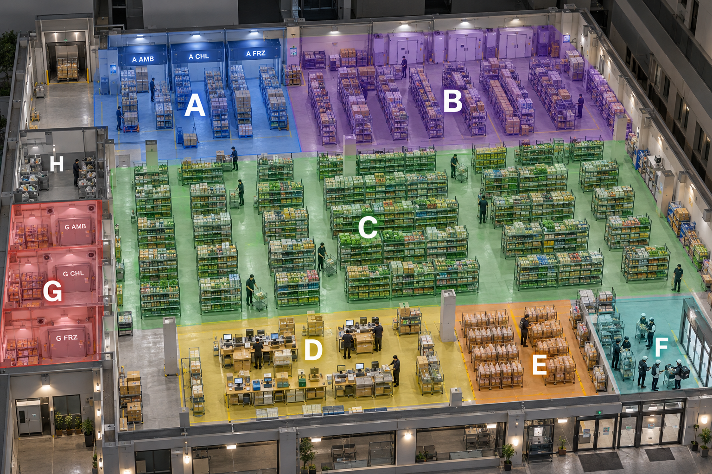
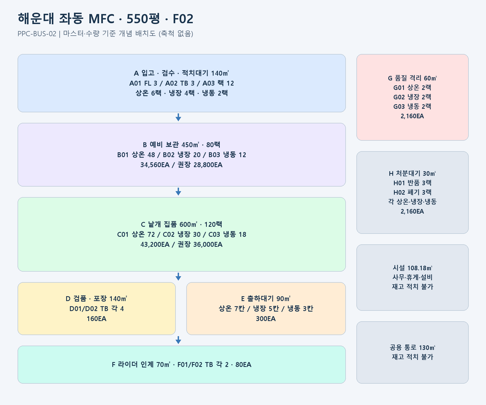
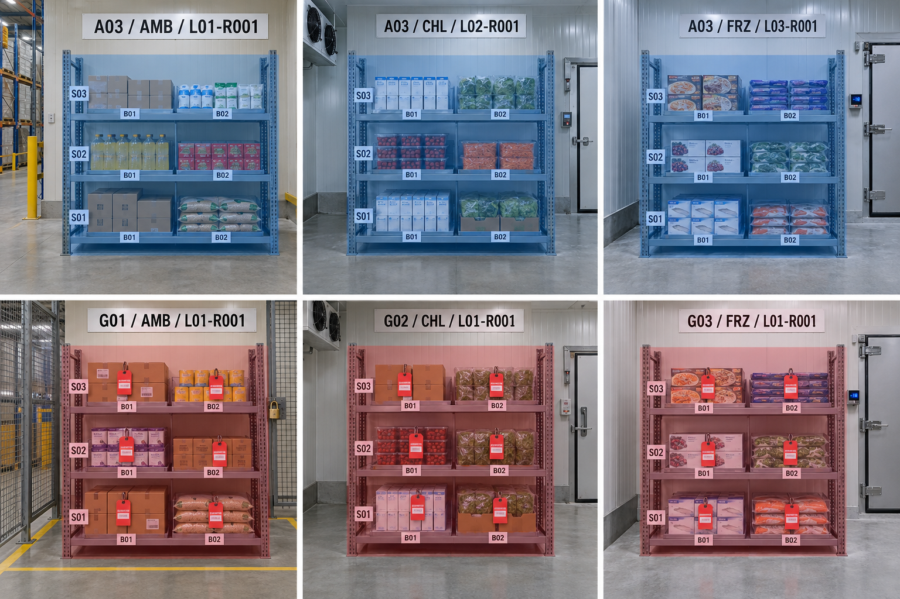

# 해운대 좌동 MFC(PPC) 550평 상세 설계

> 작성일 2026-10-15. 사용자 제공 채번·위치 지침을 적용한 가상 운영 설계다. 이미지도 AI 생성 실사형 개념 이미지이며 실제 해운대로데오아울렛 내부 사진이 아니다. 모든 마스터는 PLANNED(설계) 상태이며 실제 운영 시스템에 등록한 결과가 아니다.

## 1. 센터 기본정보

| 항목 | 설정 |
|---|---|
| 표시명 | 해운대 좌동 MFC / 해운대 PPC |
| 유지할 센터코드 | **PPC-BUS-02** |
| 주소 | 부산광역시 해운대구 좌동순환로 473 해운대로데오아울렛 2층 |
| 면적 | **550평 = 약 1,818.18㎡** |
| 위치번호 층 코드 | **F02**. 2층이므로 F01로 등록하지 않음 |
| 기능 | 허브 보충 입고, 보관, 고객 주문 피킹, 포장, 라이더 인계 |
| 3km 반경 가구 수 | 이전 사용자 제공 82,010가구. 권역 중복·실제 주문과 별개 |
| 정상 보유 재고 목표 | 기존 55,000EA 유지. 이번 선반 설계의 운영 권장 64,800EA 이내 |
| 신규 SKU 가정 | 총 1,400 SKU, 그중 피킹 상시 운영 약 1,200 SKU |
| 기존 일 집품 계획 | 9,167EA/일. 면적비례 가정이며 이번 정적 수용량과 별도 지표 |

이전 문서의 간이 로케이션 A/C/F 코드는 이번 상세 설계에 사용하지 않는다. 신규 위치는 제공된 A~H 업무 구역과 정식 위치코드를 적용한다. 실제 과거 거래가 있다면 원코드·이력은 보존하고 내부 ID 매핑으로 전환한다.

이전 SKU 수는 면적 비례 가정이었다. 이번에는 C 피킹칸 1,440개, B 예비칸 640개와 1칸 1SKU·1Lot 원칙을 반영해 SKU 가정을 수정했다. 총 1,400 SKU를 모든 선반에 각각 중복 배치하는 구조가 아니라, 1,200 SKU의 집품면과 선택적 예비 재고 및 Lot 분리를 배정한다. 품목 수용 종류와 EA 수용량은 같은 지표가 아니다.

## 2. 실사형 전체 이미지와 구역



낮은 불투명도의 구역 표시가 있는 AI 생성 개념 이미지다. 색상은 업무 구역을 나타내며 정확한 랙 수·축척·건물 구조는 아래 마스터와 면적표를 기준으로 한다.



## 3. 구역별 면적과 수용량

| 영역 | 업무 | 면적(㎡) | 랙 수 | 칸/위치 수 | 물리 계획(EA) | 운영 권장(EA) |
|---|---|---|---|---|---|---|
| A | 입고·검수·적치대기 | 140.00 | 12 | 78 | 4,920 | 4,182 |
| B | 예비·박스 보관 | 450.00 | 80 | 640 | 34,560 | 28,800 |
| C | 낱개 집품·피킹 | 600.00 | 120 | 1440 | 43,200 | 36,000 |
| D | 검품·포장 | 140.00 | 0 | 8 | 160 | 136 |
| E | 온도별 출하 대기 | 90.00 | 0 | 15 | 300 | 255 |
| F | 라이더 인계 | 70.00 | 0 | 4 | 80 | 68 |
| G | 품질 격리 | 60.00 | 6 | 36 | 2,160 | 1,836 |
| H | 반품·폐기 실행 대기 | 30.00 | 6 | 36 | 2,160 | 1,836 |
| 시설 | 사무·휴게·설비 | 108.18 | 0 | - | - | - |
| 통로 | 공용 통로·완충 | 130.00 | 0 | - | - | - |
| **합계** | 전체 | **1,818.18** | **224** | **2,257** | **87,540** | **73,113** |


- **적치창고(B+C) 물리 계획 수용량: 77,760EA**, 운영 권장 **64,800EA**.
- **입고 A: 4,920EA**, 운영 권장 **4,182EA**. 도착 바닥 구획·검수대·적치대기 랙을 포함한 동시 대기량이다.
- **품질 격리 G: 2,160EA**, 운영 권장 **1,836EA**. 전량 판매 불가로 별도 관리한다.
- **센터 전체 물리 계획 수용량: 87,540EA**, 운영 권장 **73,113EA**. 정상·입고대기·격리·처분·포장·인계 상태를 모두 포함한 순간 동시 점유 상한의 합이다.

**센터 전체 수용량을 판매가능 재고로 표시하면 안 된다.** A·G·H와 고객 예약이 걸린 D/E/F는 정상 판매 재고가 아니다. 동일 물품이 A→B→C로 이동할 때 새 재고가 생기는 것이 아니므로 입고량·이동량을 중복 가산하지 않는다. 위 합계는 서로 다른 물품이 각 실제 위치를 동시에 점유할 경우의 자리 수 합이다.

## 4. 랙·선반·칸 총수

- 랙 **224개**, 선반 단 **872개**, 선반칸 **2,224개**.
- 바닥·작업대·대기칸 **33개**, 전체 위치 **2,257개**.
- A와 G의 **모든 랙**에 AMB(상온)·CHL(냉장)·FRZ(냉동) 중 하나를 명시한다.
- 랙코드에 온도를 억지로 추가하지 않는다. `temp_class` 속성을 실제 위치와 함께 검사한다.
- 냉장·냉동 랙은 각각 온도 유지 설비가 있는 별도 공간에 설치하는 가정이다. 상온실의 랙에 온도 라벨만 붙여 냉장·냉동으로 취급하지 않는다.



## 5. 수용량 계산 전제

EA는 표준 상품 환산 단위로, **포장 포함 1EA = 3L(0.003㎥), 평균 0.4kg**를 가정했다. 상품 혼합의 빈 공간을 반영해 선반칸 부피의 75%를 유효 상품 부피로 사용한다. 실측값이 아니다.

```text
칸 물리 계획 EA = floor(칸 유효 내측 부피 × 0.75 ÷ 0.003)
운영 권장 EA = floor(칸 물리 계획 EA × 0.85)
선반/랙/구역 수용량 = 등록된 하위 위치 EA 합계
```

랙별 실제 제조사 내하중, 바닥 하중, 냉장실 구조와 실제 상품 치수는 확인하지 않았다. 상세 계산은 [06_수용량_산정.md](06_수용량_산정.md)에 있다. 제시한 중량값은 가상 입력값이며 구조·안전 검증 결과가 아니다.

큰 생수 묶음이나 부피가 큰 휴지는 표준 EA와 달라 같은 수량을 적재할 수 없다. SKU 실측 부피·중량·적층 가능 여부를 넣어 위치별 적재 허용 수량을 다시 산출한다.

## 6. 위치·문서번호 적용 요약

```text
선반칸: PPC-BUS-02-C02-F02-L01-R001-S01-B01
바닥:   PPC-BUS-02-A01-F02-FL001
작업대: PPC-BUS-02-D02-F02-TB001
대기칸: PPC-BUS-02-E02-F02-ST001
문서:   MOV-20261015-000137
```

문서의 순번은 전사·문서유형·한국시간 생성일 기준이며 센터별로 다시 000001을 시작하지 않는다. 위 순번은 예시이며 실제 발급 번호가 아니다. 위치번호는 날짜로 초기화하지 않는다.

## 7. 문서 구성

- [01_구역과_온도_위치규칙.md](01_구역과_온도_위치규칙.md): 구역·온도·층·동선과 스캔 통제.
- [02_랙_전체목록.md](02_랙_전체목록.md): 랙 224개 전수 목록.
- [03_선반단_전체목록.md](03_선반단_전체목록.md): 선반 단 872개 전수 목록.
- [04_위치칸_전체목록.md](04_위치칸_전체목록.md): 모든 위치 2257개 전수 목록.
- [05_업무문서_채번과_흐름.md](05_업무문서_채번과_흐름.md): TIN·MOV·QLT·DSP·SHP·HOV 등 연결.
- [06_수용량_산정.md](06_수용량_산정.md): 영역·온도별 산식과 집계.
- [07_이미지_설명과_생성프롬프트.md](07_이미지_설명과_생성프롬프트.md): 이미지 성격·제작 방식·프롬프트.
- `rack_master.json`, `shelf_master.json`, `location_master.json`, `capacity_summary.json`: 동일 목록의 기계 처리용 데이터.

## 8. 참고와 적용 범위

사용자 제공 `02_센터_구역_위치번호.md`, `03_업무문서_채번지침.md`를 코드·업무 규칙의 기준으로 읽었다. A~H 구역 의미, F층·L통로·R랙·S단·B칸, FL/TB/ST, 전사 문서 채번을 적용했다. 두 원본의 외부 링크와 다른 참조문서는 이번 설계에서 별도로 검증하거나 적용 범위를 확장하지 않았다.

실제 현장 평면·기둥·서비스 승강기·출입구·방화구획은 제공되지 않았다. 2층의 실제 사용 적합성 및 하역 동선·하중은 미확인이다. 따라서 이 자료는 운영 데이터 설계와 가상 시뮬레이션에 쓰며 현장 설치 도면으로 확정한 자료가 아니다.
