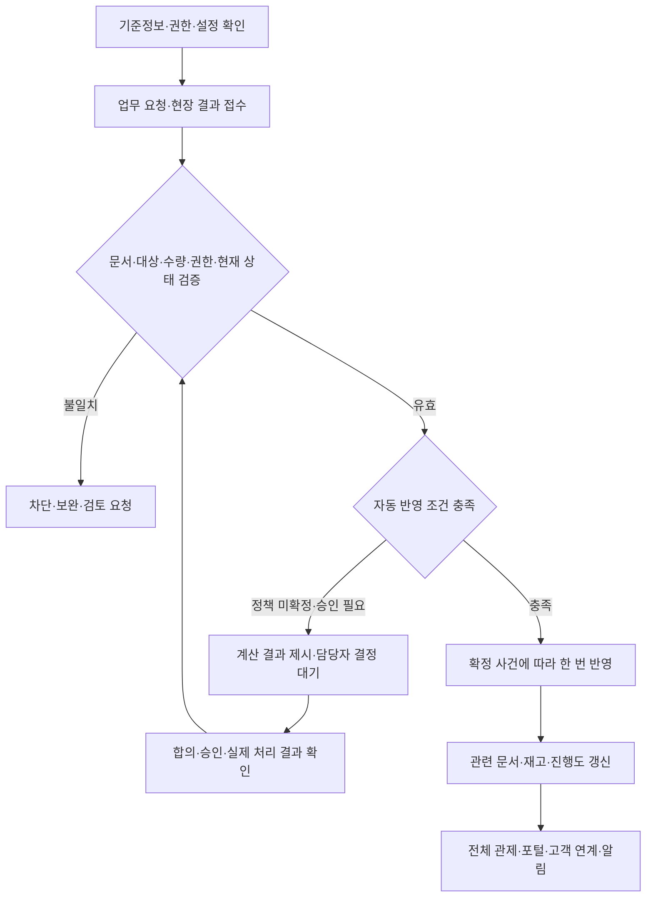

# 공급·재고·물류 자동시스템 통합관리 지침

## 1. 적용 범위·읽는 기준

현재 폴더의 전체 흐름·센터·채번·10개 도메인·운영정책 문서에서 시스템이 계산·검증·연결·추적·반영하는 기능을 통합한다.

- **프로젝트 정의:** 현재 문서의 업무·채번·권한·연결 규칙. 실제 업체 내부 구현과 구분.
- **적용 기준:** [내부·외부 연계 적용지침](../02_사전운영기준/05_재고_내부_외부연계_적용지침.md)의 I/E 항목은 사용자 요청으로 문서 적용. 수동 보충 제외.
- **제안:** 이번 적용 범위 밖의 계산·추천식은 채택 전 상태 유지.
- **미확정:** 수치·시간·계약·승인·판정 조건을 결정해야 하는 항목.
- 등록·계산·추천·검증과 승인·실제 작업·결제 실행을 구분한다.
- 미등록 기준을 임의 숫자로 채우거나 미확정 판단을 자동 승인하지 않는다.
- 이월은 현재 문서의 **기존 PO(구매발주) 유지·ASN(공급사 납품예정) 수정 또는 새 납품 차수** 규칙을 따른다.
- 실사례 근거는 [실사례 조사](../05_실사례_근거/01_쿠팡_B마트_실사례조사.md), 정책 선택은 [운영정책](../02_사전운영기준/04_운영정책_선택안_미정기준.md), 번호 형식은 [채번 지침](../02_사전운영기준/03_업무문서_채번지침.md) 참조.

## 2. 전체 자동처리 흐름



## 3. 공통 권한·기준정보 관리

| 대상 | 시스템 관리 | 사람의 판단·미확정 |
|---|---|---|
| 사용자 권한 | 접근센터 × 직무 × 행위 × 배정작업 × 승인조건 확인. 메뉴와 서버 처리 모두 검증 | 직무·승인 권한 부여는 담당자 결정 |
| 공급사 계정 | 자기 업체의 상품·발주·납품·정산만 조회. 요청·승인·응답자 기록 | 직원 계정 승인·계좌 검증 절차 미확정. 제안: 본사 관리 역할로 지정 |
| 업체·계약·상품 신청 | 제출·보완·반려·승인 상태와 이력 각각 관리 | 등록·계약·상품 거래 승인 별도. 자동 심사 승인하지 않음 |
| 상품·단위 | SKU(상품 코드)·바코드·낱개·박스·환산량·보관조건·기한 대상 연결 | 환산정보·상품 기준 변경 검토 |
| 센터·위치 | DC(중앙 물류센터)·PPC(피킹·포장센터), 구역·층·통로·랙·단·칸 및 위치 유형·사용 상태 관리 | A~H·위치 형식은 프로젝트 설계. 실제 시설별 등록 |
| 위치 속성 | 온도·수용량·상품/로트 혼재·작업 가능 여부 검증 | 코드만 보고 온도 추정 금지. 속성 기준 미확정은 검토 필요 |
| 외부 코드 | 외부 상품·공급사·문서번호를 출처와 함께 내부 ID에 연결 | 원본 외부번호를 정식 문서번호로 임의 대체하지 않음 |

## 4. 문서 채번·연결·중복 방지

- `문서유형-YYYYMMDD-6자리 일련번호`를 최초 생성 시 서버에서 발급한다. 한국시간 생성일·문서유형·날짜별 전사 공통 순번 적용.
- 번호 생성과 수량·금액 반영은 별개다. 상태 변경만으로 새 번호를 만들지 않는다.
- PO → 여러 ASN·RCV, TRF(센터 간 이송) → TOUT(이송 출발)·여러 TIN(이송 도착), ORD(고객 주문) → SHP(출하)·TSK(작업 식별자)·PKG(실물 포장 식별자)·HOV(기사 인계)를 연결한다.
- 원문서뿐 아니라 대상 상품행까지 연결한다. 표시 행번호와 내부 행 ID를 구분한다.
- 기준정보 코드·TSK·PKG·TOTE(재사용 운반 용기)·로트·요청 UUID(중복 방지용 고유 요청번호)를 업무 문서번호와 구분한다.
- 같은 요청의 재전송은 기존 문서·결과를 반환한다. 새로운 실제 입고·도착은 내용이 같아도 별도 건이다.
- 번호·이전 버전·취소·반려 이력 보존. 확정 후 수정은 정정·역처리·조정으로 처리한다.
- 업무일·생성일·승인일·재고 반영일·회계 귀속일을 구분한다.

## 5. 공급사 실적·신뢰도·우선순위

### 자동 집계
- 종료된 발주 단위의 거래횟수와 납기 지연·파손·미납품 이력을 집계한다.
- 한 발주에 여러 문제가 있어도 문제 거래횟수는 한 번 집계하고 문제 유형은 각각 보존한다.
- 원인 불명 유실·센터 책임 유실은 공급사 문제 거래에 포함하지 않는다. 공급사 책임 확인 후 평가 반영 여부를 결정한다.
- 기준 이상 파손 여부는 등록된 기준으로 판단한다. 기준 미확정이면 파손 사실만 기록한다.
- 발주 화면에 점수·거래횟수·문제율·공급 가능량·납품일·정보 갱신시각을 함께 표시한다.

### 점수식 — 기존 문서의 제안
```text
신뢰도 점수 = 100 × (1 − 문제 거래횟수 ÷ 전체 거래횟수)
거래 실적 점수 = 100 × min(전체 거래횟수 ÷ 50, 1)
우선순위 점수 = 신뢰도 점수 × 80% + 거래 실적 점수 × 20%
```
- 80%·20%·50회는 제안값. 거래 실적은 50회 이후 상한에 도달하며 무한 증가하지 않는다.
- 거래 0회는 나눗셈을 실행하지 않고 ‘평가 전’으로 표시한다.
- 거래 가능·상품·수량·납기 조건을 충족한 후보 안에서 추천한다. 점수만으로 발주 확정하지 않는다.
- **미확정:** 평가 기간·가중치·실적 상한·파손 기준·책임 판정 절차.
- **짧은 제안:** 문제 근거와 표본 거래횟수를 함께 보여주고, 책임 미확정은 평가 대기로 둔다.

## 6. 수요·안전재고·발주 추천

| 기능 | 시스템 처리 | 적용 조건 |
|---|---|---|
| 판매실적 제공 | 동일 상품 전월 판매량·월별 평균 판매량 표시 | 평균 산정기간·취소/환불 반영 기준 미확정 |
| 데이터 부족 안내 | 누적 데이터 3개월 미만이면 부족 안내·전월 판매량만 표시 | 기존 문서의 제안. 전월 기록도 없으면 ‘자료 없음’ 표시 |
| 필요량 계산 | 예상 수요 + 안전재고 − 가용 현재 재고 − 기간 내 확정 입고예정, 최소 0 | 수요 모델·안전재고·예정 신뢰도 미확정 |
| 구매단위 환산 | 필요 낱개량을 구매 묶음 단위로 올림 | 환산량 확인 후 계산 |
| 공급사 비교 | 우선순위·공급량·납품일 비교 | 추천과 구매 결정 구분 |
| 초안 저장 | PO 최초 번호·상품행·조건 기록 | 초안은 전달·수락과 다름 |

- 같은 확정 예정량을 ASN·이월·이송 기록에서 중복 차감하지 않는다.
- **제안:** 발주량은 계산 근거를 표시하고 구매담당자가 확정한다. 예측 데이터 부족 시 정밀한 자동 추천처럼 표시하지 않는다.

## 7. 발주 응답·변경·잔량·납품예정

- 공급사 참고 가능량과 특정 PO에 회신한 약속 수량을 구분한다.
- 전량 수락·일부 공급·납기 조정·공급 불가·미응답 상태를 관리한다. 미응답 자동 수락 금지.
- 부족 회신만으로 원발주를 줄이지 않는다. PCH(발주 변경 요청)·PCN(발주 잔량 취소)의 요청·응답·합의를 기록한다.
- 변경수량이 이미 이행된 수량 미만이면 차단한다. 이행 인정량은 계약·반품 조건을 반영해 판단한다.
- 미납·초과·지연을 표시하고 이월·취소·반송·추가발주·대체 조달 검토로 연결한다.
- **이월:** 현재 정의대로 기존 PO 유지. 기존 ASN 수정은 번호·이력 유지, 새 납품 차수는 새 ASN 생성. 실제 입고를 조작해 마감하지 않는다.
- ASN별 상품행·센터·예정일·수량·출하 보고와 RCV 실적을 연결한다. 출하 보고로 센터 재고 증가 금지.
- 문의·채팅·첨부 근거를 대상 문서·상품행에 연결한다. 연락 내용 자체는 승인·확정 상태와 구분한다.
- **미확정:** 종료 상태·잔량 해소·협의 절차·응답기한·대체발주 승인·ASN 필수 항목.
- **짧은 제안:** 합의 결과와 실제 이행을 대조해 마감 후보를 표시하고 담당자가 확정한다.
- **추가 검토:** 입고 예약 슬롯·차량정보·납품 라벨·일괄 업로드. 채택 시 슬롯 중복·파일 오류·식별정보를 검증한다. 공급사 라벨 부착은 현재 문서의 제안이며 필수 확정 아님.

## 8. 입고·검수·수량 차이

| 단계 | 자동 검증·연결 |
|---|---|
| 예정 조회 | PO·ASN·센터·상품행 조회. 결과 없음과 조회 실패 구분 |
| 스캔·입력 | 상품·단위·로트·위치·수량 확인. 정상·파손·품질 보류·부족·초과 분리 |
| 사진 | 선택된 정책의 대상 건에 증빙 누락 안내. 정상 건까지 필수로 단정하지 않음 |
| 도착 유형 | 공급사 RCV와 센터 이송 TIN 구분. 내부 도착에서 중복 매입 생성 금지 |
| 결과 확정 | 실제 인수·검수·상태 확인 후 위치별 현물 갱신·발주 진행도 갱신 |
| 차이 | 원 ASN 출하량·실도착·인수·정상·격리 결과 보존·담당자 검토 연결 |

- 인수 전 반송은 센터 인수 재고로 남기지 않고, 인수 후 격리는 현물에 포함해 판매 제외한다.
- 정상·파손 외 품질 보류가 있으면 단순 ‘정상+파손’ 산식만으로 총량을 검증하지 않는다.
- **미확정:** 파손 수령/반송·촬영 범위·기한·이행 인정·오프라인 확정 범위.
- **짧은 제안:** 입력된 처리구분별 수량 합계와 실제 인수량을 대조하고 예외를 검토 대기로 둔다.

## 9. 전체 재고·판매가능·예정재고

- 관리 단위는 상품×센터×위치×로트×상태. DC/PPC 현물+센터 간 이동중을 중복 없이 집계한다. 고객 배송중은 별도 범위다.
- 격리는 현물 포함·판매 제외, 예정은 현물 제외. 가용은 서비스 PPC의 판매적합 현물에서 유효 확보를 제외한다. 예약과 할당이 같은 물량이면 한 번만 제외한다.
- SKU·판매단위 환산·주소별 센터·주문 버전은 E-01~03에 따라 검증한다.
- 로트는 I-03~04대로 분리·추적, 확정 후 자동 병합하지 않는다. 상품군 기한기준·약속 수령일을 확인하고 적합 로트만 배정한다.
- 결제 전 확보는 현물 차감이 아니다. 기사 실제 인수 시 현물 차감과 해당 확보 소진을 함께 처리한다. 회수 실제 인수는 격리 현물 증가다.
- 소유·회계 범위와 계약 조건은 별도 미확정 유지.

## 10. 적치·보충·센터 내부 이동

- I-04~06 적용. 사용 가능·보관조건·수용량·실물 식별 가능한 혼재 여부 확인 후 목적지 지정.
- 최소수량 이하이면 시스템이 필요량=max(0, 목표수량−현재수량−진행 중 보충량)을 계산해 MOV(센터 내부 이동·적치·보충)를 자동 생성한다.
- 출발 이동가능량·목적지 잔여 수용량·등록 이동단위로 제한한다. 진행 중 적치/보충의 공간과 기존 출발 배정을 제외한다.
- 계산·중복 확인·지시 생성·물량 배정을 함께 처리한다. 기준 미등록·부족·조건 충돌은 예외 대기·관리자 해결 후 자동 재계산.
- **수동 보충 요청·작업 생성은 제공하지 않는다.** 실제 이동은 작업자가 수행하고 출발·상품·로트·목적지·수량을 확인한다.
- 실제 완료분만 출발 감소·목적지 증가를 함께 반영. 정상 내부 이동의 센터 총량 유지. 분할/임시 위치/잔량 기록.
- 응답 유실은 결과 조회 후 동일 요청 재전송. 미반영·충돌은 재검증하고 수량을 임의로 맞추지 않는다.

## 11. 센터 간 이송·운송

- PPC 보충 수요·출발/도착센터·상품·수량을 TRF(센터 간 이송)에 연결.
- 위치별 가용량을 자동 또는 관리자 수동 할당. 미할당·부분할당·할당·취소 상태와 확보 수량 유지.
- 위치 할당과 작업자 배정·선반 자동 보충을 구분한다.
- 공개 사례의 미할당 취소 조건을 반영하고, 할당 후 취소는 해제·작업 상태 확인 없이는 자동 처리하지 않는다.
- 목적지별 집품·검품·차량/노선·상차 결과 연결. TOUT 확정 시 출발 현물에서 이동 중으로 추적.
- 부분 도착마다 TIN 생성. 도착분만 PPC 현물에 반영. 미도착 잔량 유지·조사.
- 출발보다 많은 도착·수량 차이는 검토 대상. 부족을 자동 폐기하지 않는다.
- **미확정:** 할당 해제·운송손실 책임·배차 방식·미도착 알림 시간.
- **짧은 제안:** 출발센터·운송·도착센터의 기록을 한 이송 건에서 대조하도록 제공.

## 12. 품질·반품·폐기·마감할인

- I-09~11·E-10~11·E-17~18 적용. QLT(품질 격리) 대상 로트·수량·위치·사유·증빙 연결, 판매·일반 보충·피킹 제외.
- 상품군별 고객 수령 최소 잔여기한·정확한 소비기한 안내를 병행. 수령 지연 시 재검증, 설정 미등록이면 해당 기한관리 상품 판매/출하 보류.
- 적합 로트별 마감할인 수량·예약을 연결한다. 할인율 등 미등록 기준을 임의 설정하지 않는다.
- 격리해제는 품질담당 근거·권한 승인 후. 반품전용·추적/보관 이력 미확인은 자동 해제 금지.
- DSP(폐기) 요청·다른 권한자 승인·실제 실행을 구분하고 실행분만 한 번 차감. 미실행 잔량은 격리 유지, 승인초과 실행 차단.
- 회수 실제 센터 인수 시 격리 현물 증가, 검수·승인 후 적합품만 판매 복구. 환불과 재고는 별도 사건.
- 폐기/조정 기본 요청·승인 분리 적용, 위험 대상 추가 승인선·기한/품질 수치·보존기간은 등록 필요.

## 13. 실사·재고 조정

- I-07~08 적용. 순환 실사 기본, 전수 실사는 별도 계획. 계수 대상 위치만 수량변동 잠금, 진행 작업 정리 후 기준시각 기록.
- 첫 계수는 장부수량 숨김. 차이가 나면 다른 작업자 재계수·기준시각 이후 입출고/이동 대조.
- 잠금 불가 시 실사 시작 보류. 원인 미확정 차이는 조사 대기, 임의 자동 수량 맞춤 금지.
- ADJ(재고 조정)는 CNT(재고 실사)·상품행·근거 연결. 요청자와 다른 승인자가 검토 후 확정, 한 번 반영.
- 순환 주기·위험상품·추가 승인 임계값은 설정 필요. 같은 차이의 폐기·조정 이중 차감 차단.

## 14. 작업 배정·교대·진행 관제

- 직원코드·당일 직무·접근센터·근무 상태와 대상 업무를 확인해 TSK(작업 식별자) 배정.
- 자동배정/관리자 지정은 선택안. 같은 작업의 동시 시작은 하나만 허용.
- 대기·진행·완료·지연, 담당자·완료분·잔여분·토트·위치·마지막 스캔 집계.
- 교대는 같은 TSK 유지·담당 이력/버전 갱신. 실물 확인·강제/수락 방식에 따른 완료조건 적용.
- 이전 담당자의 늦은 스캔은 권한·담당 버전·요청 상태를 재검증하고 충돌 검토.
- 작업완료 버튼만으로 재고를 확정하지 않음. 해당 입고·이동·출하 업무의 완료 조건 확인.
- **미확정:** 자동배정 기준·지연 시간·잠금 만료·강제/수락·취소 권한.
- **짧은 제안:** 상태·경과시간·잔여분을 자동 표시하고 재배정은 권한·실물 인계 확인 후 처리.

## 15. 주문·피킹·결품·환불 연계

- E-04~09 적용. 최종 조건 재검증 후 결제 시작 직전 재고와 슬롯을 모두 확보. 실패한 접수는 부분 확보 해제·결제 차단.
- 결제 승인·유효 확보 확인 후 주문 확정·SHP(출하)/TSK(작업 식별자) 생성. 결제 결과 불명은 조회 대기. 만료/늦은 승인은 결과 확인·동일 조건 재확보 또는 환불로 처리.
- 토트·상품·위치·로트·주문 최신 버전 검증, 취소·격리·보류 주문 피킹 차단.
- 결품은 다른 위치 재확인·EXC(결품·대체 처리) 기록. 상품·수량·가격·알레르기 안내와 고객 동의 후 대체/부분출하/전체취소 확정.
- 연락 불가는 출하 보류·지원 이관. 자동 부분취소·임의 대체 없음. 적정 보관 유지·수령 약속 영향 기록.
- 센터 결품 부분취소는 기존 배송비·원주문 할인 배분 유지, 취소분 환불. 전체취소는 배송비 포함 환불·유효기간 내 쿠폰 복원. 고객 사유 취소는 별도 정책 설정.
- 취소/변경과 인계는 주문 단위로 직렬 판정. 취소 선확정이면 인계 차단, 인계 선확정이면 회수/반품.
- 미집품 취소는 확보 해제. 집품/포장 취소는 출하보류 상태로 판매 제외한 후 확보 해제, 실제 복귀·품질 확인 후 판매 복구.
- RFD(환불)·OCN(고객 주문 취소)는 각각 상태 관리. 원가격·환산·정책 버전과 피해수량을 보존하여 중복 보상 차단.

## 16. 예약 출고·작업 분산·배달 요청

- E-12~14 적용. 즉시·예약배송 제공, 재고와 시간대 슬롯 각각 확보. 슬롯 변경은 새 확보 성공 후 기존 해제.
- 작업·포장·보관·기사 여건별 등록 가능량 중 최솟값으로 접수 상한 판단. 수치·마감·예상시간 모델 미등록은 해당 예약 접수/자동 준비 요청 보류.
- 예정 물량은 확정 출처·상품행·도착예정시각으로 연결, 현물에 합산하지 않는다. 수령 약속 내 이행 가능한 물량만 배정.
- 예정 지연/취소 → 영향 주문 추출 → 같은 조건 다른 물량 확보 → 불가하면 시간 변경 동의/취소. 공급 약속 미해소 상태로 출하 확정 금지.
- 요청 시점은 약속 수령시간·예상 작업/운송시간·품질 보관 한계로 역산, 출발 가까이 준비한다. 현장 여유에 따라 분산하되 품질 범위 유지.
- 출고 요청·배달 요청 분리, 준비예정시각으로 배차 병행. 지연 시 온도·대기한계 재검증·초과 출하 차단·품질 검토.

## 17. 포장·라벨·출고·기사 인계

- E-15~16 적용. 온도별 복수 PKG(실물 포장 식별자)·상품/로트 구성 연결, 고객에게 포장 수·구분·변경 안내.
- 재포장 새 PKG·기존 무효·교체 관계, 동일 실물 라벨 재출력 같은 PKG·출력 이력. 유효 전량 집계·오주문/오기사/무효/중복/누락 차단.
- 포장완료·출고준비는 현물 차감 아님. 현재 배정 기사·유효 포장 스캔·기사 실제 인수확인으로 포장별 전달 확정.
- 패키지의 실제 전달 시 현물 차감·해당 확보 소진을 함께 한 번 반영. 일부 전달은 전달분만 반영·미전달분 추적, 모든 유효 포장 전달 후 HOV(기사 인계) 완료.
- 정상 인계는 스캔·기사 인수확인 기록. 이상 증빙은 추가. 고객 배송완료는 별도 수령 사건.
- 별도 여러 차례 분할배송 자동 제공 없음. 일부 전달은 예외 상태로 고객/운영에 표시.
- 상품별 온도·대기시간·증빙 보존기간은 설정 필요. 미등록/초과 상태는 해당 출하 보류.

## 18. 매입·정산·조정

- E-19 적용. PO·ASN·RCV·반품·계약을 상품행까지 대조. 실제 인수·정상 검수·발주 이행·매입 인정은 각각 기록.
- 기본 매입 검토량은 정상 검수수량. 전체 도착 인정은 계약 예외 승인 필요, 계약 미등록은 금액 확정·지급 보류.
- 파손·운송/센터 손실은 책임 확정 전 공급사 공제·문제 평가에 반영하지 않는다. 품질 제외와 비용 부담은 별도 판단.
- PUR(매입확정)는 권한자 확정 후 한 번 반영. 수정은 PJA(매입 조정)·역처리, 원기록 보존.
- 내부 TIN(이송 도착)에서 신규 매입 중복 생성 금지. 공급사 포털에는 자기 거래의 근거·청구·공제·지급 결과 제공.
- 고객 환불 원장과 공급사 정산 원장은 구분·연결. 세무·지급·파손 비율·비용 부담값은 계약·설정 검토 유지.

## 19. 오프라인·연계 오류·장비 상태

- 단말은 UUID로 임시 기록 생성. 정식 전사 순번 임의 발급 금지.
- 재연결 후 취소·담당 변경·기존 반영·권한·수량을 재검증하고 유효 요청만 반영.
- 응답 유실은 기존 결과 조회 후 같은 요청 재전송. 이동·정산·폐기·인계 중복 반영 방지.
- 조회 결과 없음/조회 실패/전송 대기/충돌/완료 상태 구분. 충돌은 검토 요청.
- PDA·라벨 프린터·무선망·서버 연결/최근 동기화 모니터링은 화면 제안. 실제 장비 상태는 연계 데이터 수신 시만 판단.
- **미확정:** 오프라인은 계수·스캔 임시 저장 적용. 보존기간·장비 연계·자동 재시도 종료 기준은 설정 필요.
- **짧은 제안:** 임시 기록과 최종 확정 표시를 분리하고 연결 끊김만으로 업무 완료를 만들지 않는다.

## 20. 자동 알림·통합 관제·감사

| 발생 사건 | 자동 표시·검토 연결 |
|---|---|
| 신청 보완·조건 변경 | 업체·상품·계약 담당자와 문서 연결 |
| 발주 미응답·납기 변경·미납·초과 | 원발주·예정·실적·공급사 협의 연결 |
| 선반 부족·용량/보관조건 불일치 | 보충·적치 검토·차이 보고 |
| 이송 미도착·수량 차이 | 출발·운송·도착 근거 대조 |
| 품질·기한·실사 차이 | 품질/조정 검토·승인·실제 실행 추적 |
| 작업 지연·교대·오프라인 | 담당·잔여분·요청 상태 표시 |
| 고객 결품·예약 공급 부족 | 고객 결정·지원·출고 스케줄 연결 |
| 포장 누락·무효 라벨·부분 인계 | 전체 완료 차단·실제 전달 확인 |
| 매입 차이·지급 미결 | 계약·검수·협의·승인 결과 조회 |

- 본사 전체 관제·DC/PPC 역할별 화면·공급사 자기 거래·현장 내 작업에 같은 확정 기록을 제공한다.
- 요청자·확정자·변경 전후·근거·처리시각·반영 결과를 기록한다.
- 수량·시간·금액 임계값은 미확정. **제안:** 설정된 대상·조건에만 알림을 생성하고 동일 사건은 상태 갱신으로 관리.

## 21. 미확정 정책 운영 방식

- 적용 방식과 남은 설정을 분리한다. 이번 적용 ID I-01~12·E-01~21의 방식은 더 이상 미결정 선택안으로 표시하지 않는다.
- 선반 최소/목표·실사 주기·추가 승인 임계값·확보 유효시간·상품 기한/온도·예약 용량/마감·계약·개인정보 보존기간은 설정/검토 대기.
- 필수 설정 누락은 해당 기능 자동 실행 보류·담당자 표시. 미등록 수치를 임의 기본값으로 채우지 않는다.
- 이번 범위 밖 공급사 심사·평가 가중치·수요/안전재고 모델·이월 마감·세무 상세는 기존 미확정 유지.
- 상세 값과 담당은 [적용지침 4절](../02_사전운영기준/05_재고_내부_외부연계_적용지침.md) 참조.

## 22. 도메인별 자동시스템 참조 위치

| 도메인 | 이 문서의 해당 절 |
|---|---|
| 상품·공급사 | 3·5절 |
| 구매·발주 | 6·7절 |
| 입고·검수 | 8절 |
| 재고관리 | 9·10·13절 |
| 품질·반품·폐기 | 12절 |
| 작업배정 | 14·19절 |
| 주문이행·피킹 | 15·16절 |
| 포장·출고 | 17절 |
| 운송·인계 | 11·17절 |
| 매입·정산 | 18절 |

이 문서는 자동 관리의 통합 참조다. 사용자 요청의 프로젝트 기준 I/E 항목을 적용하며 실제 업체 사례·사람의 품질판정·실물 작업과 구분한다.
