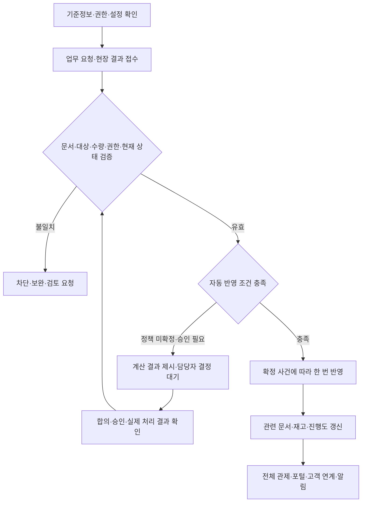

# 공급·재고·물류 자동시스템 통합관리 지침

## 1. 적용 범위·읽는 기준

현재 폴더의 전체 흐름·센터·채번·10개 도메인·운영정책 문서에서 시스템이 계산·검증·연결·추적·반영하는 기능을 통합한다.

- **프로젝트 정의:** 현재 문서의 업무·채번·권한·연결 규칙. 실제 업체 내부 구현과 구분.
- **제안:** 채택 전인 계산·추천·자동 지시 방식. 자동 실행의 확정 기준이 아님.
- **미확정:** 수치·시간·계약·승인·판정 조건을 결정해야 하는 항목.
- 등록·계산·추천·검증과 승인·실제 작업·결제 실행을 구분한다.
- 미등록 기준을 임의 숫자로 채우거나 미확정 판단을 자동 승인하지 않는다.
- 이월은 현재 문서의 **기존 PO(구매발주) 유지·ASN(공급사 납품예정) 수정 또는 새 납품 차수** 규칙을 따른다.
- 실사례 근거는 [실사례 조사](../05_실사례_근거/01_쿠팡_B마트_실사례조사.md), 정책 선택은 [운영정책](../02_사전운영기준/04_운영정책_선택안_미정기준.md), 번호 형식은 [채번 지침](../02_사전운영기준/03_업무문서_채번지침.md) 참조.

## 2. 전체 자동처리 흐름



## 3. 공통 권한·기준정보 관리

| 대상 | 시스템 관리 | 사람의 판단·미확정 |
|---|---|---|
| 사용자 권한 | 접근센터 × 직무 × 행위 × 배정작업 × 승인조건 확인. 메뉴와 서버 처리 모두 검증 | 직무·승인 권한 부여는 담당자 결정 |
| 공급사 계정 | 자기 업체의 상품·발주·납품·정산만 조회. 요청·승인·응답자 기록 | 직원 계정 승인·계좌 검증 절차 미확정. 제안: 본사 관리 역할로 지정 |
| 업체·계약·상품 신청 | 제출·보완·반려·승인 상태와 이력 각각 관리 | 등록·계약·상품 거래 승인 별도. 자동 심사 승인하지 않음 |
| 상품·단위 | SKU(상품 코드)·바코드·낱개·박스·환산량·보관조건·기한 대상 연결 | 환산정보·상품 기준 변경 검토 |
| 센터·위치 | DC(중앙 물류센터)·PPC(피킹·포장센터), 구역·층·통로·랙·단·칸 및 위치 유형·사용 상태 관리 | A~H·위치 형식은 프로젝트 설계. 실제 시설별 등록 |
| 위치 속성 | 온도·수용량·상품/로트 혼재·작업 가능 여부 검증 | 코드만 보고 온도 추정 금지. 속성 기준 미확정은 검토 필요 |
| 외부 코드 | 외부 상품·공급사·문서번호를 출처와 함께 내부 ID에 연결 | 원본 외부번호를 정식 문서번호로 임의 대체하지 않음 |

## 4. 문서 채번·연결·중복 방지

- `문서유형-YYYYMMDD-6자리 일련번호`를 최초 생성 시 서버에서 발급한다. 한국시간 생성일·문서유형·날짜별 전사 공통 순번 적용.
- 번호 생성과 수량·금액 반영은 별개다. 상태 변경만으로 새 번호를 만들지 않는다.
- PO → 여러 ASN·RCV, TRF(센터 간 이송) → TOUT(이송 출발)·여러 TIN(이송 도착), ORD(고객 주문) → SHP(출하)·TSK(작업 식별자)·PKG(실물 포장 식별자)·HOV(기사 인계)를 연결한다.
- 원문서뿐 아니라 대상 상품행까지 연결한다. 표시 행번호와 내부 행 ID를 구분한다.
- 기준정보 코드·TSK·PKG·TOTE(재사용 운반 용기)·로트·요청 UUID(중복 방지용 고유 요청번호)를 업무 문서번호와 구분한다.
- 같은 요청의 재전송은 기존 문서·결과를 반환한다. 새로운 실제 입고·도착은 내용이 같아도 별도 건이다.
- 번호·이전 버전·취소·반려 이력 보존. 확정 후 수정은 정정·역처리·조정으로 처리한다.
- 업무일·생성일·승인일·재고 반영일·회계 귀속일을 구분한다.

## 5. 공급사 실적·신뢰도·우선순위

### 자동 집계
- 종료된 발주 단위의 거래횟수와 납기 지연·파손·미납품 이력을 집계한다.
- 한 발주에 여러 문제가 있어도 문제 거래횟수는 한 번 집계하고 문제 유형은 각각 보존한다.
- 원인 불명 유실·센터 책임 유실은 공급사 문제 거래에 포함하지 않는다. 공급사 책임 확인 후 평가 반영 여부를 결정한다.
- 기준 이상 파손 여부는 등록된 기준으로 판단한다. 기준 미확정이면 파손 사실만 기록한다.
- 발주 화면에 점수·거래횟수·문제율·공급 가능량·납품일·정보 갱신시각을 함께 표시한다.

### 점수식 — 기존 문서의 제안
```text
신뢰도 점수 = 100 × (1 − 문제 거래횟수 ÷ 전체 거래횟수)
거래 실적 점수 = 100 × min(전체 거래횟수 ÷ 50, 1)
우선순위 점수 = 신뢰도 점수 × 80% + 거래 실적 점수 × 20%
```
- 80%·20%·50회는 제안값. 거래 실적은 50회 이후 상한에 도달하며 무한 증가하지 않는다.
- 거래 0회는 나눗셈을 실행하지 않고 ‘평가 전’으로 표시한다.
- 거래 가능·상품·수량·납기 조건을 충족한 후보 안에서 추천한다. 점수만으로 발주 확정하지 않는다.
- **미확정:** 평가 기간·가중치·실적 상한·파손 기준·책임 판정 절차.
- **짧은 제안:** 문제 근거와 표본 거래횟수를 함께 보여주고, 책임 미확정은 평가 대기로 둔다.

## 6. 수요·안전재고·발주 추천

| 기능 | 시스템 처리 | 적용 조건 |
|---|---|---|
| 판매실적 제공 | 동일 상품 전월 판매량·월별 평균 판매량 표시 | 평균 산정기간·취소/환불 반영 기준 미확정 |
| 데이터 부족 안내 | 누적 데이터 3개월 미만이면 부족 안내·전월 판매량만 표시 | 기존 문서의 제안. 전월 기록도 없으면 ‘자료 없음’ 표시 |
| 필요량 계산 | 예상 수요 + 안전재고 − 가용 현재 재고 − 기간 내 확정 입고예정, 최소 0 | 수요 모델·안전재고·예정 신뢰도 미확정 |
| 구매단위 환산 | 필요 낱개량을 구매 묶음 단위로 올림 | 환산량 확인 후 계산 |
| 공급사 비교 | 우선순위·공급량·납품일 비교 | 추천과 구매 결정 구분 |
| 초안 저장 | PO 최초 번호·상품행·조건 기록 | 초안은 전달·수락과 다름 |

- 같은 확정 예정량을 ASN·이월·이송 기록에서 중복 차감하지 않는다.
- **제안:** 발주량은 계산 근거를 표시하고 구매담당자가 확정한다. 예측 데이터 부족 시 정밀한 자동 추천처럼 표시하지 않는다.

## 7. 발주 응답·변경·잔량·납품예정

- 공급사 참고 가능량과 특정 PO에 회신한 약속 수량을 구분한다.
- 전량 수락·일부 공급·납기 조정·공급 불가·미응답 상태를 관리한다. 미응답 자동 수락 금지.
- 부족 회신만으로 원발주를 줄이지 않는다. PCH(발주 변경 요청)·PCN(발주 잔량 취소)의 요청·응답·합의를 기록한다.
- 변경수량이 이미 이행된 수량 미만이면 차단한다. 이행 인정량은 계약·반품 조건을 반영해 판단한다.
- 미납·초과·지연을 표시하고 이월·취소·반송·추가발주·대체 조달 검토로 연결한다.
- **이월:** 현재 정의대로 기존 PO 유지. 기존 ASN 수정은 번호·이력 유지, 새 납품 차수는 새 ASN 생성. 실제 입고를 조작해 마감하지 않는다.
- ASN별 상품행·센터·예정일·수량·출하 보고와 RCV 실적을 연결한다. 출하 보고로 센터 재고 증가 금지.
- 문의·채팅·첨부 근거를 대상 문서·상품행에 연결한다. 연락 내용 자체는 승인·확정 상태와 구분한다.
- **미확정:** 종료 상태·잔량 해소·협의 절차·응답기한·대체발주 승인·ASN 필수 항목.
- **짧은 제안:** 합의 결과와 실제 이행을 대조해 마감 후보를 표시하고 담당자가 확정한다.
- **추가 검토:** 입고 예약 슬롯·차량정보·납품 라벨·일괄 업로드. 채택 시 슬롯 중복·파일 오류·식별정보를 검증한다. 공급사 라벨 부착은 현재 문서의 제안이며 필수 확정 아님.

## 8. 입고·검수·수량 차이

| 단계 | 자동 검증·연결 |
|---|---|
| 예정 조회 | PO·ASN·센터·상품행 조회. 결과 없음과 조회 실패 구분 |
| 스캔·입력 | 상품·단위·로트·위치·수량 확인. 정상·파손·품질 보류·부족·초과 분리 |
| 사진 | 선택된 정책의 대상 건에 증빙 누락 안내. 정상 건까지 필수로 단정하지 않음 |
| 도착 유형 | 공급사 RCV와 센터 이송 TIN 구분. 내부 도착에서 중복 매입 생성 금지 |
| 결과 확정 | 실제 인수·검수·상태 확인 후 위치별 현물 갱신·발주 진행도 갱신 |
| 차이 | 원 ASN 출하량·실도착·인수·정상·격리 결과 보존·담당자 검토 연결 |

- 인수 전 반송은 센터 인수 재고로 남기지 않고, 인수 후 격리는 현물에 포함해 판매 제외한다.
- 정상·파손 외 품질 보류가 있으면 단순 ‘정상+파손’ 산식만으로 총량을 검증하지 않는다.
- **미확정:** 파손 수령/반송·촬영 범위·기한·이행 인정·오프라인 확정 범위.
- **짧은 제안:** 입력된 처리구분별 수량 합계와 실제 인수량을 대조하고 예외를 검토 대기로 둔다.

## 9. 전체 재고·판매가능·예정재고

| 항목 | 집계 기준 |
|---|---|
| 관리 단위 | 상품 × 센터 × 위치 × 로트 × 상태 |
| 센터 현물 | 실제 센터에 인수·관리 중인 수량. 격리 포함 |
| 센터 간 이동 중 | 실제 출발 − 실제 도착 − 확정된 잔량 처리 |
| 전체 관리 현물 | DC 현물 + PPC 현물 + 센터 간 이동 중. 중복 집계 금지 |
| 즉시 판매가능 | 서비스 대상 PPC의 판매 적합 현물 − 유효 예약/할당 |
| 예정재고 | 미래 확정 공급 약속. 현재 현물에 합산 금지 |
| 예약가능 | 고객 수령시간 내 현재·예정·확보 물량과 출고·배송 가능성 판단 |

- 예약·할당이 같은 물량이면 중복 차감하지 않는다. 격리·예약을 현물에 다시 더하지 않는다.
- DC 보유만으로 PPC 즉시 배송가능 표시 금지. 고객 배송 중·공급사 미인수·소유/회계 재고는 별도 범위.
- 재고변동원장·현재 잔량·예약 관계를 연결하고 확정 사건별 반영 이력 유지.
- 로트 내부 ID·공급사 Lot값·소비기한·입고 상품행 추적. 로트 병합·혼재 허용은 정책 설정 후 적용.
- 소비기한 기준 후보 추천. 격리품 제외·기한 조건 미등록 시 임의 일수 적용 금지.
- **미확정:** 로트 구분·병합·판매기한·판매가능 산정의 상세 예약 상태·회계 범위.
- **짧은 제안:** 현물·가용·격리·예정·이동 중을 분리 표시하고 계산 근거를 조회 가능하게 한다.

## 10. 적치·보충·센터 내부 이동

- 위치 보관조건·사용 상태·잔여 수용량·혼재 정책으로 적치 후보 추천. 작업자가 실제 위치·수량 확인.
- MOV(센터 내부 이동·적치·보충) 대상 상품·로트·출발·목적지 스캔 검증.
- 부족·오위치·오상품·조건 불일치·용량 초과 시 확정 차단·차이 보고.
- 분할 적치·목적지 변경은 실제 위치별 수량 기록. 이동 확정 시 출발 감소·목적지 증가·센터 총량 유지.
- 응답 유실 시 결과 조회·같은 요청 재전송. 두 위치 갱신은 부분 성공 상태를 남기지 않도록 함께 관리.
- **자동 보충 제안:** 최소수량 미달 시 목표수량까지 부족분을 계산하되 진행 중 보충량을 제외. 가용량·수용량·이동 단위로 제한.
- 수동 보충 요청에도 동일 검증 적용. 추천·지시 생성과 실제 수량 반영 분리.
- **미확정:** 최소수량·목표수량·배치 우선순위·자동 지시/관리자 확인 범위.
- **짧은 제안:** 기준 미등록은 추천 보류, 동일 선반의 진행 작업을 확인해 중복 보충 방지.

## 11. 센터 간 이송·운송

- PPC 보충 수요·출발/도착센터·상품·수량을 TRF(센터 간 이송)에 연결.
- 위치별 가용량을 자동 또는 관리자 수동 할당. 미할당·부분할당·할당·취소 상태와 확보 수량 유지.
- 위치 할당과 작업자 배정·선반 자동 보충을 구분한다.
- 공개 사례의 미할당 취소 조건을 반영하고, 할당 후 취소는 해제·작업 상태 확인 없이는 자동 처리하지 않는다.
- 목적지별 집품·검품·차량/노선·상차 결과 연결. TOUT 확정 시 출발 현물에서 이동 중으로 추적.
- 부분 도착마다 TIN 생성. 도착분만 PPC 현물에 반영. 미도착 잔량 유지·조사.
- 출발보다 많은 도착·수량 차이는 검토 대상. 부족을 자동 폐기하지 않는다.
- **미확정:** 할당 해제·운송손실 책임·배차 방식·미도착 알림 시간.
- **짧은 제안:** 출발센터·운송·도착센터의 기록을 한 이송 건에서 대조하도록 제공.

## 12. 품질·반품·폐기·마감할인

- 이상 보고를 QLT(품질 격리)·상품·로트·수량·위치·증빙에 연결. 판매·피킹·출고 차단, 현물 유지.
- 재검수 결과·해제 권한·사유별 반품 전용 여부를 확인한 뒤 상태 갱신. 품질 판정 자체는 사람의 업무.
- RTV(공급사 반품) 승인과 실제 반출을 구분. 반출 결과를 재고·매입 검토에 전달.
- DSP(폐기) 요청·승인·실행을 같은 문서로 추적. 실제 실행 후 한 번 차감.
- 폐기 승인 조건 미등록 시 자동 승인 금지. 중복 실행 요청은 기존 결과 반환.
- 판매 적합 임박품의 기한·수요 기반 할인 후보·수량·할인율 계산은 제안. 격리품을 할인 판매 대상으로 전환하지 않음.
- **미확정:** 최소 잔여기한·정확한 기한 안내/동의·해제 조건·폐기 결재·사진·할인 대상/율.
- **짧은 제안:** 기한·품질 검토 대상만 자동 추출하고 해제·처분·할인 조건은 승인된 설정으로 적용.

## 13. 실사·재고 조정

```text
CNT(재고 실사) 대상·기준시각·장부 기록
→ 실물 계수 → 차이 계산 → 재계수·이동 대조
→ 잔여 차이 ADJ(재고 조정) 요청 → 권한자 검토·확정
```
- 기준시각 이후 입출고·이동을 대조해 계수시각 차이를 검증. 원인 미확정 차이는 미결 조사로 기록.
- 구역 중단 방식 선택 시 대상 위치 작업 통제, 운영 유지 방식은 변동 대조 근거 제공.
- 전수/순환 실사 진행률·미계수 위치·재계수 대상·조정 현황 집계.
- 차이만으로 장부를 실사수량에 자동 맞추지 않는다. 승인된 조정만 반영·사유·증빙·승인자 보존.
- **미확정:** 실사 중 작업 통제·범위/주기·재계수·일반/추가 승인 기준.
- **짧은 제안:** 자동 차이 대조와 요청 생성까지만 수행하고 조정은 권한자 확정.

## 14. 작업 배정·교대·진행 관제

- 직원코드·당일 직무·접근센터·근무 상태와 대상 업무를 확인해 TSK(작업 식별자) 배정.
- 자동배정/관리자 지정은 선택안. 같은 작업의 동시 시작은 하나만 허용.
- 대기·진행·완료·지연, 담당자·완료분·잔여분·토트·위치·마지막 스캔 집계.
- 교대는 같은 TSK 유지·담당 이력/버전 갱신. 실물 확인·강제/수락 방식에 따른 완료조건 적용.
- 이전 담당자의 늦은 스캔은 권한·담당 버전·요청 상태를 재검증하고 충돌 검토.
- 작업완료 버튼만으로 재고를 확정하지 않음. 해당 입고·이동·출하 업무의 완료 조건 확인.
- **미확정:** 자동배정 기준·지연 시간·잠금 만료·강제/수락·취소 권한.
- **짧은 제안:** 상태·경과시간·잔여분을 자동 표시하고 재배정은 권한·실물 인계 확인 후 처리.

## 15. 주문·피킹·결품·환불 연계

- ORD(고객 주문) 접수·SHP(출하) 생성·재고/시간 판단·출고 요청·TSK/토트 연결.
- 토트는 사용 이력으로 주문에 연결. 오상품·오토트·오위치·격리·취소 주문 처리 차단.
- 요구·실제 피킹·부족 수량 비교. EXC(결품·대체 처리)를 주문·상품행·고객 결정에 연결.
- 다른 위치 확인·대체/취소 선택·고객 응답을 추적. 동의 없는 대체 금지.
- 주문 변경 확정 후 피킹 대상·예약/할당 갱신. OCN(고객 주문 취소)·RFD(환불) 상태는 각각 관리.
- 부분 출하/전체 취소/연락 불가 후 보류·지원 이관/정책상 부분 취소는 선택지. 무응답만으로 임의 처리하지 않음.
- **미확정:** 대체 선정·가격/알레르기·환불 재계산·사전 동의·연락 횟수/대기시간.
- **짧은 제안:** 고객 결정 또는 확정된 사전 정책을 확인한 뒤 주문·출하·환불에 함께 연결.

## 16. 예약 출고·작업 분산·배달 요청

- 고객 수령시간과 작업 시작시간 구분. 바로배달/예약·접수량·가용 작업량·현재 작업 현황 표시.
- 현재·예정·이미 확보된 재고를 대조하고 예정 공급 지연/취소가 연결 주문에 미치는 영향 추적.
- 출고 요청과 배달 요청 분리. 현장 여유·상품 품질 보존 구간·입고 확인에 따라 준비 요청 분산.
- 예정 재고 부족 작업은 보류하고 배송 가능한 마지막 요청 시점에 다시 검토하는 공개 사례 참고.
- 준비예정시각·픽업준비 상태를 배달 연계에 전달. 포장 완료 뒤에만 배차하도록 고정하지 않음.
- **미확정:** 예측모델·작업 용량·고객 슬롯 상한·접수 마감·대기시간·최종 부족 대응.
- **짧은 제안:** 인력·현재 작업·기사 여건을 따로 표시하고 품질 구간 안에서 준비시각 추천. 고정 시간·안전계수 추가 금지.

## 17. 포장·라벨·출고·기사 인계

- 주문·피킹 결과·SHP를 확인해 온도별 실물 포장 PKG 생성·상품 구성 연결·라벨 발급.
- 라벨 표시 순번과 고유 PKG 구분. 한 출하의 유효 포장 구성·수량 집계.
- 오주문·무효 포장·중복 스캔·구성 누락·다른 기사 인계 차단.
- 재포장은 새 PKG·기존 무효·교체 관계, 동일 실물 라벨 재출력은 같은 PKG·출력 이력.
- 포장완료·출고준비·대기 위치/시간·실제 전달·HOV(기사 인계) 완료 각각 기록.
- 부분 전달은 실물 위치·수령 상태 추적. 유효 포장 전체 전달 전 전체 완료 금지.
- 원장 차감은 확정된 한 사건에만 연결. 현재 차감 사건은 미확정이며 자동 채택하지 않음.
- **미확정:** 상품별 포장·보관온도·최대 대기시간·분리포장 고객 안내·출고 확정·인계 사진.
- **짧은 제안:** 유효 포장 목록을 기준으로 검증하고 정책 등록 시 보관/대기 경고 적용.

## 18. 매입·정산·조정

- PO·ASN·RCV·반품·계약과 상품행을 대조해 인정 수량·단가·금액 계산 자료 제공.
- 실입고·검수 적합·발주 이행·매입 인정 수량을 구분. 파손만으로 비용 부담 자동 결정 금지.
- 파손·부족·초과·처분 예외는 자동 결제 확정 보류·협의 근거 연결.
- PUR(매입확정) 번호 생성은 매입·지급 확정이 아님. 권한자 확정 상태 기준 한 번 반영.
- 확정 후 PJA(매입 조정)·역처리로 변경. 원 PUR·인정 근거 유지.
- 내부 TIN에서 같은 물량 신규 매입 생성 금지. 청구·공제·지급예정·지급결과를 공급사 포털에 제공.
- **미확정:** 파손 허용률·반품/폐기 비용·인정수량·정산 승인·지급·세무 전표.
- **짧은 제안:** 계약 검증·이상 감지·금액 계산은 자동 지원, 예외 승인·지급 실행은 별도 권한과 연계 기준 확인.

## 19. 오프라인·연계 오류·장비 상태

- 단말은 UUID로 임시 기록 생성. 정식 전사 순번 임의 발급 금지.
- 재연결 후 취소·담당 변경·기존 반영·권한·수량을 재검증하고 유효 요청만 반영.
- 응답 유실은 기존 결과 조회 후 같은 요청 재전송. 이동·정산·폐기·인계 중복 반영 방지.
- 조회 결과 없음/조회 실패/전송 대기/충돌/완료 상태 구분. 충돌은 검토 요청.
- PDA·라벨 프린터·무선망·서버 연결/최근 동기화 모니터링은 화면 제안. 실제 장비 상태는 연계 데이터 수신 시만 판단.
- **미확정:** 오프라인 허용 업무·보존기간·장비 연계·자동 재시도 기준.
- **짧은 제안:** 임시 기록과 최종 확정 표시를 분리하고 연결 끊김만으로 업무 완료를 만들지 않는다.

## 20. 자동 알림·통합 관제·감사

| 발생 사건 | 자동 표시·검토 연결 |
|---|---|
| 신청 보완·조건 변경 | 업체·상품·계약 담당자와 문서 연결 |
| 발주 미응답·납기 변경·미납·초과 | 원발주·예정·실적·공급사 협의 연결 |
| 선반 부족·용량/보관조건 불일치 | 보충·적치 검토·차이 보고 |
| 이송 미도착·수량 차이 | 출발·운송·도착 근거 대조 |
| 품질·기한·실사 차이 | 품질/조정 검토·승인·실제 실행 추적 |
| 작업 지연·교대·오프라인 | 담당·잔여분·요청 상태 표시 |
| 고객 결품·예약 공급 부족 | 고객 결정·지원·출고 스케줄 연결 |
| 포장 누락·무효 라벨·부분 인계 | 전체 완료 차단·실제 전달 확인 |
| 매입 차이·지급 미결 | 계약·검수·협의·승인 결과 조회 |

- 본사 전체 관제·DC/PPC 역할별 화면·공급사 자기 거래·현장 내 작업에 같은 확정 기록을 제공한다.
- 요청자·확정자·변경 전후·근거·처리시각·반영 결과를 기록한다.
- 수량·시간·금액 임계값은 미확정. **제안:** 설정된 대상·조건에만 알림을 생성하고 동일 사건은 상태 갱신으로 관리.

## 21. 미확정 정책 운영 방식

| 미확정 묶음 | 유지할 상태 | 간략 제안 |
|---|---|---|
| 공급 가능 갱신·계정·심사 | 미확정 | 월 1~2회 갱신은 현재 문서의 선택 제안. 발주 회신은 최신 약속 별도 관리 |
| 공급사 점수·파손 기준 | 제안·미확정 | 제안식을 설정값으로 보존하고 책임 판정 전 문제 집계 제외 |
| 수요·안전재고 | 미확정 | 실적·계산 근거 표시 후 수동 확정 |
| 잔량·계약·매입 | 미확정 | 현재 문서의 PO·ASN 연결 유지, 합의·확정 전 자동 변경 금지 |
| 로트·위치·보충 | 미확정 | 속성 등록 후 검증·추천, 미등록 기준은 보류 |
| 품질·폐기·실사 | 미확정 | 후보·차이 자동 추출, 권한자 판단·실제 실행 확인 |
| 배정·교대·오프라인 | 미확정 | 담당·버전·실물 인계·유효 요청 검증 |
| 결품·환불·예약 | 미확정 | 고객 결정과 품질·공급 약속을 확인해 연계 |
| 포장·인계·원장 반영 | 미확정 | 상태 분리·전체 유효 포장 확인, 차감 사건 확정 후 적용 |
| 장비·외부 지급·세무 | 추가 설계 | 연계 결과와 권한 확인 전 실행 완료로 표시하지 않음 |

## 22. 도메인별 자동시스템 참조 위치

| 도메인 | 이 문서의 해당 절 |
|---|---|
| 상품·공급사 | 3·5절 |
| 구매·발주 | 6·7절 |
| 입고·검수 | 8절 |
| 재고관리 | 9·10·13절 |
| 품질·반품·폐기 | 12절 |
| 작업배정 | 14·19절 |
| 주문이행·피킹 | 15·16절 |
| 포장·출고 | 17절 |
| 운송·인계 | 11·17절 |
| 매입·정산 | 18절 |

이 문서는 자동 관리의 통합 참조다. 실제 사례 여부·선택 미확정 상태를 변경하지 않으며 도메인별 사람의 업무를 대체하지 않는다.
