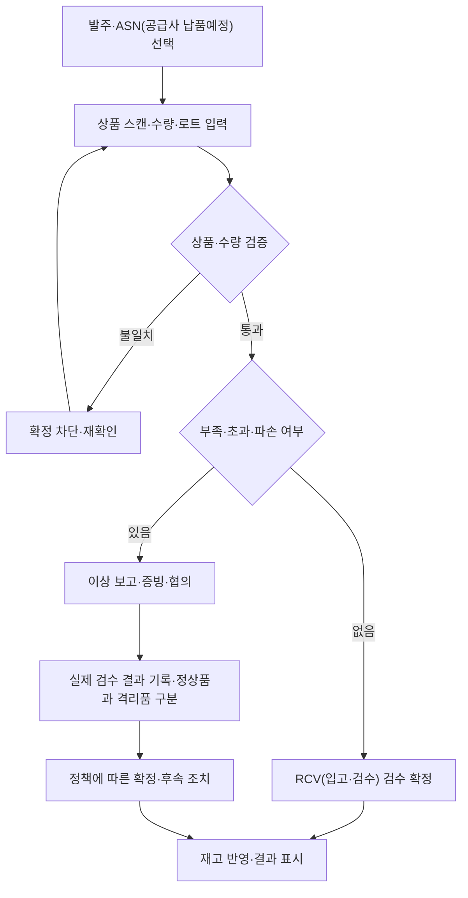

# 공급·재고·물류 기능별 조사 및 취합

## 1. 문서 개요

- **문서 분류:** 물류센터 / 백오피스 / 공통 업무 규칙. 고객앱·배송·라이더앱은 관련 연계 범위만 포함.
- **문서 목적:** 기능별 자료를 취합하고 구현 방향·미결정사항·연계를 정리한다.
- **작성 범위:** 공급사·발주부터 센터 재고·고객 출하·매입 정산까지 10개 기능.
- **관련 문서:** [공통 운영원칙](02_사전운영기준/01_공통운영원칙.md), [자동시스템 통합관리](04_시스템_화면/01_자동시스템_통합관리.md), [운영정책·미정기준](02_사전운영기준/04_운영정책_선택안_미정기준.md), [채번 지침](02_사전운영기준/03_업무문서_채번지침.md), [실사례 조사](05_실사례_근거/01_쿠팡_B마트_실사례조사.md).
- **최종 수정일:** 2026-10-13.
- **상태 구분:** 기존 문서의 프로젝트 규칙은 '문서 정의'로 표기. 팀 합의·담당자 확인 기록이 없어 '팀 합의 완료'로 간주하지 않는다. 제안·미정은 그대로 유지.

---

## 2. 기능 목록

| 기능 ID | 기능명 | 주요 범위 | 정리 상태 |
|---|---|---|---|
| F-001 | 상품·협력업체(공급사) | 업체·상품·계약·공급조건·평가 | 자료 취합 완료·정책 검토 필요 |
| F-002 | 구매·발주 | 수요·발주·응답·변경·잔량 | 자료 취합 완료·정책 검토 필요 |
| F-003 | 입고·검수 | 납품예정·도착·인수·검수 | 자료 취합 완료·정책 검토 필요 |
| F-004 | 재고관리 | 위치·로트·보충·현물·실사·조정 | 자료 취합 완료·정책 검토 필요 |
| F-005 | 품질·반품·폐기 | 격리·재검수·반품·폐기 | 자료 취합 완료·정책 검토 필요 |
| F-006 | 작업배정 | 배정·진행·교대·재배정 | 자료 취합 완료·정책 검토 필요 |
| F-007 | 주문이행·피킹 | 주문·피킹·결품·예약 | 자료 취합 완료·정책 검토 필요 |
| F-008 | 포장·출고 | 포장·라벨·출고 준비 | 자료 취합 완료·정책 검토 필요 |
| F-009 | 운송·인계 | 센터 이송·배차·기사 인계 | 자료 취합 완료·정책 검토 필요 |
| F-010 | 매입·정산 | 매입 인정·정산·조정 | 자료 취합 완료·정책 검토 필요 |

---

## 3. 기능별 조사 및 취합

### F-001. 상품·협력업체(공급사)

#### 3.1 기능 개요

- **상태:** 사용자 요청에 따라 문서 적용한 프로젝트 기준. 외부 팀 합의·업체 SOP 확인과 구분.
- **연결:** [내부·외부 연계 적용지침](02_사전운영기준/05_재고_내부_외부연계_적용지침.md), 적용 ID I-01·E-01~03·E-10~11·E-19.
- 판매 옵션은 실물 SKU·기준단위 환산표로 연결하고 기존 주문 버전을 보존한다.
- 서비스 대상 PPC 기준으로 판매 재고 제공. 품절·판매중지·배송 불가·용량 초과를 구분한다.
- 마감 할인은 적합 로트의 수량만 대상으로 하며 소비기한과 원주문 가격정보를 연결한다.
- 운영 방식은 적용했으며 수치·시간·계약·연계 미등록 항목은 설정/검토 대기. 아래 원본 선택표는 조사 이력으로만 참조한다.

- **주요 범위:** 업체·상품·계약·공급조건·평가.
- **상세 문서:** [상품·협력업체(공급사)](03_도메인/01_상품_공급사.md).

- 직매입 납품 협력업체용 포털을 기준으로 정리. 쿠팡 Supplier Hub의 계약·상품등록·발주확인·입고·정산 범위를 참고.
- [쿠팡 공식 입점 안내](https://supplier.coupang.com/welcome/join/guide.html)는 Supplier Hub와 마켓플레이스 WING을 구분. 이 프로젝트는 공급사 업무를 중심으로 설계.
- [우아한형제들 협력사 가이드](https://epro.woowahan.com/resources/login/contents/guide.pdf)에서 등록·전자서명 확인. B마트 전용 포털의 전체 기능은 공개 자료로 미확인. 아래 세부 화면·권한은 프로젝트 설계.
- 공급사 등록·상품등록 신청은 원문 기능. 평가·인증서 로그인·공급량 갱신의 업체 실제 기준은 미확인.
- 아래 단계·대응표는 프로젝트 흐름. 업체 SOP(표준 업무 절차)로 확인된 범위는 [실사례 조사](05_실사례_근거/01_쿠팡_B마트_실사례조사.md) 참조.

#### 3.2 주요 처리 흐름

##### UI·담당 화면

| 순서 | 담당·화면 | 처리 | 확인·결과 |
|---|---|---|---|
| 1 | 관리자·공급사 포털 | 공급사 등록·입점신청 검토 | SUP(공급사 코드)·거래정보 확보 |
| 2 | 관리자·공급사 포털 | 상품등록 신청·단위 검토 | SKU(상품 코드)·단위 환산정보 확보 |
| 3 | 관리자·공급사 포털 | 상품·공급량·납품일 연결 | 발주 시 비교 가능한 조건 |
| 4 | 관리자 웹 | 조건 검토 | 구매·보관·검수 기준 제공 |
| 5 | 관리자·시스템 | 거래 이력 집계 | 평가·우선순위 반영은 제안 |

##### 전체적인 흐름

```text
업체 신청 → 심사·보완 → 거래 승인·계약 → 상품 제안·심사 → 공급조건 확정 → 발주에 제공
                                                          이후 발주·납품·검수·정산 내역 확인
```

##### 데이터 흐름

업체 신청·계약·상품 승인 → 공급조건 → 발주 후보

자동 계산·검증·반영은 [자동시스템 통합관리](04_시스템_화면/01_자동시스템_통합관리.md) 참조.

##### 상세 기능·처리 기준

##### 책임
- 상품 기준정보·공급사 거래정보 관리.
- 발주·보관·검수에 필요한 기준 제공.

##### 상품 기능
- 상품코드·바코드 등록.
- 낱개·박스 단위 구분.
- 박스당 낱개 수량·구매단위 관리.
- 상품군·보관온도·보관조건 관리.
- 소비기한 관리 대상 구분.
- 상품별 공급사 연결.

##### 공급사 기능
- 공급사 등록·로그인·담당자 관리.
- 취급상품·공급 가능 수량·납품 가능일 관리.
- 거래 조건·정산 조건 확인.
- 인증서 로그인은 원문 제안. 인증 방식 별도 결정.
- 입점신청. 
- 상품등록신청.
- 상품별 공급가·최소주문량·구매 묶음·납품 리드타임·납품 가능 센터·조건 적용기간 관리는 프로젝트 보충안.
- 공급 가능 정보에는 갱신 시각을 표시. 포털의 참고 가능량과 특정 PO(구매발주)에 회신한 약속 수량을 구분.

##### 평가·추천 제안
- 공급사 신뢰도·거래 우선순위 산정.
    - 거래횟수가 늘수록 거래 실적 점수를 높이되, 제안식의 상한 이후에는 유지. 신뢰도와 합산해 비교
    - 납기 지연·파손·미납품 이력 집계.
    - 파손 사실은 모두 기록. 문제 거래 평가에 포함할 파손 수준은 별도 결정.
- 발주 화면에서 우선순위·재고·납품일 비교.

>제안<br>우선순위 점수 = 신뢰도 점수 × 80% + 거래 실적 점수 × 20%
<br><br>신뢰도 점수 = 100 × (1 − 문제 거래횟수 ÷ 전체 거래횟수)
<br>거래 실적 점수 = 100 × min(전체 거래횟수 ÷ 50, 1)

- 위 80%·20%·50회는 제안값이며 확정 기준이 아님. 거래 0회는 평가 전 표시. 원인 불명·센터 책임 유실은 공급사 문제 거래에서 제외하고 책임 확인 후 판단.

##### 주요 데이터
- 상품, 바코드, 수량 단위, 포장단위.
- 공급사, 담당자, 공급상품, 공급조건.
- 공급사 평가 근거·점수·우선순위.

##### 연결 화면
- 관리자 웹: 상품·공급사·거래조건 관리.
- 공급사 포털: 업체·계약·상품 신청, 공급 가능 정보, 발주·납품·검수·정산·문의.
- PDA(현장 작업 단말): 스캔 상품 식별·보관조건 조회.

#### 3.3 예외 및 실패 처리

| 발생 상황 | 즉시 조치 | 확인·후속 처리 | 재개 조건 |
|---|---|---|---|
| 바코드·구매단위 식별 불가 | 담당자 확인 요청 | 기준정보 확인·수정 권장 | 상품·환산단위 확인 |
| 공급 가능량·납품일 미확인 | 확정 정보로 간주하지 않음 | 공급사에 최신 조건 확인 권장 | 조건 확인 후 발주 판단 |
| 지연·파손 반복 | 거래 근거 기록 | 평가 항목·가중치 정책에 따라 검토 | 우선순위 적용 여부 결정 |

기준정보 오류 대응은 운영 제안. 평가·갱신 기준은 아래 미결정 정책 참조.

- **재시도·복구:** 응답 유실은 기존 결과 조회·동일 요청 재전송. 확정 후 오류는 원기록 보존·정정/역처리/조정. 실제 작업 재수행과 단순 요청 재전송을 구분한다.

#### 3.4 결정 기록·남은 설정

**결정 항목 ID: D-001**
- **결정이 필요한 내용:** 공급 가능 정보의 갱신 주체·주기. (제안: 월 1회 또는 2회 갱신일 지정. 주기는 미확정)
- **미결정 사유:** 상세 기준·설정·담당자 확인 또는 채택 기록이 부족함.
- **선택지:** 원본·현재 문서에 기재된 제안 범위에서 검토. 정해진 대안이 없으면 추가 논의.
- **선택지별 영향:** 설정에 따라 자동처리·검토·승인 범위가 달라짐. 구체 영향은 결정 시 기록.
- **관련 기능 및 문서:** F-001, [상품·협력업체(공급사)](03_도메인/01_상품_공급사.md), [자동시스템 통합관리](04_시스템_화면/01_자동시스템_통합관리.md).
- **상태:** 논의 예정(팀 진행 상태 확인 필요).
- **최종 결정:** 미정.
- **결정 근거:** 현재 도메인 문서의 미결정 항목.

**결정 항목 ID: D-002**
- **결정이 필요한 내용:** 필수 서류·심사 기준·계약 서명 방식·심사 처리기한.
- **미결정 사유:** 상세 기준·설정·담당자 확인 또는 채택 기록이 부족함.
- **선택지:** 원본·현재 문서에 기재된 제안 범위에서 검토. 정해진 대안이 없으면 추가 논의.
- **선택지별 영향:** 설정에 따라 자동처리·검토·승인 범위가 달라짐. 구체 영향은 결정 시 기록.
- **관련 기능 및 문서:** F-001, [상품·협력업체(공급사)](03_도메인/01_상품_공급사.md), [자동시스템 통합관리](04_시스템_화면/01_자동시스템_통합관리.md).
- **상태:** 논의 예정(팀 진행 상태 확인 필요).
- **최종 결정:** 미정.
- **결정 근거:** 현재 도메인 문서의 미결정 항목.

**결정 항목 ID: D-003**
- **결정이 필요한 내용:** 계좌 변경 검증·승인 절차, 업체 직원 계정 승인 주체.(제안: 본사 담당 역할 지정. 승인 행위·범위는 미확정.)
- **미결정 사유:** 상세 기준·설정·담당자 확인 또는 채택 기록이 부족함.
- **선택지:** 원본·현재 문서에 기재된 제안 범위에서 검토. 정해진 대안이 없으면 추가 논의.
- **선택지별 영향:** 설정에 따라 자동처리·검토·승인 범위가 달라짐. 구체 영향은 결정 시 기록.
- **관련 기능 및 문서:** F-001, [상품·협력업체(공급사)](03_도메인/01_상품_공급사.md), [자동시스템 통합관리](04_시스템_화면/01_자동시스템_통합관리.md).
- **상태:** 논의 예정(팀 진행 상태 확인 필요).
- **최종 결정:** 미정.
- **결정 근거:** 현재 도메인 문서의 미결정 항목.

**결정 항목 ID: D-004**
- **결정이 필요한 내용:** 거래 중지 시 진행 중인 발주·반품·정산 처리 범위.
- **미결정 사유:** 상세 기준·설정·담당자 확인 또는 채택 기록이 부족함.
- **선택지:** 원본·현재 문서에 기재된 제안 범위에서 검토. 정해진 대안이 없으면 추가 논의.
- **선택지별 영향:** 설정에 따라 자동처리·검토·승인 범위가 달라짐. 구체 영향은 결정 시 기록.
- **관련 기능 및 문서:** F-001, [상품·협력업체(공급사)](03_도메인/01_상품_공급사.md), [자동시스템 통합관리](04_시스템_화면/01_자동시스템_통합관리.md).
- **상태:** 논의 예정(팀 진행 상태 확인 필요).
- **최종 결정:** 미정.
- **결정 근거:** 현재 도메인 문서의 미결정 항목.

#### 3.5 확정된 규칙

**팀 합의 기록은 미제공. 아래는 기존 프로젝트 문서에 정의된 식별·연결 규칙이며 팀 최종 승인 여부는 별도 확인한다.**

- 상품 `SKU-000001`, 공급사 `SUP-000001`: 기준정보 코드.
- 센터 `PPC-GN-01`: 기준정보 코드. 위치의 구역·층·통로·랙·단·칸 확장안 참조. 짧은 위치번호는 이전 예시로 보존.
- 기준정보 코드는 발주·입고 문서번호와 분리.
- 외부 상품·공급사 코드는 출처와 함께 별도 참조 관리.

관련 의사결정 기록: [채번 지침](02_사전운영기준/03_업무문서_채번지침.md), [공통 운영원칙](02_사전운영기준/01_공통운영원칙.md).

#### 3.6 추가 확인 사항

- 미결정 항목의 담당·선택·적용 범위·채택일 확인.
- 자동화·외부 연계 제약과 데이터 유효성은 [자동시스템 통합관리](04_시스템_화면/01_자동시스템_통합관리.md)에서 확인.
- 업체 실제 운영 여부·근거 범위는 [실사례 조사](05_실사례_근거/01_쿠팡_B마트_실사례조사.md)에서 확인.

#### 3.7 참고 자료

- **자료명:** 상품·협력업체(공급사) 도메인 정리 및 관련 실사례.
- **출처:** 프로젝트 아웃풋·사용자 사전조사 이미지·공식 자료 조사.
- **조사자:** 개별 팀 조사자 미기재. 실제 담당자 확인 필요.
- **원본 파일 또는 링크:** [상품·협력업체(공급사)](03_도메인/01_상품_공급사.md), [실사례 조사](05_실사례_근거/01_쿠팡_B마트_실사례조사.md).
- **기준 문서:** [채번 지침](02_사전운영기준/03_업무문서_채번지침.md), [운영정책·미정기준](02_사전운영기준/04_운영정책_선택안_미정기준.md), [자동시스템 통합관리](04_시스템_화면/01_자동시스템_통합관리.md).

---

### F-002. 구매·발주

#### 3.1 기능 개요

- **상태:** 사용자 요청에 따라 문서 적용한 프로젝트 기준. 외부 팀 합의·업체 SOP 확인과 구분.
- **연결:** [내부·외부 연계 적용지침](02_사전운영기준/05_재고_내부_외부연계_적용지침.md), 적용 ID E-13·E-19.
- 예정 공급 지연·취소 시 연결된 예약 주문과 영향 수량을 추출한다. 대체 확보 또는 고객 일정 변경·취소 처리로 연결한다.
- 이월은 기존 PO 유지·ASN 수정/새 차수 정의를 유지한다. 새로운 이월대장·다음 PO 연결은 적용하지 않는다.
- 운영 방식은 적용했으며 수치·시간·계약·연계 미등록 항목은 설정/검토 대기. 아래 원본 선택표는 조사 이력으로만 참조한다.

- **주요 범위:** 수요·발주·응답·변경·잔량.
- **상세 문서:** [구매·발주](03_도메인/02_구매_발주.md).

- [쿠팡 Supplier Hub 공식 안내](https://supplier.coupang.com/welcome/join/guide.html)에서 상품등록·발주확인·입고·정산 범위 확인. 협력업체의 세부 응답 상태·ASN(공급사 납품예정) 항목·변경 승인 규칙은 아래 프로젝트 정의.
- 변경·잔량 협의는 원문·사용자 채번 규칙. 실제 공급사 승인·파손 비용 조건은 계약 확인 필요.
- 아래 단계·대응표는 프로젝트 흐름. 업체 SOP(표준 업무 절차)로 확인된 범위는 [실사례 조사](05_실사례_근거/01_쿠팡_B마트_실사례조사.md) 참조.

#### 3.2 주요 처리 흐름

##### UI·담당 화면

| 순서 | 담당·화면 | 처리 | 확인·결과 |
|---|---|---|---|
| 1 | 관리자 웹 | 필요수량·묶음 수량 계산 | 87병 필요·6병 단위 → 90병 |
| 2 | 관리자 웹 | 초안 최초 저장·발주 전달 | PO(구매발주) 생성·상품행 확보 |
| 3 | 공급사 포털·관리자 | 전량 수락 또는 공급 가능한 수량·납기 회신·협의 | 부족 회신만으로 PO(구매발주) 자동 축소하지 않음 |
| 3-1 | 공급사 포털 | 합의 조건에 맞춰 ASN(공급사 납품예정)·출하정보 등록 | PO(구매발주) 상품행·납품 차수·센터 연결 |
| 4 | 관리자 웹 | 입고 진행·잔량 확인 | RCV(입고·검수) 실적 연결 |
| 5 | 관리자·공급사 | 이월·취소 협의 | ASN(공급사 납품예정) 변경·새 차수 또는 PCN(발주 잔량 취소) 승인 |
| 6 | 관리자 웹 | 잔량 처리 확인·마감 | 원발주·실입고·취소 이력 보존 |

##### 전체적인 흐름

```text
수량 계산 → PO(구매발주) 초안 저장 → 발주 전달 → 공급사 수량·납기 회신 → 합의 확정 → ASN(공급사 납품예정) 등록·출하
                                                                     → 입고·검수 → 잔량 처리 → 종료
                           변경 필요 → PCH(발주 변경 요청) 요청 → 공급사 승인 → 같은 PO(구매발주) 갱신
                           잔량 취소 → PCN(발주 잔량 취소) 요청 → 공급사 승인 → 잔량 취소
```

##### 데이터 흐름

PO(구매발주) 상품행 → 공급사 응답·PCH/PCN → ASN → RCV 실적

자동 계산·검증·반영은 [자동시스템 통합관리](04_시스템_화면/01_자동시스템_통합관리.md) 참조.

##### 상세 기능·처리 기준

##### 책임
- 구매 필요수량 산정·발주 확정.
- 공급사와 발주 변경·납기·잔량 협의.

##### 수량 계산
- 예상 수요·안전재고 기준 필요수량 계산.
- 필요한 낱개 수량과 구매 묶음 수량 구분.
- 묶음 수량은 올림 처리.
    - 예: 87병 필요 / 6병 묶음 → 15박스·90병 발주.
    - 필요량 = max(0, 예상 수요 + 안전재고 − 사용 가능한 현재 재고 − 해당 기간 확정 입고예정). 묶음은 올림. 
- 제안: 동일상품 전월 판매량·월별 평균 판매량을 발주 주문 페이지에서 표시. >누적 데이터 3개월 미만이면 데이터 부족 안내와 전월 판매량만 표시 제안. 전월 자료도 없으면 자료 없음 표시. 평균 산정기간은 미확정.
- 제안: 공급사 우선순위 추천. (상품공급사의 평가 추천 제안란 참조)
- 제안: 발주량 추천 (실제 예측모델·예정 신뢰도는 미정.)

##### 기본 흐름
1. 관리자: 공급사·센터·상품·수량 지정.
2. 발주 초안 최초 저장·PO(구매발주) 번호 생성.
3. 공급사: 전량 수락·일부 공급 가능·납기 조정·공급 불가 회신. 응답 방식은 프로젝트 설계.
4. 관리자·공급사: 차이 협의 후 확정. 공급사: ASN(공급사 납품예정) 등록·출하정보 제출. 분할 납품 가능.
5. 입고 결과 수신·진행도 갱신.
6. 미납품 잔량 처리·발주 종료.

##### 포털 화면·데이터 — 프로젝트 설계
| 화면 | 주요 항목 | 처리 |
|---|---|---|
| 발주 목록·상세 | PO(구매발주)·버전·상품행·납품센터·수량·단가·요청 납기·응답 상태 | 조회·다운로드·확인·회신 |
| 공급 가능 회신 | 가능 수량·가능 납기·부족 사유·회신자·시각 | 관리자 검토. 합의 전에는 원 PO(구매발주) 유지 |
| 변경·취소 협의 | 원 조건·요청 조건·사유·PCH(발주 변경 요청)/PCN(발주 잔량 취소)·응답 | 수락·조정 제안·거절 및 이력 |
| 납품 예정·출하 | ASN(공급사 납품예정)·PO(구매발주) 상품행·센터·예정일·수량·출하일·첨부서류 | 등록·수정 이력·출하 보고 |
| 입고 진행·차이 | 출하량·실입고량·정상·파손·불합격·미납 잔량 | 결과 조회·차이 문의·잔량 협의 |
| 거래 문서 문의 | 관련 PO(구매발주)/ASN(공급사 납품예정)/RCV(입고·검수)·상품행·질문·증빙 | 담당자 답변·처리 상태 관리 |

추가제안
| 기능 | 뜻 | 예시 |
|---|---|---|
| **입고 예약 슬롯** | 센터에 납품하러 올 시간대를 예약 | 공급사가 ‘오전 10~11시’ 선택 → 차량 몰림·하역 대기 줄이기 |
| **차량정보** | 납품 차량·운송 정보를 등록 | 차량번호, 운송사, 기사 연락처 → 센터 도착 확인 |
| **라벨 출력** | 납품 상품·박스에 붙일 식별표 출력 | 납품예정번호, 상품, 수량, 납품센터가 적힌 바코드 라벨 |
| **일괄 업로드** | 여러 상품·납품 정보를 파일로 한 번에 등록 | 엑셀에 상품 50개의 수량·예정일을 작성해 업로드 |

*B마트·쿠팡의 실사용 여부는 알 수 없으며, 프로젝트에 필수적인 내용은 아님. 공급사측의 라벨출력 부착은 기본 운영지침으로 두어도 좋을 것 같다 제안*

##### 발주·납품 상태 구분
- 발주: 초안 → 전달 → 응답·협의 → 수락·확정 → 이행 중 → 잔량 처리 완료·종료. 미응답·공급 불가·변경 협의는 별도 표시.
- 납품: 예정 등록 → 출하 보고 → 센터 도착 → 검수 → 결과 확정. 분할 납품은 ASN(공급사 납품예정)별 진행도 관리.
- 발주 확인, 공급 약속, 출하 보고, 센터 입고 확정을 각각 기록. **공급사 출하 보고로 센터 재고를 증가시키지 않음.**
- 정상·파손·불합격 수량의 매입 인정 여부는 계약과 [매입·정산](03_도메인/10_매입_정산.md)에서 판단. 정상수량만으로 발주 잔량을 자동 계산하지 않음.
- 잔량 산식은 발주 이행으로 인정할 수량·반품 후 재납품 조건·승인 취소량을 확정한 뒤 적용. 공개 사례에서 세부 산식은 미확인.
- 원인 불명의 유실품이나 센터측의 책임으로 유실된 재고의 경우, 공급처 문제거래량에 반영되지 말아야함.

##### 수량 차이 예시
| 사건 | 기록 | 후속 판단 |
|---|---|---|
| PO(구매발주) 100개·공급 가능 80개 회신 | 발주 100·약속 가능 80 각각 보존 | 20개 이월·취소·대체 조달 협의 |
| 100개 출하·실입고 100개 중 정상 95·파손 5 | 출하 100·실입고 100·검수 결과 95/5 보존 | 파손 5의 반품·재납품·매입 인정은 계약에 따라 결정 |
| 100개 출하·센터 실입고 98개 | 출하 100·실입고 98·차이 2 보존 | 운송·수량 증빙 확인. 원 ASN(공급사 납품예정)을 98로 덮어쓰지 않음 |

##### 변경·잔량
- 관리자는 변경요청만 등록.
- 공급사 승인 후 발주 변경 적용.
- 변경 전후 수량·사유·요청자·응답 기록.
- 이미 납품 완료된 수량 미만으로 변경 차단.
- 잔량 이월: 공급사 협의 후 다음 납품으로 연결.
- 잔량 취소: 공급사 승인 후 취소.
- 실제 입고수량을 변경해 발주 마감하지 않음.
- 이월 잔량은 기존 PO(구매발주) 유지·ASN(공급사 납품예정) 변경 또는 새 차수 생성. 이월 근거 보존.

##### 예외
- 초과 납품: 반송 협의 또는 추가발주 승인.
- 납기 지연: 대체 공급사 검토 또는 납품일 재확정.
- 필요 시 고객 안내로 연결.

##### 주요 데이터·화면
- 발주서·발주항목·변경요청·공급사 응답·잔량 처리.
- 관리자 웹: 발주 추천·등록·조회·변경요청·잔량 처리.
- 공급사 포털: 발주 확인·수락·변경 응답·일정 협의.

#### 3.3 예외 및 실패 처리

| 발생 상황 | 즉시 조치 | 확인·후속 처리 | 재개·완료 조건 |
|---|---|---|---|
| 수량·납기 변경 | PCH(발주 변경 요청) 요청·기존 발주 유지 | 공급사 응답·입고 실적 확인 | 공급사 승인 후 변경 |
| 변경수량이 납품 완료량 미만 | 적용 차단 | 이미 완료된 수량 재확인 | 완료량 이상으로만 수정 가능 |
| 미납품 잔량 | 입고수량 조작 금지 | ASN(공급사 납품예정) 이월 또는 PCN(발주 잔량 취소) 취소 협의 | 일정 재확정 또는 취소 승인 |
| 초과 납품 | 임의 발주수량 변경 금지 | 반송 또는 추가발주 협의 | 반송 결정 또는 추가발주 승인 |
| 납기 지연 | 공급사 일정 확인 | 일정 변경·대체 공급사 검토 | 새 일정 또는 새 PO(구매발주) 확정 |
| 발주 미응답 | 미응답 현황·연락 이력 기록 | 담당자가 공급 가능 여부 확인 | 응답 또는 계약상 종료 조건 확인. 자동 수락 금지 |
| 일부 수량만 공급 가능 | 원발주·공급사 회신을 각각 보존 | 잔량 이월·취소·대체 조달 협의 | 합의된 변경·취소 적용 |
| 출하량과 검수 결과 불일치 | 원 ASN(공급사 납품예정)·센터 결과 보존 | 차이 사유·증빙 확인, 이의 처리 | 센터 결과·매입 인정 결과 각각 확정 |

- **재시도·복구:** 응답 유실은 기존 결과 조회·동일 요청 재전송. 확정 후 오류는 원기록 보존·정정/역처리/조정. 실제 작업 재수행과 단순 요청 재전송을 구분한다.

#### 3.4 결정 기록·남은 설정

**결정 항목 ID: D-005**
- **결정이 필요한 내용:** 미납품 잔량.
- **미결정 사유:** 원본에서 제시한 선택안이며 운영·계약·권한 조건에 따른 채택 기록이 없음.
- **선택지:** A — 다음 납품으로 이월·잔량 유지 / B — 잔량 취소 승인.
- **선택지별 영향:** 실제 입고량 보존. 이월 잔량을 현재 현물로 표시하지 않음
- **관련 기능 및 문서:** F-002, [구매·발주](03_도메인/02_구매_발주.md), [운영정책·미정기준](02_사전운영기준/04_운영정책_선택안_미정기준.md).
- **상태:** 논의 예정(팀 진행 상태 확인 필요).
- **최종 결정:** 미정.
- **결정 근거:** 원본 선택안. 실제 업체 표준·팀 합의로 확정되지 않음.

**결정 항목 ID: D-006**
- **결정이 필요한 내용:** 초과 납품.
- **미결정 사유:** 원본에서 제시한 선택안이며 운영·계약·권한 조건에 따른 채택 기록이 없음.
- **선택지:** A — 초과분 분리·반송 협의 / B — 추가발주 승인 후 수령.
- **선택지별 영향:** 원발주 수량을 몰래 늘리지 않음
- **관련 기능 및 문서:** F-002, [구매·발주](03_도메인/02_구매_발주.md), [운영정책·미정기준](02_사전운영기준/04_운영정책_선택안_미정기준.md).
- **상태:** 논의 예정(팀 진행 상태 확인 필요).
- **최종 결정:** 미정.
- **결정 근거:** 원본 선택안. 실제 업체 표준·팀 합의로 확정되지 않음.

**결정 항목 ID: D-007**
- **결정이 필요한 내용:** 납기 지연.
- **미결정 사유:** 원본에서 제시한 선택안이며 운영·계약·권한 조건에 따른 채택 기록이 없음.
- **선택지:** A — 대체 공급사 검토·새 발주 / B — 기존 공급사 일정 변경.
- **선택지별 영향:** 공급 가능량·납품 가능일 확인. 변경 이력 보존
- **관련 기능 및 문서:** F-002, [구매·발주](03_도메인/02_구매_발주.md), [운영정책·미정기준](02_사전운영기준/04_운영정책_선택안_미정기준.md).
- **상태:** 논의 예정(팀 진행 상태 확인 필요).
- **최종 결정:** 미정.
- **결정 근거:** 원본 선택안. 실제 업체 표준·팀 합의로 확정되지 않음.

**결정 항목 ID: D-008**
- **결정이 필요한 내용:** 안전재고(품절,손실 대비 추가 보유량) 산정 방식. 
- **미결정 사유:** 상세 기준·설정·담당자 확인 또는 채택 기록이 부족함.
- **선택지:** 원본·현재 문서에 기재된 제안 범위에서 검토. 정해진 대안이 없으면 추가 논의.
- **선택지별 영향:** 설정에 따라 자동처리·검토·승인 범위가 달라짐. 구체 영향은 결정 시 기록.
- **관련 기능 및 문서:** F-002, [구매·발주](03_도메인/02_구매_발주.md), [자동시스템 통합관리](04_시스템_화면/01_자동시스템_통합관리.md).
- **상태:** 논의 예정(팀 진행 상태 확인 필요).
- **최종 결정:** 미정.
- **결정 근거:** 현재 도메인 문서의 미결정 항목.

**결정 항목 ID: D-009**
- **결정이 필요한 내용:** 이월은 기존 PO(구매발주)·ASN(공급사 납품예정) 유지/새 차수라는 사용자 정의 적용. 미정: 종료 상태·잔량 해소 기준·협의 조건.
- **미결정 사유:** 상세 기준·설정·담당자 확인 또는 채택 기록이 부족함.
- **선택지:** 원본·현재 문서에 기재된 제안 범위에서 검토. 정해진 대안이 없으면 추가 논의.
- **선택지별 영향:** 설정에 따라 자동처리·검토·승인 범위가 달라짐. 구체 영향은 결정 시 기록.
- **관련 기능 및 문서:** F-002, [구매·발주](03_도메인/02_구매_발주.md), [자동시스템 통합관리](04_시스템_화면/01_자동시스템_통합관리.md).
- **상태:** 논의 예정(팀 진행 상태 확인 필요).
- **최종 결정:** 미정.
- **결정 근거:** 현재 도메인 문서의 미결정 항목.

**결정 항목 ID: D-010**
- **결정이 필요한 내용:** 납기 지연 시 대체 발주 승인 기준.
- **미결정 사유:** 상세 기준·설정·담당자 확인 또는 채택 기록이 부족함.
- **선택지:** 원본·현재 문서에 기재된 제안 범위에서 검토. 정해진 대안이 없으면 추가 논의.
- **선택지별 영향:** 설정에 따라 자동처리·검토·승인 범위가 달라짐. 구체 영향은 결정 시 기록.
- **관련 기능 및 문서:** F-002, [구매·발주](03_도메인/02_구매_발주.md), [자동시스템 통합관리](04_시스템_화면/01_자동시스템_통합관리.md).
- **상태:** 논의 예정(팀 진행 상태 확인 필요).
- **최종 결정:** 미정.
- **결정 근거:** 현재 도메인 문서의 미결정 항목.

**결정 항목 ID: D-011**
- **결정이 필요한 내용:** 발주 응답기한·미응답 종료 조건·공급사 회신 후 변경 적용 절차.
- **미결정 사유:** 상세 기준·설정·담당자 확인 또는 채택 기록이 부족함.
- **선택지:** 원본·현재 문서에 기재된 제안 범위에서 검토. 정해진 대안이 없으면 추가 논의.
- **선택지별 영향:** 설정에 따라 자동처리·검토·승인 범위가 달라짐. 구체 영향은 결정 시 기록.
- **관련 기능 및 문서:** F-002, [구매·발주](03_도메인/02_구매_발주.md), [자동시스템 통합관리](04_시스템_화면/01_자동시스템_통합관리.md).
- **상태:** 논의 예정(팀 진행 상태 확인 필요).
- **최종 결정:** 미정.
- **결정 근거:** 현재 도메인 문서의 미결정 항목.

**결정 항목 ID: D-012**
- **결정이 필요한 내용:** 상품별 ASN(공급사 납품예정) 필수 항목·출하 후 수정 허용 범위·납품 예약 필요 여부.
- **미결정 사유:** 상세 기준·설정·담당자 확인 또는 채택 기록이 부족함.
- **선택지:** 원본·현재 문서에 기재된 제안 범위에서 검토. 정해진 대안이 없으면 추가 논의.
- **선택지별 영향:** 설정에 따라 자동처리·검토·승인 범위가 달라짐. 구체 영향은 결정 시 기록.
- **관련 기능 및 문서:** F-002, [구매·발주](03_도메인/02_구매_발주.md), [자동시스템 통합관리](04_시스템_화면/01_자동시스템_통합관리.md).
- **상태:** 논의 예정(팀 진행 상태 확인 필요).
- **최종 결정:** 미정.
- **결정 근거:** 현재 도메인 문서의 미결정 항목.

**결정 항목 ID: D-013**
- **결정이 필요한 내용:** 파손·불합격·반품 수량의 발주 이행 인정 및 재납품 조건.
- **미결정 사유:** 상세 기준·설정·담당자 확인 또는 채택 기록이 부족함.
- **선택지:** 원본·현재 문서에 기재된 제안 범위에서 검토. 정해진 대안이 없으면 추가 논의.
- **선택지별 영향:** 설정에 따라 자동처리·검토·승인 범위가 달라짐. 구체 영향은 결정 시 기록.
- **관련 기능 및 문서:** F-002, [구매·발주](03_도메인/02_구매_발주.md), [자동시스템 통합관리](04_시스템_화면/01_자동시스템_통합관리.md).
- **상태:** 논의 예정(팀 진행 상태 확인 필요).
- **최종 결정:** 미정.
- **결정 근거:** 현재 도메인 문서의 미결정 항목.

##### 원본 선택안·제안의 전체 문맥

사전조사 5.png. 다음은 원본의 선택안이며 실제 업체의 확정 지침이 아님. 조건에 맞는 방안을 결정한 뒤 적용.

| 상황 | 선택 가능한 지침 A | 선택 가능한 지침 B | 원본의 공통 처리 |
|---|---|---|---|
| 미납품 잔량 | 다음 납품으로 이월·잔량 유지 | 잔량 취소 승인 | 실제 입고량 보존. 이월 잔량을 현재 현물로 표시하지 않음 |
| 초과 납품 | 초과분 분리·반송 협의 | 추가발주 승인 후 수령 | 원발주 수량을 몰래 늘리지 않음 |
| 납기 지연 | 대체 공급사 검토·새 발주 | 기존 공급사 일정 변경 | 공급 가능량·납품 가능일 확인. 변경 이력 보존 |

이월·변경·취소 문서 연결은 사용자 채번 지침의 PO(구매발주)·ASN(공급사 납품예정)·PCH(발주 변경 요청)·PCN(발주 잔량 취소) 규칙 적용.

#### 3.5 확정된 규칙

**팀 합의 기록은 미제공. 아래는 기존 프로젝트 문서에 정의된 식별·연결 규칙이며 팀 최종 승인 여부는 별도 확인한다.**

- `PO`(구매발주): 발주 초안 최초 저장 시 생성. 수락·변경 후에도 유지.
- `PCH`(발주 변경 요청): 수량·납기 변경요청 생성. 원 PO(구매발주)·대상 상품행 연결.
- `PCN`(발주 잔량 취소): 잔량 취소요청 생성. 공급사 승인 상태 기록.
- 원발주·이전 버전 보존. 버전 `v1`, `v2`는 번호와 분리.
- 이월은 기존 PO(구매발주) 잔량의 납품예정 변경. 기존 ASN(공급사 납품예정) 수정 시 번호 유지·이력 보존.
- 새 납품 차수는 새 ASN(공급사 납품예정) 생성. 이월만으로 새 PO(구매발주)를 생성하지 않음.
- 대체 공급사 발주는 새 PO(구매발주) 생성·기존 PO(구매발주)와 대체 관계 기록.
- PO(구매발주) 90병 / 정상 입고 RCV(입고·검수) 60병 / 승인 취소 PCN(발주 잔량 취소) 30병을 각각 보존.

관련 의사결정 기록: [채번 지침](02_사전운영기준/03_업무문서_채번지침.md), [공통 운영원칙](02_사전운영기준/01_공통운영원칙.md).

#### 3.6 추가 확인 사항

- 미결정 항목의 담당·선택·적용 범위·채택일 확인.
- 자동화·외부 연계 제약과 데이터 유효성은 [자동시스템 통합관리](04_시스템_화면/01_자동시스템_통합관리.md)에서 확인.
- 업체 실제 운영 여부·근거 범위는 [실사례 조사](05_실사례_근거/01_쿠팡_B마트_실사례조사.md)에서 확인.

#### 3.7 참고 자료

- **자료명:** 구매·발주 도메인 정리 및 관련 실사례.
- **출처:** 프로젝트 아웃풋·사용자 사전조사 이미지·공식 자료 조사.
- **조사자:** 개별 팀 조사자 미기재. 실제 담당자 확인 필요.
- **원본 파일 또는 링크:** [구매·발주](03_도메인/02_구매_발주.md), [실사례 조사](05_실사례_근거/01_쿠팡_B마트_실사례조사.md).
- **기준 문서:** [채번 지침](02_사전운영기준/03_업무문서_채번지침.md), [운영정책·미정기준](02_사전운영기준/04_운영정책_선택안_미정기준.md), [자동시스템 통합관리](04_시스템_화면/01_자동시스템_통합관리.md).

---

### F-003. 입고·검수

#### 3.1 기능 개요

- **상태:** 사용자 요청에 따라 문서 적용한 프로젝트 기준. 외부 팀 합의·업체 SOP 확인과 구분.
- **연결:** [내부·외부 연계 적용지침](02_사전운영기준/05_재고_내부_외부연계_적용지침.md), 적용 ID I-01~04·I-09·I-11~12·E-19.
- 정상·격리·품질 보류를 실제 인수량 안에서 구분한다. 추적 필수정보 미확인은 판매 제외·확인 대기로 둔다.
- 정상 입고는 스캔·계수 이력, 수량 차이·파손·이상은 사진 또는 승인된 대체 증빙을 기록한다.
- 입고 이상은 격리 인수를 기본으로 하고 공급사 반송은 승인·실제 반출을 구분한다. 검수 정상수량을 기본 매입 검토량으로 전달한다.
- 운영 방식은 적용했으며 수치·시간·계약·연계 미등록 항목은 설정/검토 대기. 아래 원본 선택표는 조사 이력으로만 참조한다.

- **주요 범위:** 납품예정·도착·인수·검수.
- **상세 문서:** [입고·검수](03_도메인/03_입고_검수.md).

- B마트 입고 수량·품질·소비기한 검수 확인. 승인 생략·사진 범위·오프라인 확정은 프로젝트 규칙 또는 미정.
- 아래 단계·대응표는 프로젝트 흐름. 업체 SOP(표준 업무 절차)로 확인된 범위는 [실사례 조사](05_실사례_근거/01_쿠팡_B마트_실사례조사.md) 참조.

#### 3.2 주요 처리 흐름

##### UI·담당 화면

| 순서 | 담당·화면 | 처리 | 확인·결과 |
|---|---|---|---|
| 1 | 공급사 포털 | ASN(공급사 납품예정) 저장 | PO(구매발주)·상품행·예정 수량 연결 |
| 2 | PDA(현장 작업 단말) | 도착·검수 건 최초 저장 | RCV(입고·검수) 생성. 오프라인은 UUID(중복 방지용 고유 요청번호) |
| 3 | PDA(현장 작업 단말) | 스캔·수량·로트·소비기한 입력 | 도착·인수·정상·파손·기타 보류·인수 전 반송을 구분해 합계 검증 |
| 4 | PDA(현장 작업 단말)·관리자 | 정상 확정 또는 이상 보고 | 제안: 정상 건은 권한·검증 충족 시 작업자 확정. 승인 생략 범위는 미정 |
| 5 | 시스템 | 확정 결과 반영 | 정상·격리 구분·중복 반영 방지 |
| 6 | 품질·정산 담당 | 반품·폐기·매입 판단 | 입고수량과 인정금액 분리 |

##### 전체적인 흐름



##### 데이터 흐름

PO·ASN 상품행 → RCV(입고·검수) → 재고·품질·매입 검토

자동 계산·검증·반영은 [자동시스템 통합관리](04_시스템_화면/01_자동시스템_통합관리.md) 참조.

##### 상세 기능·처리 기준

##### 책임
- 납품예정·실제 도착·검수 결과 기록.
- 확정 결과를 재고·품질·정산에 전달.

##### 납품예정
- 공급사에서 ASN(공급사 납품예정) 등록.
- 발주별 분할 납품 일정·수량 관리.
- 예: 90병 발주 → 60병 ASN(공급사 납품예정) + 30병 ASN(공급사 납품예정).
- 관리자 웹: 입고예정·미확정 예정 조회.
- 예정 없음과 조회 실패를 별도 표시.

##### 검수 흐름
1. 발주·ASN(공급사 납품예정) 선택.
2. 상품 바코드 스캔.
3. 도착·인수·정상·파손·기타 보류·인수 전 반송 수량 구분 입력.
4. 로트·소비기한 기록.
5. 검증·검수 확정.
6. 결과 표시·재고 반영.

##### 확정 조건
- 다른 상품 스캔 차단·대상 상품 안내.
- 도착수량 = 인수수량 + 인수 전 반송수량(해당 시). 인수수량 = 정상수량 + 파손 격리수량 + 기타 품질 보류수량. 상태별 수량은 중복 없이 구분. 원문의 정상+파손 산식은 기타 보류·반송이 없는 단순 사례에만 적용.
- 불일치 시 확정 차단.
- 제안: 정상 건의 별도 관리자 승인 생략. 적용 범위 결정 전 확정 규칙으로 사용하지 않음.
- 부족·초과·파손은 관리자 보고·후속 처리.
- 예외 건 결제 자동 확정 보류.

##### 증빙·후속 처리
- 납품서·운송장·현장사진·불량사진 연결.
- 정상품과 격리품 구분 반영.
- 파손품은 품질 도메인에서 반품·폐기 결정.
- 매입 인정 수량은 정산 도메인에서 결정.

##### 통신·중복
- 연결 끊김 시 임시저장.
- 복구 후 같은 요청 ID 재전송·서버 권한/상태 재검증. 오프라인 임시저장은 확정이 아님.
- 동일 확정 요청은 한 번만 반영.
- 확정 여부·전송상태 조회.
- 응답 미수신 시 기존 처리 결과 확인 후 재처리.

##### 주요 데이터·화면
- ASN(공급사 납품예정)·ASN(공급사 납품예정)항목·입고서·검수항목·로트정보·증빙.
- 공급사 포털: ASN(공급사 납품예정) 등록·조회.
- PDA(현장 작업 단말): 검수예정·스캔·수량 입력·확정·문제 보고.
- 관리자 웹: 입고현황·검수 예외 검토.

#### 3.3 예외 및 실패 처리

| 발생 상황 | 즉시 조치 | 확인·후속 처리 | 재개·완료 조건 |
|---|---|---|---|
| 다른 상품 스캔 | 스캔 차단·대상 안내 | 상품·선택 발주 재확인 | 올바른 상품 확인 |
| 수량 합계 불일치 | 확정 차단 | 도착·인수·검수 상태별 수량 재계수 | 합계 일치 |
| 파손·부족·초과 | 보고·증빙 확보·결제 자동 확정 보류 | 격리·반송·추가발주·매입 협의 | 정책·협의 결과에 따라 처리 |
| 연결 끊김 | 임시저장·전송 대기 | 복구 후 같은 UUID(중복 방지용 고유 요청번호) 재전송 | 기존 결과 조회·한 번만 반영 |
| 확정 응답 미수신 | 새 입고 건 임의 생성 금지 | 확정 여부 먼저 조회 | 미처리면 동일 요청 재전송 |
| 확정 후 입력 오류 | 원기록 보존 | 권한에 따라 정정·역처리 | 정정 이력·반영 결과 확인 |

이상 건의 확정 가능 시점은 운영 정책에 따름. 검수 사실과 공급사 협의 결과는 구분 기록.

- **재시도·복구:** 응답 유실은 기존 결과 조회·동일 요청 재전송. 확정 기록 보존·정정/역처리/조정.

#### 3.4 결정 기록·남은 설정

**결정 항목 ID: D-014**
- **결정이 필요한 내용:** 파손 발견.
- **미결정 사유:** 원본에서 제시한 선택안이며 운영·계약·권한 조건에 따른 채택 기록이 없음.
- **선택지:** A — 수령 후 파손품 격리·공급사 반품 / B — 인수 전 파손품 반송.
- **선택지별 영향:** 도착량·인수량·정상량·파손량 및 실물 위치 구분
- **관련 기능 및 문서:** F-003, [입고·검수](03_도메인/03_입고_검수.md), [운영정책·미정기준](02_사전운영기준/04_운영정책_선택안_미정기준.md).
- **상태:** 논의 예정(팀 진행 상태 확인 필요).
- **최종 결정:** 미정.
- **결정 근거:** 원본 선택안. 실제 업체 표준·팀 합의로 확정되지 않음.

**결정 항목 ID: D-015**
- **결정이 필요한 내용:** 사진 촬영.
- **미결정 사유:** 운영 방식은 문서 적용. 아래 결과에 남은 수치·계약·연계 확인은 설정 대기로 구분.
- **선택지:** 원본 선택안은 조사 이력. 현재 적용은 최신 지침 참조.
- **선택지별 영향:** 원본의 증빙 방안. 업체 실제 촬영 의무로 단정하지 않음
- **관련 기능 및 문서:** F-003, [입고·검수](03_도메인/03_입고_검수.md), [운영정책·미정기준](02_사전운영기준/04_운영정책_선택안_미정기준.md).
- **상태:** 프로젝트 방식 문서 적용(수치·계약·연계 설정은 결과 참조). 외부 팀 합의 완료 표기 아님.
- **최종 결정:** 이상 건 증빙 적용. 정상 건은 스캔/계수 이력. 보존기간·대체 증빙 승인선 등록 필요.
- **결정 근거:** 2026-10-13 사용자 일괄 적용 요청. [적용지침](02_사전운영기준/05_재고_내부_외부연계_적용지침.md) I-11.

**결정 항목 ID: D-016**
- **결정이 필요한 내용:** 매입 인정.
- **미결정 사유:** 운영 방식은 문서 적용. 아래 결과에 남은 수치·계약·연계 확인은 설정 대기로 구분.
- **선택지:** 원본 선택안은 조사 이력. 현재 적용은 최신 지침 참조.
- **선택지별 영향:** 검수 결과와 매입 인정 결과 별도 기록
- **관련 기능 및 문서:** F-003, [입고·검수](03_도메인/03_입고_검수.md), [운영정책·미정기준](02_사전운영기준/04_운영정책_선택안_미정기준.md).
- **상태:** 프로젝트 방식 문서 적용(수치·계약·연계 설정은 결과 참조). 외부 팀 합의 완료 표기 아님.
- **최종 결정:** 정상 검수량 기본 매입 검토·전체 도착 인정은 계약 예외 승인. 계약 금액조건은 설정 대기.
- **결정 근거:** 2026-10-13 사용자 일괄 적용 요청. [적용지침](02_사전운영기준/05_재고_내부_외부연계_적용지침.md) E-19.

**결정 항목 ID: D-017**
- **결정이 필요한 내용:** 정상 입고 포함 매건 촬영 또는 이상 건만 촬영.
- **미결정 사유:** 운영 방식은 문서 적용. 아래 결과에 남은 수치·계약·연계 확인은 설정 대기로 구분.
- **선택지:** 원본 선택안은 조사 이력. 현재 적용은 최신 지침 참조.
- **선택지별 영향:** 설정에 따라 자동처리·검토·승인 범위가 달라짐. 구체 영향은 결정 시 기록.
- **관련 기능 및 문서:** F-003, [입고·검수](03_도메인/03_입고_검수.md), [자동시스템 통합관리](04_시스템_화면/01_자동시스템_통합관리.md).
- **상태:** 프로젝트 방식 문서 적용(수치·계약·연계 설정은 결과 참조). 외부 팀 합의 완료 표기 아님.
- **최종 결정:** 이상 건 촬영/증빙 적용. 보존기간·대체 증빙 승인선 설정 대기.
- **결정 근거:** 2026-10-13 사용자 일괄 적용 요청. [적용지침](02_사전운영기준/05_재고_내부_외부연계_적용지침.md) I-11.

**결정 항목 ID: D-018**
- **결정이 필요한 내용:** 입고 즉시 격리 또는 즉시 공급사 반송.
- **미결정 사유:** 운영 방식은 문서 적용. 아래 결과에 남은 수치·계약·연계 확인은 설정 대기로 구분.
- **선택지:** 원본 선택안은 조사 이력. 현재 적용은 최신 지침 참조.
- **선택지별 영향:** 설정에 따라 자동처리·검토·승인 범위가 달라짐. 구체 영향은 결정 시 기록.
- **관련 기능 및 문서:** F-003, [입고·검수](03_도메인/03_입고_검수.md), [자동시스템 통합관리](04_시스템_화면/01_자동시스템_통합관리.md).
- **상태:** 프로젝트 방식 문서 적용(수치·계약·연계 설정은 결과 참조). 외부 팀 합의 완료 표기 아님.
- **최종 결정:** 격리 인수 기본·반송은 협의/승인/실제 반출. 계약별 예외 설정 대기.
- **결정 근거:** 2026-10-13 사용자 일괄 적용 요청. [적용지침](02_사전운영기준/05_재고_내부_외부연계_적용지침.md) I-09.

##### 원본 선택안·제안의 전체 문맥

출처: 사전조사 10.png. 다음 방안은 선택지이며, 적용 방식은 계약·운영 검토 후 결정.

| 결정 항목 | 선택 가능한 지침 A | 선택 가능한 지침 B | 적용 시 구분 |
|---|---|---|---|
| 파손 발견 | 수령 후 파손품 격리·공급사 반품 | 인수 전 파손품 반송 | 도착량·인수량·정상량·파손량 및 실물 위치 구분 |
| 사진 촬영 | 모든 입고에 사진 첨부 | 수량 차이·파손·이상 건에 사진 필수, 정상 건 선택 | 원본의 증빙 방안. 업체 실제 촬영 의무로 단정하지 않음 |
| 매입 인정 | 검수 정상수량을 기준으로 매입 협의 | 계약 예외 협의·승인 후 도착수량 기준 매입 | 검수 결과와 매입 인정 결과 별도 기록 |

원본 제안: 상품 전체·기한 라벨·수량 라벨을 증빙 대상으로 검토. 사진 범위 선택 후 적용하며 촬영 수량·보관기간을 임의 추가하지 않음. 매입의 상세 연결은 [매입·정산](03_도메인/10_매입_정산.md) 참조.

#### 3.5 확정된 규칙

**팀 합의 기록은 미제공. 아래는 기존 프로젝트 문서에 정의된 식별·연결 규칙이며 팀 최종 승인 여부는 별도 확인한다.**

- `ASN`(공급사 납품예정): 납품예정 최초 저장 시 생성. PO(구매발주)·대상 상품행 연결.
- `RCV`(입고·검수): 실제 도착·검수 건 최초 저장 시 생성.
- PO(구매발주) 한 건에 여러 ASN(공급사 납품예정)·RCV(입고·검수) 연결. RCV(입고·검수)는 ASN(공급사 납품예정)·PO(구매발주) 상품행까지 참조.
- 실제 부분입고마다 새 RCV(입고·검수) 생성. 같은 RCV(입고·검수)의 검수·확정은 상태·이력 관리.
- 입고번호 생성만으로 재고·매입 반영 금지. 확정 상태·반영 기록으로 관리.
- 확정 후 수량 덮어쓰기 금지. 원기록 보존·정정 또는 역처리.
- 오프라인 기록은 단말 UUID(중복 방지용 고유 요청번호) 사용. 재연결 후 서버에서 정식 번호 발급.
- 기존 작업·발주·입고번호는 그대로 참조. 재전송 시 UUID(중복 방지용 고유 요청번호) 유지.

관련 의사결정 기록: [채번 지침](02_사전운영기준/03_업무문서_채번지침.md), [공통 운영원칙](02_사전운영기준/01_공통운영원칙.md).

#### 3.6 추가 확인 사항

- 미결정 항목의 담당·선택·적용 범위·채택일 확인.
- 자동화·외부 연계 제약과 데이터 유효성은 [자동시스템 통합관리](04_시스템_화면/01_자동시스템_통합관리.md)에서 확인.
- 업체 실제 운영 여부·근거 범위는 [실사례 조사](05_실사례_근거/01_쿠팡_B마트_실사례조사.md)에서 확인.

#### 3.7 참고 자료

- **자료명:** 입고·검수 도메인 정리 및 관련 실사례.
- **출처:** 프로젝트 아웃풋·사용자 사전조사 이미지·공식 자료 조사.
- **조사자:** 개별 팀 조사자 미기재. 실제 담당자 확인 필요.
- **원본 파일 또는 링크:** [입고·검수](03_도메인/03_입고_검수.md), [실사례 조사](05_실사례_근거/01_쿠팡_B마트_실사례조사.md).
- **기준 문서:** [채번 지침](02_사전운영기준/03_업무문서_채번지침.md), [운영정책·미정기준](02_사전운영기준/04_운영정책_선택안_미정기준.md), [자동시스템 통합관리](04_시스템_화면/01_자동시스템_통합관리.md).

---

### F-004. 재고관리

#### 3.1 기능 개요

- **상태:** 사용자 요청에 따라 문서 적용한 프로젝트 기준. 외부 팀 합의·업체 SOP 확인과 구분.
- **연결:** [내부·외부 연계 적용지침](02_사전운영기준/05_재고_내부_외부연계_적용지침.md), 적용 ID I-01~12·E-04~06·E-10·E-16~17.
- 선반 보충은 최소수량 이하 시 시스템 계산·MOV 자동 생성만 제공한다. 수동 보충 요청·생성은 제외한다.
- 필요량=max(0, 목표수량−현재수량−진행 중 보충량). 출발 이동가능량·목적지 잔여 용량으로 제한하고 중복 지시를 차단한다.
- 순환 실사와 계수 위치 잠금을 기본으로 적용한다. 첫 계수 장부량 비공개·다른 작업자 재계수·변동 대조 후 요청자와 다른 승인자가 조정한다.
- 확정 로트는 자동 병합하지 않는다. 혼재는 실물 식별·구획·수량 분리가 가능한 경우만 허용한다.
- 고객 출하 현물은 기사 인수확인된 패키지의 실제 전달 시 차감하고 해당 확보도 함께 소진한다. 취소된 집품은 출하보류·판매 제외 후 실물 복귀·확인 시 판매 복구한다.
- 운영 방식은 적용했으며 수치·시간·계약·연계 미등록 항목은 설정/검토 대기. 아래 원본 선택표는 조사 이력으로만 참조한다.

- **주요 범위:** 위치·로트·보충·현물·실사·조정.
- **상세 문서:** [재고관리](03_도메인/04_재고관리.md).

- B마트 실시간 재고·이관 위치 자동/수동 할당, 쿠팡 분산 적치·재고조사 확인. 보충 임계값·실사 방식은 미확인.
- 아래 단계·대응표는 프로젝트 흐름. 업체 SOP(표준 업무 절차)로 확인된 범위는 [실사례 조사](05_실사례_근거/01_쿠팡_B마트_실사례조사.md) 참조.

#### 3.2 주요 처리 흐름

##### UI·담당 화면

| 순서 | 담당·화면 | 처리 | 확인·결과 |
|---|---|---|---|
| 1 | 관리자·시스템 | 위치·수량·MOV(센터 내부 이동·적치·보충) 지정 | 보관조건·수용량 확인 |
| 2 | PDA(현장 작업 단말) | 출발위치·상품·로트 확인 | 대상·실제 수량 일치 |
| 3 | PDA(현장 작업 단말) | 이동·목적지 스캔 | 위치·보관조건 일치 |
| 4 | 시스템 | MOV(센터 내부 이동·적치·보충) 확정 반영 | 출발 감소·목적지 증가·센터 총량 유지 |
| 5 | 관리자·PDA(현장 작업 단말) | CNT(재고 실사) 실사·재계수 | 기준시각 이후 이동 반영 |
| 6 | 승인자 | ADJ(재고 조정) 검토·확정 | 근거·승인·조정량 보존 |

##### 전체적인 흐름

```text
입고 재고 → MOV(센터 내부 이동·적치·보충) 적치·보충·이동 지시 → 스캔·수량 확인 → 목적지 확인 → 확정 → 위치별 갱신
실사 CNT(재고 실사) → 계수 → 차이 확인 → 재계수·이동내역 검증 → ADJ(재고 조정) 요청 → 승인·확정
```

##### 데이터 흐름

MOV(내부 이동) → 위치별 잔량 / CNT(실사) → ADJ(조정) / TOUT·TIN → 이동 중 잔량

자동 계산·검증·반영은 [자동시스템 통합관리](04_시스템_화면/01_자동시스템_통합관리.md) 참조.

##### 상세 기능·처리 기준

##### 책임
- 실물 위치·수량·로트·상태 관리.
- 이동·실사·조정의 수량 근거 보존.

##### 관리 단위
- 상품 × 센터 × 로케이션 × 로트 × 재고상태.
- 현물수량·판매가능수량 구분.
- 격리품은 현물에 포함, 판매에서 제외.
- 반품·폐기 완료 후 현물 차감.
- 재고변동원장·현재 잔량·주문 예약을 구분 관리.
- 판매가능 상태 재고에서 유효 확보수량·소비기한 제한 반영.

##### 로트
- 원문 로트 구분안: 입고일·공급사·품목·소비기한. 내부 ID·공급사 Lot 보존은 사용자 정의. 제조/공급사 로트가 다르면 추가 분리. 확정 로트 자동 병합 금지.
- 로트번호·초기수량·소비기한 기록.
- 로트별 수량·추적정보 혼합 방지. 같은 위치의 복수 로트는 실물 식별·구획·수량 분리가 가능할 때만 허용.
- 소비기한 기준 출고 대상 추천.
- 로트 내부 고유 ID와 공급사 Lot값 구분 보존. 제조사 로트정보는 확인 가능한 경우 추가 기록.

##### 적치·보충·센터 내 이동
- 입고장 → 보관구역 적치.
- 보관구역 → 피킹선반 보충.
- 센터 내 다른 위치로 이동.
- 출발위치·상품·목적지 스캔.
- 실제 이동수량 입력·확정.
- 출발위치 차감·목적지 증가. 센터 총수량 유지.
- 오상품·오위치·보관조건 불일치 차단.
- 부족·용량 초과 시 차이 보고.
- 분할 적치·목적지 변경 시 실제 위치·수량 기록.
- 확정 오류 시 결과 조회·중복 이동 방지.

##### 배치·보충 — 실사례와 구현안
- 위치별 수용량·보관조건 확인.
- 적치 위치 추천·작업 배정.
- 실사례: 쿠팡 동일 상품 복수 위치 배치. 목포 PPC(피킹·포장센터) 무게·주문빈도·패킹 접근 동선 고려.
- 한 선반의 복수 상품 보관 여부는 운영조건에 따라 결정.
- 피킹선반 최소수량 이하 시 자동 보충 계산·지시 생성. 기준 미등록이면 생성 보류.
- 시스템 계산·MOV 자동 생성. 작업자 수동 보충요청 기능은 제공하지 않음.

##### 실사·조정
1. 대상·기준시각·장부수량 기록.
2. 실물수량 계수.
3. 차이 발생 시 재계수. 다른 작업자가 재계수하며 요청자와 승인자를 분리한다.
4. 기준시각 이후 입출고·이동 반영.
5. 차이 지속 시 조정요청.
6. 권한자 검토·승인·조정 확정.
- 조정 사유·증빙·승인자 보존.
- 중복 조정·이중 차감 방지.

##### 외부 제공
- 고객 앱에 판매가능 재고 제공.
- 제안: 지역·센터 재고 기반 배송 가능일 제공.
- 즉시 판매가능과 예정재고 예약 가능 분리. 예정 물량은 현물에 합산하지 않음.

##### 전체 재고 관제 — 프로젝트 집계
| 항목 | 기준 |
|---|---|
| 센터 현물 | DC(중앙 물류센터)·PPC(피킹·포장센터) 위치별 실제 관리 수량. 격리 포함 |
| 이동중 | 출발분 − 도착분 − 승인 잔량 처리 |
| 전체 관리 현물 | DC(중앙 물류센터) 현물 + PPC(피킹·포장센터) 현물 + 센터 간 이동중 |
| 즉시 판매가능 | 서비스 대상 PPC(피킹·포장센터)의 판매 적합 현물 − 유효 예약/할당 |
| 예정재고 | 미래 공급 약속. 현물에 포함하지 않음 |

- 예약·격리는 현물에 다시 더하지 않음. 같은 물량은 한 번만 집계.
- 고객 배송중·공급사 미인수 물량은 별도 범위. 소유·회계 재고는 계약 기준.
- DC(중앙 물류센터) 재고만으로 PPC(피킹·포장센터) 즉시 배송 가능 표시 금지.

##### 주요 데이터·화면
- 위치·로트·재고잔량·재고변동·예약·이동·실사·조정.
- 관리자 웹: 재고조회·이동현황·실사·조정 승인.
- PDA(현장 작업 단말): 적치·보충·이동·실사·차이 보고.

#### 3.3 예외 및 실패 처리

| 발생 상황 | 즉시 조치 | 확인·후속 처리 | 재개·완료 조건 |
|---|---|---|---|
| 오상품·오위치·조건 불일치 | 확정 차단 | 올바른 상품·위치 안내 | 지정 조건 일치 |
| 선반 용량 부족 | 임의 적치 대신 보고 | 분할 적치·목적지 재배정 | 실제 위치·수량 확인 |
| 이동수량 부족·위치 재고 없음 | 차이 보고 | 관리자 조사·수량 확인 | 확인된 수량·지시로 재개 |
| 실사 차이 | 바로 감산하지 않음 | 재계수·기준시각 이후 이동 검증 | 잔여 차이 ADJ(재고 조정) 승인 |
| 이동 확정 응답 오류 | 결과 먼저 조회 | 동일 요청 ID 재전송 | 위치별 한 번만 반영 |

- **재시도·복구:** 응답 유실은 기존 결과 조회·동일 요청 재전송. 확정 기록 보존·정정/역처리/조정.

#### 3.4 결정 기록·남은 설정

**결정 항목 ID: D-019**
- **결정이 필요한 내용:** 선반 보충.
- **미결정 사유:** 운영 방식은 문서 적용. 아래 결과에 남은 수치·계약·연계 확인은 설정 대기로 구분.
- **선택지:** 원본 선택안은 조사 이력. 현재 적용은 최신 지침 참조.
- **선택지별 영향:** 최소수량·추천량은 별도 결정. 위치 할당과 작업자 배정은 별개
- **관련 기능 및 문서:** F-004, [재고관리](03_도메인/04_재고관리.md), [운영정책·미정기준](02_사전운영기준/04_운영정책_선택안_미정기준.md).
- **상태:** 프로젝트 방식 문서 적용(수치·계약·연계 설정은 결과 참조). 외부 팀 합의 완료 표기 아님.
- **최종 결정:** 자동 보충 계산·MOV 자동 생성 적용, 수동 보충 제외. 선반 최소/목표/주기 설정 대기.
- **결정 근거:** 2026-10-13 사용자 일괄 적용 요청. [적용지침](02_사전운영기준/05_재고_내부_외부연계_적용지침.md) I-06.

**결정 항목 ID: D-020**
- **결정이 필요한 내용:** 이송 중 물량.
- **미결정 사유:** 운영 방식은 문서 적용. 아래 결과에 남은 수치·계약·연계 확인은 설정 대기로 구분.
- **선택지:** 원본 선택안은 조사 이력. 현재 적용은 최신 지침 참조.
- **선택지별 영향:** 예정 물량과 현재 현물 분리. 예약판매는 최신 실사례 보충 반영
- **관련 기능 및 문서:** F-004, [재고관리](03_도메인/04_재고관리.md), [운영정책·미정기준](02_사전운영기준/04_운영정책_선택안_미정기준.md).
- **상태:** 프로젝트 방식 문서 적용(수치·계약·연계 설정은 결과 참조). 외부 팀 합의 완료 표기 아님.
- **최종 결정:** 현재 현물 제외·확정 도착약속 내 예정 예약 허용·지연 영향 주문 처리.
- **결정 근거:** 2026-10-13 사용자 일괄 적용 요청. [적용지침](02_사전운영기준/05_재고_내부_외부연계_적용지침.md) E-13.

**결정 항목 ID: D-021**
- **결정이 필요한 내용:** 실사 중 작업.
- **미결정 사유:** 운영 방식은 문서 적용. 아래 결과에 남은 수치·계약·연계 확인은 설정 대기로 구분.
- **선택지:** 원본 선택안은 조사 이력. 현재 적용은 최신 지침 참조.
- **선택지별 영향:** 실사 기준시각·수량·변동 근거 확인
- **관련 기능 및 문서:** F-004, [재고관리](03_도메인/04_재고관리.md), [운영정책·미정기준](02_사전운영기준/04_운영정책_선택안_미정기준.md).
- **상태:** 프로젝트 방식 문서 적용(수치·계약·연계 설정은 결과 참조). 외부 팀 합의 완료 표기 아님.
- **최종 결정:** 계수 대상 위치의 수량변동 잠금. 잠금/진행 작업 연계 확인 필요.
- **결정 근거:** 2026-10-13 사용자 일괄 적용 요청. [적용지침](02_사전운영기준/05_재고_내부_외부연계_적용지침.md) I-07.

**결정 항목 ID: D-022**
- **결정이 필요한 내용:** 실사 범위.
- **미결정 사유:** 운영 방식은 문서 적용. 아래 결과에 남은 수치·계약·연계 확인은 설정 대기로 구분.
- **선택지:** 원본 선택안은 조사 이력. 현재 적용은 최신 지침 참조.
- **선택지별 영향:** 원본에 없는 주기·빈도는 추가하지 않음
- **관련 기능 및 문서:** F-004, [재고관리](03_도메인/04_재고관리.md), [운영정책·미정기준](02_사전운영기준/04_운영정책_선택안_미정기준.md).
- **상태:** 프로젝트 방식 문서 적용(수치·계약·연계 설정은 결과 참조). 외부 팀 합의 완료 표기 아님.
- **최종 결정:** 순환 실사 기본·전수 별도 계획. 주기 설정 대기.
- **결정 근거:** 2026-10-13 사용자 일괄 적용 요청. [적용지침](02_사전운영기준/05_재고_내부_외부연계_적용지침.md) I-07.

**결정 항목 ID: D-023**
- **결정이 필요한 내용:** ADJ(재고 조정) 승인.
- **미결정 사유:** 운영 방식은 문서 적용. 아래 결과에 남은 수치·계약·연계 확인은 설정 대기로 구분.
- **선택지:** 원본 선택안은 조사 이력. 현재 적용은 최신 지침 참조.
- **선택지별 영향:** 차이 원인 확인. 승인 임계값은 미결정
- **관련 기능 및 문서:** F-004, [재고관리](03_도메인/04_재고관리.md), [운영정책·미정기준](02_사전운영기준/04_운영정책_선택안_미정기준.md).
- **상태:** 프로젝트 방식 문서 적용(수치·계약·연계 설정은 결과 참조). 외부 팀 합의 완료 표기 아님.
- **최종 결정:** 요청/승인 분리·다른 작업자 재계수·변동 대조. 추가 승인 임계값 설정 대기.
- **결정 근거:** 2026-10-13 사용자 일괄 적용 요청. [적용지침](02_사전운영기준/05_재고_내부_외부연계_적용지침.md) I-08.

**결정 항목 ID: D-024**
- **결정이 필요한 내용:** 작업 중단 실사 또는 운영 중 실사.
- **미결정 사유:** 운영 방식은 문서 적용. 아래 결과에 남은 수치·계약·연계 확인은 설정 대기로 구분.
- **선택지:** 원본 선택안은 조사 이력. 현재 적용은 최신 지침 참조.
- **선택지별 영향:** 설정에 따라 자동처리·검토·승인 범위가 달라짐. 구체 영향은 결정 시 기록.
- **관련 기능 및 문서:** F-004, [재고관리](03_도메인/04_재고관리.md), [자동시스템 통합관리](04_시스템_화면/01_자동시스템_통합관리.md).
- **상태:** 프로젝트 방식 문서 적용(수치·계약·연계 설정은 결과 참조). 외부 팀 합의 완료 표기 아님.
- **최종 결정:** 계수 위치 잠금 적용. 전체 센터 중단하지 않음.
- **결정 근거:** 2026-10-13 사용자 일괄 적용 요청. [적용지침](02_사전운영기준/05_재고_내부_외부연계_적용지침.md) I-07.

**결정 항목 ID: D-025**
- **결정이 필요한 내용:** 전체 실사 또는 품목·구역별 순환 실사.
- **미결정 사유:** 운영 방식은 문서 적용. 아래 결과에 남은 수치·계약·연계 확인은 설정 대기로 구분.
- **선택지:** 원본 선택안은 조사 이력. 현재 적용은 최신 지침 참조.
- **선택지별 영향:** 설정에 따라 자동처리·검토·승인 범위가 달라짐. 구체 영향은 결정 시 기록.
- **관련 기능 및 문서:** F-004, [재고관리](03_도메인/04_재고관리.md), [자동시스템 통합관리](04_시스템_화면/01_자동시스템_통합관리.md).
- **상태:** 프로젝트 방식 문서 적용(수치·계약·연계 설정은 결과 참조). 외부 팀 합의 완료 표기 아님.
- **최종 결정:** 품목/위치 순환 실사 적용·주기 설정 대기.
- **결정 근거:** 2026-10-13 사용자 일괄 적용 요청. [적용지침](02_사전운영기준/05_재고_내부_외부연계_적용지침.md) I-07.

**결정 항목 ID: D-026**
- **결정이 필요한 내용:** 조정 승인자 수·승인 조건.
- **미결정 사유:** 운영 방식은 문서 적용. 아래 결과에 남은 수치·계약·연계 확인은 설정 대기로 구분.
- **선택지:** 원본 선택안은 조사 이력. 현재 적용은 최신 지침 참조.
- **선택지별 영향:** 설정에 따라 자동처리·검토·승인 범위가 달라짐. 구체 영향은 결정 시 기록.
- **관련 기능 및 문서:** F-004, [재고관리](03_도메인/04_재고관리.md), [자동시스템 통합관리](04_시스템_화면/01_자동시스템_통합관리.md).
- **상태:** 프로젝트 방식 문서 적용(수치·계약·연계 설정은 결과 참조). 외부 팀 합의 완료 표기 아님.
- **최종 결정:** 요청자와 다른 승인자 기본 검토·추가 승인 임계값 설정 대기.
- **결정 근거:** 2026-10-13 사용자 일괄 적용 요청. [적용지침](02_사전운영기준/05_재고_내부_외부연계_적용지침.md) I-08.

**결정 항목 ID: D-027**
- **결정이 필요한 내용:** 출고 재고 차감 시점.
- **미결정 사유:** 운영 방식은 문서 적용. 아래 결과에 남은 수치·계약·연계 확인은 설정 대기로 구분.
- **선택지:** 원본 선택안은 조사 이력. 현재 적용은 최신 지침 참조.
- **선택지별 영향:** 설정에 따라 자동처리·검토·승인 범위가 달라짐. 구체 영향은 결정 시 기록.
- **관련 기능 및 문서:** F-004, [재고관리](03_도메인/04_재고관리.md), [자동시스템 통합관리](04_시스템_화면/01_자동시스템_통합관리.md).
- **상태:** 프로젝트 방식 문서 적용(수치·계약·연계 설정은 결과 참조). 외부 팀 합의 완료 표기 아님.
- **최종 결정:** 기사 인수확인된 포장별 실제 전달 시 현물 차감·확보 소진.
- **결정 근거:** 2026-10-13 사용자 일괄 적용 요청. [적용지침](02_사전운영기준/05_재고_내부_외부연계_적용지침.md) E-16.

##### 원본 선택안·제안의 전체 문맥

출처: 보충·이송 15.png, 실사·조정 24.png. 아래 선택은 확정 운영값이 아님.

| 결정 항목 | 선택 가능한 지침 A | 선택 가능한 지침 B | 공통 확인 |
|---|---|---|---|
| 선반 보충 | 선반 최소수량 기준 자동 추천 | 수동 보충 제외·자동 지시만 적용 | 최소수량·추천량은 별도 결정. 위치 할당과 작업자 배정은 별개 |
| 이송 중 물량 | 즉시 판매용 현물에서 제외 | 도착 예정 근거로 예약 주문 허용 | 예정 물량과 현재 현물 분리. 예약판매는 최신 실사례 보충 반영 |
| 실사 중 작업 | 대상 구역 입출고를 일시 중단 | 운영 유지·기준시각 이후 입출고·이동 대조 | 실사 기준시각·수량·변동 근거 확인 |
| 실사 범위 | 전체 상품 전수 실사 | 품목별 순환 실사 | 원본에 없는 주기·빈도는 추가하지 않음 |
| ADJ(재고 조정) 승인 | 재계수 후 일반 승인 | 수량·금액·중요 상품 등 위험 기준에 따라 추가 승인 | 차이 원인 확인. 승인 임계값은 미결정 |

원본 제안: 출발·도착 차이는 출발센터 재확인 → 운송 확인 → 도착센터 재계수로 조사. 미도착 잔량을 자동 폐기하지 않음. 원인 미확정 차이는 미결 조사로 기록. 일반 승인 방안도 이동내역·원인 확인을 대신하지 않음.

#### 3.5 확정된 규칙

**팀 합의 기록은 미제공. 아래는 기존 프로젝트 문서에 정의된 식별·연결 규칙이며 팀 최종 승인 여부는 별도 확인한다.**

- `MOV`(센터 내부 이동·적치·보충): 적치·보충·센터 내부 이동 지시 생성 시 발급.
- `CNT`(재고 실사): 실사 문서 생성 시 발급.
- `ADJ`(재고 조정): 재고 조정요청 생성 시 발급. 실사 차이 조정은 CNT(재고 실사)·대상 항목 연결.
- Lot: 내부 고유 ID와 공급사 Lot값 분리. 공급사 Lot값만으로 전사 유일성 판단 금지.
- 센터·위치는 기준정보 코드로 참조. 문서번호에 위치정보 포함 금지.
- 이동·조정 번호 발급은 수량 반영 아님. 확정 상태·반영 기록으로 중복 차단.
- 확정 후 원기록 보존. 수정은 정정·역처리·조정 이력으로 관리.

관련 의사결정 기록: [채번 지침](02_사전운영기준/03_업무문서_채번지침.md), [공통 운영원칙](02_사전운영기준/01_공통운영원칙.md).

#### 3.6 추가 확인 사항

- 미결정 항목의 담당·선택·적용 범위·채택일 확인.
- 자동화·외부 연계 제약과 데이터 유효성은 [자동시스템 통합관리](04_시스템_화면/01_자동시스템_통합관리.md)에서 확인.
- 업체 실제 운영 여부·근거 범위는 [실사례 조사](05_실사례_근거/01_쿠팡_B마트_실사례조사.md)에서 확인.

#### 3.7 참고 자료

- **자료명:** 재고관리 도메인 정리 및 관련 실사례.
- **출처:** 프로젝트 아웃풋·사용자 사전조사 이미지·공식 자료 조사.
- **조사자:** 개별 팀 조사자 미기재. 실제 담당자 확인 필요.
- **원본 파일 또는 링크:** [재고관리](03_도메인/04_재고관리.md), [실사례 조사](05_실사례_근거/01_쿠팡_B마트_실사례조사.md).
- **기준 문서:** [채번 지침](02_사전운영기준/03_업무문서_채번지침.md), [운영정책·미정기준](02_사전운영기준/04_운영정책_선택안_미정기준.md), [자동시스템 통합관리](04_시스템_화면/01_자동시스템_통합관리.md).

---

### F-005. 품질·반품·폐기

#### 3.1 기능 개요

- **상태:** 사용자 요청에 따라 문서 적용한 프로젝트 기준. 외부 팀 합의·업체 SOP 확인과 구분.
- **연결:** [내부·외부 연계 적용지침](02_사전운영기준/05_재고_내부_외부연계_적용지침.md), 적용 ID I-09~11·E-10~11·E-17~18.
- 상품군별 고객 수령 시 최소 잔여기한과 정확한 기한 안내를 함께 적용한다. 숫자는 품질 설정값이며 미등록 대상은 판매 보류한다.
- 격리해제는 품질담당 검수·근거·승인 후만 허용한다. 반품전용·보관 이력 미확인은 자동 판매 복구하지 않는다.
- 폐기 요청자와 승인자를 분리한다. 기본 권한자 승인 후 실제 실행분만 차감하고 미실행 잔량은 격리 유지한다.
- 고객 회수품은 실제 센터 인수 후 격리 현물로 반영한다. 검수·품질 승인 후 판매 복구하며 환불 상태와 분리한다.
- 운영 방식은 적용했으며 수치·시간·계약·연계 미등록 항목은 설정/검토 대기. 아래 원본 선택표는 조사 이력으로만 참조한다.

- **주요 범위:** 격리·재검수·반품·폐기.
- **상세 문서:** [품질·반품·폐기](03_도메인/05_품질_반품_폐기.md).

- B마트 신선 검품·품질 미달 판매 제외·마감할인 확인. 해제·폐기 결재·잔여기간은 미확인.
- 아래 단계·대응표는 프로젝트 흐름. 업체 SOP(표준 업무 절차)로 확인된 범위는 [실사례 조사](05_실사례_근거/01_쿠팡_B마트_실사례조사.md) 참조.

#### 3.2 주요 처리 흐름

##### UI·담당 화면

| 순서 | 담당·화면 | 처리 | 확인·결과 |
|---|---|---|---|
| 1 | PDA(현장 작업 단말) | 이상·수량·증빙 보고 | 대상 로트·사유 확인 |
| 2 | 품질 담당 | QLT(품질 격리)·격리 처리 | 판매·피킹·출고 제외 |
| 3 | 품질·공급사 | 재검수·처분 협의 | 해제·반품·폐기 결정 |
| 4 | 승인자 | DSP(폐기) 또는 반품 처리 검토 | 승인 조건·대상 확인 |
| 5 | 현장 작업자 | 실제 반출·폐기 확인 | 승인과 실행 구분 |
| 6 | 시스템·정산 | 실제 결과 반영 | 현물 차감·매입 조건 별도 판단 |

##### 전체적인 흐름

```text
이상 발견 → QLT(품질 격리) 격리·출고 제외 → 재검수·공급사 협의
                                  ├─ 적합 → 격리 해제·판매 재개
                                  ├─ 반품 → RTV(공급사 반품) → 실제 반출 → 재고·정산 반영
                                  └─ 폐기 → DSP(폐기) 요청 → 승인 → 실행 → 재고 반영
```

##### 데이터 흐름

QLT(격리) → 재검수 → RTV(반품)/DSP(폐기) → 실제 결과·재고·정산

자동 계산·검증·반영은 [자동시스템 통합관리](04_시스템_화면/01_자동시스템_통합관리.md) 참조.

##### 상세 기능·처리 기준

##### 책임
- 판매 가능 여부 판단.
- 격리·재검수·반품·폐기 결정과 처리 근거 관리.

##### 격리
- 파손·품질미달·소비기한 문제 등록.
- 상품·로트·수량·위치·사유 기록.
- 사진·검수 근거 연결.
- 격리품 피킹·출고 차단.
- 실제 반품·폐기 전까지 현물수량 유지.

##### 재검수·격리 해제
- 품질담당 재검수.
- 결과·담당자·처리시각 기록.
- 해제 허용 대상은 적합 판정·권한 확인 후 격리 해제·판매 재개. 반품 전용 대상은 자동 해제하지 않음.
- 반품 전용 재고는 판매 재개 대상에서 제외.

##### 반품
- 공급사와 반품 협의.
- 대상·수량·사유·증빙 기록.
- 반품 승인과 실제 반출 구분 권장.
- 실제 반출 결과를 재고·정산에 전달.

##### 폐기
1. 폐기요청·사유·수량 등록.
2. 권한자 검토·승인.
3. 실제 폐기 처리.
4. 재고 차감·이력 보존.
- 중복 확정 방지.
- 승인만으로 실물 재고 차감하지 않음.

#### 3.3 예외 및 실패 처리

| 발생 상황 | 즉시 조치 | 확인·후속 처리 | 재개·완료 조건 |
|---|---|---|---|
| 격리품 피킹 시도 | 피킹·출고 차단 | 품질 상태 확인 | 재검수 적합·격리 해제 |
| 처분 방식 미확정 | 판매 제외·현물 유지 | 공급사·품질 담당 협의 | 반품·폐기 방식 결정 |
| 폐기 미승인 | 실행 보류 | 권한·금액·수량 기준 검토 | 필요한 승인 완료 |
| 승인됐지만 미실행 | 현물수량 유지 | 실제 실행 확인 | 실행 결과 기록 후 차감 |
| 폐기 중복 요청 | 같은 DSP(폐기)·요청 결과 확인 | 기존 반영 기록 조회 | 재차감 없이 결과 반환 |

즉시 반송·증빙·소비기한·추가 승인 기준은 아래 선택안·미정 정책 참조.

- **재시도·복구:** 응답 유실은 기존 결과 조회·동일 요청 재전송. 확정 기록 보존·정정/역처리/조정.

#### 3.4 결정 기록·남은 설정

**결정 항목 ID: D-028**
- **결정이 필요한 내용:** 고객 수령 잔여기한.
- **미결정 사유:** 운영 방식은 문서 적용. 아래 결과에 남은 수치·계약·연계 확인은 설정 대기로 구분.
- **선택지:** 원본 선택안은 조사 이력. 현재 적용은 최신 지침 참조.
- **선택지별 영향:** 동의가 품질·안전 기준을 대체하지 않음. 기한 일수는 미정
- **관련 기능 및 문서:** F-005, [품질·반품·폐기](03_도메인/05_품질_반품_폐기.md), [운영정책·미정기준](02_사전운영기준/04_운영정책_선택안_미정기준.md).
- **상태:** 프로젝트 방식 문서 적용(수치·계약·연계 설정은 결과 참조). 외부 팀 합의 완료 표기 아님.
- **최종 결정:** 고객 수령 최소 잔여기한·정확한 소비기한 안내 병행·일수 설정 대기.
- **결정 근거:** 2026-10-13 사용자 일괄 적용 요청. [적용지침](02_사전운영기준/05_재고_내부_외부연계_적용지침.md) E-10.

**결정 항목 ID: D-029**
- **결정이 필요한 내용:** 격리 해제.
- **미결정 사유:** 운영 방식은 문서 적용. 아래 결과에 남은 수치·계약·연계 확인은 설정 대기로 구분.
- **선택지:** 원본 선택안은 조사 이력. 현재 적용은 최신 지침 참조.
- **선택지별 영향:** 격리 중 피킹·판매 차단. 사유별 허용 범위 결정
- **관련 기능 및 문서:** F-005, [품질·반품·폐기](03_도메인/05_품질_반품_폐기.md), [운영정책·미정기준](02_사전운영기준/04_운영정책_선택안_미정기준.md).
- **상태:** 프로젝트 방식 문서 적용(수치·계약·연계 설정은 결과 참조). 외부 팀 합의 완료 표기 아님.
- **최종 결정:** 품질담당 검수/근거/승인 후 허용 대상만 해제·반품전용 자동 해제 금지.
- **결정 근거:** 2026-10-13 사용자 일괄 적용 요청. [적용지침](02_사전운영기준/05_재고_내부_외부연계_적용지침.md) E-11.

**결정 항목 ID: D-030**
- **결정이 필요한 내용:** DSP(폐기) 승인.
- **미결정 사유:** 운영 방식은 문서 적용. 아래 결과에 남은 수치·계약·연계 확인은 설정 대기로 구분.
- **선택지:** 원본 선택안은 조사 이력. 현재 적용은 최신 지침 참조.
- **선택지별 영향:** 실물 확인·폐기 증빙·감사 이력 기록. 임계값은 미정
- **관련 기능 및 문서:** F-005, [품질·반품·폐기](03_도메인/05_품질_반품_폐기.md), [운영정책·미정기준](02_사전운영기준/04_운영정책_선택안_미정기준.md).
- **상태:** 프로젝트 방식 문서 적용(수치·계약·연계 설정은 결과 참조). 외부 팀 합의 완료 표기 아님.
- **최종 결정:** 요청자와 다른 권한자 기본 승인·실제 실행분만 차감·추가 승인 설정 대기.
- **결정 근거:** 2026-10-13 사용자 일괄 적용 요청. [적용지침](02_사전운영기준/05_재고_내부_외부연계_적용지침.md) I-10.

**결정 항목 ID: D-031**
- **결정이 필요한 내용:** 격리보관 또는 즉시 반송.
- **미결정 사유:** 운영 방식은 문서 적용. 아래 결과에 남은 수치·계약·연계 확인은 설정 대기로 구분.
- **선택지:** 원본 선택안은 조사 이력. 현재 적용은 최신 지침 참조.
- **선택지별 영향:** 설정에 따라 자동처리·검토·승인 범위가 달라짐. 구체 영향은 결정 시 기록.
- **관련 기능 및 문서:** F-005, [품질·반품·폐기](03_도메인/05_품질_반품_폐기.md), [자동시스템 통합관리](04_시스템_화면/01_자동시스템_통합관리.md).
- **상태:** 프로젝트 방식 문서 적용(수치·계약·연계 설정은 결과 참조). 외부 팀 합의 완료 표기 아님.
- **최종 결정:** 격리보관 기본·반송 승인/실제 반출 구분.
- **결정 근거:** 2026-10-13 사용자 일괄 적용 요청. [적용지침](02_사전운영기준/05_재고_내부_외부연계_적용지침.md) I-09.

**결정 항목 ID: D-032**
- **결정이 필요한 내용:** 정상 건 포함 촬영 또는 이상 건만 촬영.
- **미결정 사유:** 운영 방식은 문서 적용. 아래 결과에 남은 수치·계약·연계 확인은 설정 대기로 구분.
- **선택지:** 원본 선택안은 조사 이력. 현재 적용은 최신 지침 참조.
- **선택지별 영향:** 설정에 따라 자동처리·검토·승인 범위가 달라짐. 구체 영향은 결정 시 기록.
- **관련 기능 및 문서:** F-005, [품질·반품·폐기](03_도메인/05_품질_반품_폐기.md), [자동시스템 통합관리](04_시스템_화면/01_자동시스템_통합관리.md).
- **상태:** 프로젝트 방식 문서 적용(수치·계약·연계 설정은 결과 참조). 외부 팀 합의 완료 표기 아님.
- **최종 결정:** 이상 건 증빙 적용·보존기간 설정 대기.
- **결정 근거:** 2026-10-13 사용자 일괄 적용 요청. [적용지침](02_사전운영기준/05_재고_내부_외부연계_적용지침.md) I-11.

**결정 항목 ID: D-033**
- **결정이 필요한 내용:** 상품군별 판매 가능 소비기한.
- **미결정 사유:** 운영 방식은 문서 적용. 아래 결과에 남은 수치·계약·연계 확인은 설정 대기로 구분.
- **선택지:** 원본 선택안은 조사 이력. 현재 적용은 최신 지침 참조.
- **선택지별 영향:** 설정에 따라 자동처리·검토·승인 범위가 달라짐. 구체 영향은 결정 시 기록.
- **관련 기능 및 문서:** F-005, [품질·반품·폐기](03_도메인/05_품질_반품_폐기.md), [자동시스템 통합관리](04_시스템_화면/01_자동시스템_통합관리.md).
- **상태:** 프로젝트 방식 문서 적용(수치·계약·연계 설정은 결과 참조). 외부 팀 합의 완료 표기 아님.
- **최종 결정:** 최소 잔여기한 방식 적용·상품군별 일수 설정 대기.
- **결정 근거:** 2026-10-13 사용자 일괄 적용 요청. [적용지침](02_사전운영기준/05_재고_내부_외부연계_적용지침.md) E-10.

**결정 항목 ID: D-034**
- **결정이 필요한 내용:** 품질 부적합은 판매 제외. 적합한 기한 임박품의 안내·할인·동의 기준은 별도 확인.
- **미결정 사유:** 운영 방식은 문서 적용. 아래 결과에 남은 수치·계약·연계 확인은 설정 대기로 구분.
- **선택지:** 원본 선택안은 조사 이력. 현재 적용은 최신 지침 참조.
- **선택지별 영향:** 설정에 따라 자동처리·검토·승인 범위가 달라짐. 구체 영향은 결정 시 기록.
- **관련 기능 및 문서:** F-005, [품질·반품·폐기](03_도메인/05_품질_반품_폐기.md), [자동시스템 통합관리](04_시스템_화면/01_자동시스템_통합관리.md).
- **상태:** 프로젝트 방식 문서 적용(수치·계약·연계 설정은 결과 참조). 외부 팀 합의 완료 표기 아님.
- **최종 결정:** 품질 부적합 제외·적합 로트만 할인·기한/가격 안내·할인율 설정 대기.
- **결정 근거:** 2026-10-13 사용자 일괄 적용 요청. [적용지침](02_사전운영기준/05_재고_내부_외부연계_적용지침.md) E-10.

**결정 항목 ID: D-035**
- **결정이 필요한 내용:** B마트 OMS(주문·출고 관리)·쿠팡 사례에서 마감할인 확인. 우리 할인 대상·수량·율·승인 조건은 미정.
- **미결정 사유:** 상세 기준·설정·담당자 확인 또는 채택 기록이 부족함.
- **선택지:** 원본·현재 문서에 기재된 제안 범위에서 검토. 정해진 대안이 없으면 추가 논의.
- **선택지별 영향:** 설정에 따라 자동처리·검토·승인 범위가 달라짐. 구체 영향은 결정 시 기록.
- **관련 기능 및 문서:** F-005, [품질·반품·폐기](03_도메인/05_품질_반품_폐기.md), [자동시스템 통합관리](04_시스템_화면/01_자동시스템_통합관리.md).
- **상태:** 논의 예정(팀 진행 상태 확인 필요).
- **최종 결정:** 미정.
- **결정 근거:** 현재 도메인 문서의 미결정 항목.

**결정 항목 ID: D-036**
- **결정이 필요한 내용:** 폐기 승인 1인 또는 수량·금액별 추가 승인.
- **미결정 사유:** 운영 방식은 문서 적용. 아래 결과에 남은 수치·계약·연계 확인은 설정 대기로 구분.
- **선택지:** 원본 선택안은 조사 이력. 현재 적용은 최신 지침 참조.
- **선택지별 영향:** 설정에 따라 자동처리·검토·승인 범위가 달라짐. 구체 영향은 결정 시 기록.
- **관련 기능 및 문서:** F-005, [품질·반품·폐기](03_도메인/05_품질_반품_폐기.md), [자동시스템 통합관리](04_시스템_화면/01_자동시스템_통합관리.md).
- **상태:** 프로젝트 방식 문서 적용(수치·계약·연계 설정은 결과 참조). 외부 팀 합의 완료 표기 아님.
- **최종 결정:** 요청/승인 분리 기본 승인 적용·추가 승인 임계값 설정 대기.
- **결정 근거:** 2026-10-13 사용자 일괄 적용 요청. [적용지침](02_사전운영기준/05_재고_내부_외부연계_적용지침.md) I-10.

**결정 항목 ID: D-037**
- **결정이 필요한 내용:** 품질사건·격리·재검수·반품·폐기요청·승인·처리결과.
- **미결정 사유:** 상세 기준·설정·담당자 확인 또는 채택 기록이 부족함.
- **선택지:** 원본·현재 문서에 기재된 제안 범위에서 검토. 정해진 대안이 없으면 추가 논의.
- **선택지별 영향:** 설정에 따라 자동처리·검토·승인 범위가 달라짐. 구체 영향은 결정 시 기록.
- **관련 기능 및 문서:** F-005, [품질·반품·폐기](03_도메인/05_품질_반품_폐기.md), [자동시스템 통합관리](04_시스템_화면/01_자동시스템_통합관리.md).
- **상태:** 논의 예정(팀 진행 상태 확인 필요).
- **최종 결정:** 미정.
- **결정 근거:** 현재 도메인 문서의 미결정 항목.

**결정 항목 ID: D-038**
- **결정이 필요한 내용:** 관리자 웹: 품질 검토·격리해제·반품 협의·폐기 승인.
- **미결정 사유:** 상세 기준·설정·담당자 확인 또는 채택 기록이 부족함.
- **선택지:** 원본·현재 문서에 기재된 제안 범위에서 검토. 정해진 대안이 없으면 추가 논의.
- **선택지별 영향:** 설정에 따라 자동처리·검토·승인 범위가 달라짐. 구체 영향은 결정 시 기록.
- **관련 기능 및 문서:** F-005, [품질·반품·폐기](03_도메인/05_품질_반품_폐기.md), [자동시스템 통합관리](04_시스템_화면/01_자동시스템_통합관리.md).
- **상태:** 논의 예정(팀 진행 상태 확인 필요).
- **최종 결정:** 미정.
- **결정 근거:** 현재 도메인 문서의 미결정 항목.

**결정 항목 ID: D-039**
- **결정이 필요한 내용:** PDA(현장 작업 단말): 문제 보고·격리 위치 기록·반품·폐기 실행 확인.
- **미결정 사유:** 상세 기준·설정·담당자 확인 또는 채택 기록이 부족함.
- **선택지:** 원본·현재 문서에 기재된 제안 범위에서 검토. 정해진 대안이 없으면 추가 논의.
- **선택지별 영향:** 설정에 따라 자동처리·검토·승인 범위가 달라짐. 구체 영향은 결정 시 기록.
- **관련 기능 및 문서:** F-005, [품질·반품·폐기](03_도메인/05_품질_반품_폐기.md), [자동시스템 통합관리](04_시스템_화면/01_자동시스템_통합관리.md).
- **상태:** 논의 예정(팀 진행 상태 확인 필요).
- **최종 결정:** 미정.
- **결정 근거:** 현재 도메인 문서의 미결정 항목.

##### 원본 선택안·제안의 전체 문맥

출처: 사전조사 19.png. 품질·안전 기준은 공통 적용하며 아래 방안은 별도 선택·검토.

| 결정 항목 | 선택 가능한 지침 A | 선택 가능한 지침 B | 공통 조건 |
|---|---|---|---|
| 고객 수령 잔여기한 | 상품군별 최소 잔여기한 설정·미달 판매 제외 | 정확한 소비기한 안내·고객 동의 후 판매 | 동의가 품질·안전 기준을 대체하지 않음. 기한 일수는 미정 |
| 격리 해제 | 권한 있는 품질담당 재검수 후 기준 충족 시 해제 | 특정 사유는 공급사 반품 전용·해제 불가 | 격리 중 피킹·판매 차단. 사유별 허용 범위 결정 |
| DSP(폐기) 승인 | 권한 있는 1인 승인 | 수량·금액 기준 초과 시 추가 승인 | 실물 확인·폐기 증빙·감사 이력 기록. 임계값은 미정 |

앞의 '적합 → 격리 해제' 흐름은 해제 허용 방안을 선택한 대상에 적용. 반품 전용 대상은 적합 여부만으로 자동 해제하지 않음. 원본 이미지의 수량·금액·날짜는 사례 값이며 승인·판매 기준으로 사용하지 않음.

#### 3.5 확정된 규칙

**팀 합의 기록은 미제공. 아래는 기존 프로젝트 문서에 정의된 식별·연결 규칙이며 팀 최종 승인 여부는 별도 확인한다.**

- `QLT`(품질 격리): 품질 격리 건 등록 시 생성.
- `RTV`(공급사 반품): 공급사 반품 건 최초 저장 시 생성. 원입고·대상 상품행 연결.
- `DSP`(폐기): 폐기요청 생성 시 발급.
- 폐기 요청·승인·실행은 같은 DSP(폐기)의 상태·이력으로 관리.
- 격리·처분 대상 상품·로트·수량·근거 문서 연결.
- 번호 생성·승인만으로 재고 차감 금지. 실제 처리·반영 기록 확인.

관련 의사결정 기록: [채번 지침](02_사전운영기준/03_업무문서_채번지침.md), [공통 운영원칙](02_사전운영기준/01_공통운영원칙.md).

#### 3.6 추가 확인 사항

- 미결정 항목의 담당·선택·적용 범위·채택일 확인.
- 자동화·외부 연계 제약과 데이터 유효성은 [자동시스템 통합관리](04_시스템_화면/01_자동시스템_통합관리.md)에서 확인.
- 업체 실제 운영 여부·근거 범위는 [실사례 조사](05_실사례_근거/01_쿠팡_B마트_실사례조사.md)에서 확인.

#### 3.7 참고 자료

- **자료명:** 품질·반품·폐기 도메인 정리 및 관련 실사례.
- **출처:** 프로젝트 아웃풋·사용자 사전조사 이미지·공식 자료 조사.
- **조사자:** 개별 팀 조사자 미기재. 실제 담당자 확인 필요.
- **원본 파일 또는 링크:** [품질·반품·폐기](03_도메인/05_품질_반품_폐기.md), [실사례 조사](05_실사례_근거/01_쿠팡_B마트_실사례조사.md).
- **기준 문서:** [채번 지침](02_사전운영기준/03_업무문서_채번지침.md), [운영정책·미정기준](02_사전운영기준/04_운영정책_선택안_미정기준.md), [자동시스템 통합관리](04_시스템_화면/01_자동시스템_통합관리.md).

---

### F-006. 작업배정

#### 3.1 기능 개요

- **상태:** 사용자 요청에 따라 문서 적용한 프로젝트 기준. 외부 팀 합의·업체 SOP 확인과 구분.
- **연결:** [내부·외부 연계 적용지침](02_사전운영기준/05_재고_내부_외부연계_적용지침.md), 적용 ID I-06~08·I-12·E-06·E-20~21.
- 보충작업 생성은 시스템 자동 처리. 작업자는 실제 이동·스캔을 수행하고 관리자는 오류·재배정만 처리한다.
- 오프라인은 계수·스캔 임시 기록만 허용. 재연결 시 담당 버전·취소·권한·수량을 검증하여 반영한다.
- 취소·인계 충돌은 주문 단위 최신 상태로 판정한다. 이전 담당자의 지연 기록으로 작업을 재개하지 않는다.
- 운영 방식은 적용했으며 수치·시간·계약·연계 미등록 항목은 설정/검토 대기. 아래 원본 선택표는 조사 이력으로만 참조한다.

- **주요 범위:** 배정·진행·교대·재배정.
- **상세 문서:** [작업배정](03_도메인/06_작업배정.md).

- 쿠팡 작업자·경로 안내 확인. B마트 로케이션 할당과 작업자 배정은 별개. 교대·오프라인 세부는 프로젝트 설계.
- 아래 단계·대응표는 프로젝트 흐름. 업체 SOP(표준 업무 절차)로 확인된 범위는 [실사례 조사](05_실사례_근거/01_쿠팡_B마트_실사례조사.md) 참조.

#### 3.2 주요 처리 흐름

##### UI·담당 화면

| 순서 | 담당·화면 | 처리 | 확인·결과 |
|---|---|---|---|
| 1 | 관리자 웹 | 직무·대상 업무·작업자 지정 | TSK(작업 식별자)·업무문서 연결 |
| 2 | PDA(현장 작업 단말) | 작업 시작 요청 | 동시 시작 하나만 허용 |
| 3 | PDA(현장 작업 단말) | 진행·문제 보고 | 완료분·잔여분 기록 |
| 4 | 관리자 웹 | 지연 확인·인계·재배정 | TSK(작업 식별자) 유지·담당자 이력 보존 |
| 5 | 업무 도메인 | 실제 업무 완료 검증 | 재고 등은 해당 업무에서 확정 |

##### 전체적인 흐름

```text
직무·권한 확인 → 작업 배정 → 시작 요청 → 진행·문제 보고 → 업무 확정 → 완료
                                             지연·교대 → 인계·재배정 → 같은 TSK(작업 식별자)로 계속
```

##### 데이터 흐름

TSK(작업) → 담당·버전·진행량 → 교대 이력·업무문서

자동 계산·검증·반영은 [자동시스템 통합관리](04_시스템_화면/01_자동시스템_통합관리.md) 참조.

##### 상세 기능·처리 기준

##### 책임
- 작업 담당자·진행상태·인계 관리.
- 실제 업무 완료·수량 확정은 각 업무 도메인에서 판단.

##### 배정
- 직원코드·당일 직무 기준 화면·권한 설정.
- 적치·보충·피킹 등 작업 배정.
- 작업별 대상 상품·수량·출발·목적지 제공.
- 주문·토트별 담당 작업자 지정.
- 같은 작업의 동시 시작은 하나만 허용.

##### 자동화 범위 구분
| 대상 | 확인된 실사례 | 프로젝트 적용 |
|---|---|---|
| 재고 위치 할당 | B마트 센터 간 이동에서 자동·관리자 수동 할당 | 출발 위치·수량 할당. 작업자 배정과 별도 처리 |
| 작업자·작업 경로 | 쿠팡 WMS(창고·재고 관리)에서 작업자·경로 안내 | 직무·근무 여부·현재 작업을 반영하는 배정 기능 설계 |
| 보충 작업 생성 | 공개 자료로 이 프로젝트의 최소재고 기준은 확인되지 않음 | 상품·위치별 보충 기준을 별도 결정 |
| 교대·재배정 | 업체의 상세 인계 규칙은 미확인 | 완료분·잔여분·담당 변경 이력을 보존하는 설계 |

##### 진행 관리
- 작업 대기·진행·완료·지연 현황 조회.
- 관리자에게 담당자·진행도 제공.
- 문제·차이 보고 연결.
- 작업취소·예외처리는 권한자 확인.

##### 인계·재배정
- 지연 작업 재배정.
- 교대 시 작업 인계.
- 완료분·잔여분·스캔 이력 인계.
- 이전 작업자의 늦은 요청 통제.
- 충돌 발생 시 관리자 검토.
- 배정·시작·인계·취소 이력 보존.
- 제안: 담당자 변경 버전으로 오래된 요청 식별.

##### 주요 데이터·화면
- 작업·담당자·직무·진행상태·인계·재배정 이력.
- 관리자 웹: 작업현황·배정·취소·인계·재배정.
- PDA(현장 작업 단말): 내 작업·시작·진행·문제 보고·완료.

#### 3.3 예외 및 실패 처리

| 발생 상황 | 즉시 조치 | 확인·후속 처리 | 재개·완료 조건 |
|---|---|---|---|
| 두 작업자 동시 시작 | 한 요청만 수락 | 현재 담당·시작 상태 조회 | 유효 담당자만 진행 |
| 작업 지연·교대 | 진행분·잔여분 확인 | 관리자 인계·재배정 | 신규 담당자 확인 |
| 이전 담당자의 늦은 스캔 | 자동 반영 제한 | 담당 변경·요청 시점 검토 | 관리자 판단·유효 요청 확인 |
| 권한 없는 취소·예외처리 | 처리 차단 | 권한자에게 요청 | 승인 권한 확인 |

담당 변경 버전으로 늦은 요청 식별은 설계 제안.

- **재시도·복구:** 응답 유실은 기존 결과 조회·동일 요청 재전송. 확정 후 오류는 원기록 보존·정정/역처리/조정. 실제 작업 재수행과 단순 요청 재전송을 구분한다.

#### 3.4 결정 기록·남은 설정

**결정 항목 ID: D-040**
- **결정이 필요한 내용:** 작업 배정.
- **미결정 사유:** 원본에서 제시한 선택안이며 운영·계약·권한 조건에 따른 채택 기록이 없음.
- **선택지:** A — 시스템 자동배정·작업 수락 / B — 관리자가 작업자 지정.
- **선택지별 영향:** 같은 작업은 한 명만 보유·진행. 잠금 만료시간은 미정
- **관련 기능 및 문서:** F-006, [작업배정](03_도메인/06_작업배정.md), [운영정책·미정기준](02_사전운영기준/04_운영정책_선택안_미정기준.md).
- **상태:** 논의 예정(팀 진행 상태 확인 필요).
- **최종 결정:** 미정.
- **결정 근거:** 원본 선택안. 실제 업체 표준·팀 합의로 확정되지 않음.

**결정 항목 ID: D-041**
- **결정이 필요한 내용:** 교대·재배정.
- **미결정 사유:** 원본에서 제시한 선택안이며 운영·계약·권한 조건에 따른 채택 기록이 없음.
- **선택지:** A — 관리자 강제 재배정 / B — 전임·후임 인계 수락.
- **선택지별 영향:** 실물 토트·완료분·잔여분·위치 확인. 같은 TSK(작업 식별자)와 변경 이력 유지
- **관련 기능 및 문서:** F-006, [작업배정](03_도메인/06_작업배정.md), [운영정책·미정기준](02_사전운영기준/04_운영정책_선택안_미정기준.md).
- **상태:** 논의 예정(팀 진행 상태 확인 필요).
- **최종 결정:** 미정.
- **결정 근거:** 원본 선택안. 실제 업체 표준·팀 합의로 확정되지 않음.

**결정 항목 ID: D-042**
- **결정이 필요한 내용:** 오프라인.
- **미결정 사유:** 운영 방식은 문서 적용. 아래 결과에 남은 수치·계약·연계 확인은 설정 대기로 구분.
- **선택지:** 원본 선택안은 조사 이력. 현재 적용은 최신 지침 참조.
- **선택지별 영향:** 두 방안은 함께 적용 가능. 재연결 후 취소·담당 버전 확인
- **관련 기능 및 문서:** F-006, [작업배정](03_도메인/06_작업배정.md), [운영정책·미정기준](02_사전운영기준/04_운영정책_선택안_미정기준.md).
- **상태:** 프로젝트 방식 문서 적용(수치·계약·연계 설정은 결과 참조). 외부 팀 합의 완료 표기 아님.
- **최종 결정:** 계수/스캔 임시 저장만 허용·재연결 최신 상태 검증·확정과 구분.
- **결정 근거:** 2026-10-13 사용자 일괄 적용 요청. [적용지침](02_사전운영기준/05_재고_내부_외부연계_적용지침.md) I-12.

**결정 항목 ID: D-043**
- **결정이 필요한 내용:** 자동 배정과 수동 배정 범위.
- **미결정 사유:** 상세 기준·설정·담당자 확인 또는 채택 기록이 부족함.
- **선택지:** 원본·현재 문서에 기재된 제안 범위에서 검토. 정해진 대안이 없으면 추가 논의.
- **선택지별 영향:** 설정에 따라 자동처리·검토·승인 범위가 달라짐. 구체 영향은 결정 시 기록.
- **관련 기능 및 문서:** F-006, [작업배정](03_도메인/06_작업배정.md), [자동시스템 통합관리](04_시스템_화면/01_자동시스템_통합관리.md).
- **상태:** 논의 예정(팀 진행 상태 확인 필요).
- **최종 결정:** 미정.
- **결정 근거:** 현재 도메인 문서의 미결정 항목.

**결정 항목 ID: D-044**
- **결정이 필요한 내용:** 지연 판정 시간.
- **미결정 사유:** 상세 기준·설정·담당자 확인 또는 채택 기록이 부족함.
- **선택지:** 원본·현재 문서에 기재된 제안 범위에서 검토. 정해진 대안이 없으면 추가 논의.
- **선택지별 영향:** 설정에 따라 자동처리·검토·승인 범위가 달라짐. 구체 영향은 결정 시 기록.
- **관련 기능 및 문서:** F-006, [작업배정](03_도메인/06_작업배정.md), [자동시스템 통합관리](04_시스템_화면/01_자동시스템_통합관리.md).
- **상태:** 논의 예정(팀 진행 상태 확인 필요).
- **최종 결정:** 미정.
- **결정 근거:** 현재 도메인 문서의 미결정 항목.

**결정 항목 ID: D-045**
- **결정이 필요한 내용:** 취소·인계 가능 권한.
- **미결정 사유:** 운영 방식은 문서 적용. 아래 결과에 남은 수치·계약·연계 확인은 설정 대기로 구분.
- **선택지:** 원본 선택안은 조사 이력. 현재 적용은 최신 지침 참조.
- **선택지별 영향:** 설정에 따라 자동처리·검토·승인 범위가 달라짐. 구체 영향은 결정 시 기록.
- **관련 기능 및 문서:** F-006, [작업배정](03_도메인/06_작업배정.md), [자동시스템 통합관리](04_시스템_화면/01_자동시스템_통합관리.md).
- **상태:** 프로젝트 방식 문서 적용(수치·계약·연계 설정은 결과 참조). 외부 팀 합의 완료 표기 아님.
- **최종 결정:** 센터/직무/행위/배정 권한·취소/인계 직렬 판정 적용·역할 담당자 등록 대기.
- **결정 근거:** 2026-10-13 사용자 일괄 적용 요청. [적용지침](02_사전운영기준/05_재고_내부_외부연계_적용지침.md) E-06·E-21.

##### 원본 선택안·제안의 전체 문맥

출처: 사전조사 25·29.png. 다음은 프로젝트에서 선택 가능한 원본 방안.

| 결정 항목 | 선택 가능한 지침 A | 선택 가능한 지침 B | 공통 처리 |
|---|---|---|---|
| 작업 배정 | 시스템 자동배정·작업 수락 | 관리자가 작업자 지정 | 같은 작업은 한 명만 보유·진행. 잠금 만료시간은 미정 |
| 교대·재배정 | 관리자 강제 재배정 | 전임·후임 인계 수락 | 실물 토트·완료분·잔여분·위치 확인. 같은 TSK(작업 식별자)와 변경 이력 유지 |
| 오프라인 | 조회·스캔을 임시 기록 | 주문 확정·인계 완료 등 주요 확정 업무 제한 | 두 방안은 함께 적용 가능. 재연결 후 취소·담당 버전 확인 |

원본 제안: 오프라인 스캔은 건별 임시 저장 후 서버 상태를 확인해 유효한 요청만 반영. 재연결 시 주문이 취소됐으면 작업 중단·실물 반납 확인. 강제 재배정도 실제 작업번호를 새 번호로 대체하는 방식으로 해석하지 않음.

#### 3.5 확정된 규칙

**팀 합의 기록은 미제공. 아래는 기존 프로젝트 문서에 정의된 식별·연결 규칙이며 팀 최종 승인 여부는 별도 확인한다.**

- 작업 식별자 `TSK-YYYYMMDD-6자리 일련번호` 사용.
- 교대·인계·재배정 후에도 TSK(작업 식별자) 유지.
- TSK(작업 식별자)와 대상 업무문서 PO(구매발주)·RCV(입고·검수)·MOV(센터 내부 이동·적치·보충)·SHP(출하) 등을 별도 연결.
- 작업 담당자 변경은 이력·버전으로 관리. 새 번호로 기존 작업 대체하지 않음.
- 스캔 요청은 단말 UUID(중복 방지용 고유 요청번호) 생성·재전송 시 유지.

관련 의사결정 기록: [채번 지침](02_사전운영기준/03_업무문서_채번지침.md), [공통 운영원칙](02_사전운영기준/01_공통운영원칙.md).

#### 3.6 추가 확인 사항

- 미결정 항목의 담당·선택·적용 범위·채택일 확인.
- 자동화·외부 연계 제약과 데이터 유효성은 [자동시스템 통합관리](04_시스템_화면/01_자동시스템_통합관리.md)에서 확인.
- 업체 실제 운영 여부·근거 범위는 [실사례 조사](05_실사례_근거/01_쿠팡_B마트_실사례조사.md)에서 확인.

#### 3.7 참고 자료

- **자료명:** 작업배정 도메인 정리 및 관련 실사례.
- **출처:** 프로젝트 아웃풋·사용자 사전조사 이미지·공식 자료 조사.
- **조사자:** 개별 팀 조사자 미기재. 실제 담당자 확인 필요.
- **원본 파일 또는 링크:** [작업배정](03_도메인/06_작업배정.md), [실사례 조사](05_실사례_근거/01_쿠팡_B마트_실사례조사.md).
- **기준 문서:** [채번 지침](02_사전운영기준/03_업무문서_채번지침.md), [운영정책·미정기준](02_사전운영기준/04_운영정책_선택안_미정기준.md), [자동시스템 통합관리](04_시스템_화면/01_자동시스템_통합관리.md).

---

### F-007. 주문이행·피킹

#### 3.1 기능 개요

- **상태:** 사용자 요청에 따라 문서 적용한 프로젝트 기준. 외부 팀 합의·업체 SOP 확인과 구분.
- **연결:** [내부·외부 연계 적용지침](02_사전운영기준/05_재고_내부_외부연계_적용지침.md), 적용 ID E-01~14·E-18·E-20.
- 장바구니는 확보 아님. 결제 직전 재고와 필요한 슬롯을 함께 확보하고 결제 승인·유효 확보 확인 후 주문 확정한다.
- 결품 대체는 상품·가격·수량·알레르기 안내와 고객 동의 후 수행한다. 부분 출하·전체취소는 고객 결정 기록과 연결한다.
- 고객 연락 불가는 출하 보류·지원팀 이관한다. 무응답 자동 부분취소·임의 대체하지 않는다.
- 센터 결품의 부분취소는 기존 배송비·원주문 할인 배분을 유지하고 취소분만 환불한다. 취소·환불 상태는 별도 관리한다.
- 즉시·예약배송을 제공하되 재고·슬롯 모두 확보된 경우만 접수한다. 슬롯 변경은 새 슬롯 확보 후 기존 해제한다.
- 예정 공급 지연은 영향 주문 추출·대체 확보·일정 변경 동의/취소로 연결한다. 준비는 품질 보관 한계 안에서 출발 가까이 요청한다.
- 운영 방식은 적용했으며 수치·시간·계약·연계 미등록 항목은 설정/검토 대기. 아래 원본 선택표는 조사 이력으로만 참조한다.

- **주요 범위:** 주문·피킹·결품·예약.
- **상세 문서:** [주문이행·피킹](03_도메인/07_주문이행_피킹.md).

- B마트 Shipment·예정재고 예약 판매·부하 기반 출고 확인. 피킹 결품 대체·무응답 규칙은 미확인.
- 아래 단계·대응표는 프로젝트 흐름. 업체 SOP(표준 업무 절차)로 확인된 범위는 [실사례 조사](05_실사례_근거/01_쿠팡_B마트_실사례조사.md) 참조.

#### 3.2 주요 처리 흐름

##### UI·담당 화면

| 순서 | 담당·화면 | 처리 | 확인·결과 |
|---|---|---|---|
| 1 | 고객 앱·시스템 | 주문·예약 접수 | 상품 재고·시간대 여력 각각 확인 |
| 2 | 관리자·시스템 | 작업자·토트 배정 | ORD(고객 주문)·TSK(작업 식별자)·TOTE(재사용 운반 용기) 사용 이력 |
| 3 | PDA(현장 작업 단말) | 토트·위치·상품 스캔 | 오집품·혼입 방지 |
| 4 | PDA(현장 작업 단말)·고객·지원팀 | 결품 EXC(결품·대체 처리)·고객 선택 | 동의·대체·취소 기록 |
| 5 | 주문 시스템 | 주문 변경 확정 | OCN(고객 주문 취소)·RFD(환불) 및 대상 행 연결 |
| 6 | PDA(현장 작업 단말) | 유효 주문 기준 작업 마무리 | 완료수량·잔여수량 확인 |

##### 전체적인 흐름

```text
ORD(고객 주문) → SHP(출하) 생성 → 현재·예정·할당 재고 확인 → 출고 요청 → TSK(작업 식별자)·토트 배정 → 피킹
                                                    ├─ 정상 → 포장
                                                    └─ 결품 EXC(결품·대체 처리) → 고객 확인
                                                                  ├─ 대체 → 변경 후 피킹
                                                                  ├─ 부분·전체취소 OCN(고객 주문 취소) → 필요 시 RFD(환불)
                                                                  └─ 연락 불가 → 정책별 보류·이관
```

##### 데이터 흐름

ORD(주문) → SHP(출하) → 작업·토트 → EXC(결품) → 취소·환불

자동 계산·검증·반영은 [자동시스템 통합관리](04_시스템_화면/01_자동시스템_통합관리.md) 참조.

##### 상세 기능·처리 기준

##### 책임
- 고객 주문을 실제 출고 상품으로 준비.
- 결품 발견·고객 선택·작업 변경 연결.

##### 준비·피킹
- 주문·상품·수량 확인.
- 결제 직전 주문별 재고 확보·결제 승인 후 확정 적용.
- 작업자·토트 배정.
- 토트·위치·상품 스캔.
- 다른 주문 상품의 토트 혼입 차단.
- 피킹수량·완료수량 기록.
- 위치의 수량 부족·분실 보고.
- 다른 작업자의 동시 작업 방지.

##### 결품
1. 결품 상품·수량 보고.
2. 고객 의사 확인.
3. 결품 수량만 취소 / 대체상품 / 전체취소 선택.
4. 주문 변경 확정.
5. 피킹 대상·재고 예약 갱신.
- 대체 품목·수량·고객 동의 기록.
- 연락 불가 시 임의 확정 금지.
- 연락 불가는 출하 보류·지원팀 이관. 고객 결정 후 필요한 환불 연결.
- 고객 주문·환불 처리는 고객 주문 시스템과 연계.

##### 예약 주문
- 고객이 가능한 시간대 선택.
- 관리자: 시간대별 작업 가능량·접수량 확인.
- 시간대 여력과 상품 재고 각각 확인.
- 품질 보존 분산 구간·현장 여유에 따라 피킹 요청. 고객 수령시간과 작업 시작시각 구분.
- 인계 전 적정 온도 보관.

##### 예약 스케줄·재고 부족
- 출고요청과 배달요청 분리. 입고 상태·현장 여유에 따라 요청 시점 제어.
- 예정 물량 부족 시 우선 SKIP·배송 가능한 마지막 시점에 요청하는 B마트 사례.
- 마지막 시점에도 부족할 때 최종 연락·취소는 미확인. 피킹 결품 EXC(결품·대체 처리)와 구분.
- 슬롯 판매 상한과 현장 작업 처리량은 별개.

##### 주요 데이터·화면
- 이행주문·피킹항목·토트·결품·대체내역·예약시간.
- PDA(현장 작업 단말): 배정 작업·토트 스캔·피킹·결품 보고.
- 관리자 웹: 주문 진행·결품 검토·보류·예약 용량 관리.
- 고객 앱: 결품 선택·대체 동의·예약시간 선택.

#### 3.3 예외 및 실패 처리

| 발생 상황 | 즉시 조치 | 확인·후속 처리 | 재개·완료 조건 |
|---|---|---|---|
| 다른 주문 토트·상품 | 혼입 차단 | 주문·토트·상품 재확인 | 지정 대상 일치 |
| 결품 | 부족수량 기록·EXC(결품·대체 처리) 생성 | 고객에게 대체·취소 확인 | 고객 결정·주문 변경 확정 |
| 고객 연락 불가 | 임의 결정 금지 | 정책에 따라 보류·지원팀 이관 | 고객 확인 또는 정해진 정책 처리 |
| 예약 여력 부족 | 가능 슬롯과 재고 별도 확인 | 다른 시간 선택 안내 권장 | 접수 가능한 시간·재고 확인 |
| 대체상품 선택 | 원주문대로 임의 피킹 금지 | 품목·수량·동의 기록 | 변경 확정 후 피킹 |

결제 직전 재고·슬롯 확보 및 등록 용량 제한을 적용한다. 작업자 자동/관리자 배정 방식은 별도 정책을 유지한다.

- **재시도·복구:** 응답 유실은 기존 결과 조회·동일 요청 재전송. 확정 기록 보존·정정/역처리/조정.

#### 3.4 결정 기록·남은 설정

**결정 항목 ID: D-046**
- **결정이 필요한 내용:** 결품 대체.
- **미결정 사유:** 운영 방식은 문서 적용. 아래 결과에 남은 수치·계약·연계 확인은 설정 대기로 구분.
- **선택지:** 원본 선택안은 조사 이력. 현재 적용은 최신 지침 참조.
- **선택지별 영향:** 고객 동의 없는 대체 금지
- **관련 기능 및 문서:** F-007, [주문이행·피킹](03_도메인/07_주문이행_피킹.md), [운영정책·미정기준](02_사전운영기준/04_운영정책_선택안_미정기준.md).
- **상태:** 프로젝트 방식 문서 적용(수치·계약·연계 설정은 결과 참조). 외부 팀 합의 완료 표기 아님.
- **최종 결정:** 상품/수량/가격/알레르기 안내·고객 동의·추가 정산 후 대체.
- **결정 근거:** 2026-10-13 사용자 일괄 적용 요청. [적용지침](02_사전운영기준/05_재고_내부_외부연계_적용지침.md) E-07.

**결정 항목 ID: D-047**
- **결정이 필요한 내용:** 결품 후 출하.
- **미결정 사유:** 운영 방식은 문서 적용. 아래 결과에 남은 수치·계약·연계 확인은 설정 대기로 구분.
- **선택지:** 원본 선택안은 조사 이력. 현재 적용은 최신 지침 참조.
- **선택지별 영향:** 고객 결정·주문 조건 반영. 실제 출하 대상 재확인
- **관련 기능 및 문서:** F-007, [주문이행·피킹](03_도메인/07_주문이행_피킹.md), [운영정책·미정기준](02_사전운영기준/04_운영정책_선택안_미정기준.md).
- **상태:** 프로젝트 방식 문서 적용(수치·계약·연계 설정은 결과 참조). 외부 팀 합의 완료 표기 아님.
- **최종 결정:** 고객 결정 후 부분 출하 또는 전체취소. 임의 자동 전체취소 없음.
- **결정 근거:** 2026-10-13 사용자 일괄 적용 요청. [적용지침](02_사전운영기준/05_재고_내부_외부연계_적용지침.md) E-07.

**결정 항목 ID: D-048**
- **결정이 필요한 내용:** 고객 연락 불가.
- **미결정 사유:** 운영 방식은 문서 적용. 아래 결과에 남은 수치·계약·연계 확인은 설정 대기로 구분.
- **선택지:** 원본 선택안은 조사 이력. 현재 적용은 최신 지침 참조.
- **선택지별 영향:** 대기시간·연락 횟수·사전 동의 조건은 미정. 원본의 자동처리 방안을 확정으로 간주하지 않음
- **관련 기능 및 문서:** F-007, [주문이행·피킹](03_도메인/07_주문이행_피킹.md), [운영정책·미정기준](02_사전운영기준/04_운영정책_선택안_미정기준.md).
- **상태:** 프로젝트 방식 문서 적용(수치·계약·연계 설정은 결과 참조). 외부 팀 합의 완료 표기 아님.
- **최종 결정:** 출하 보류·지원팀 이관, 무응답 자동 부분취소·임의 대체 없음.
- **결정 근거:** 2026-10-13 사용자 일괄 적용 요청. [적용지침](02_사전운영기준/05_재고_내부_외부연계_적용지침.md) E-08.

**결정 항목 ID: D-049**
- **결정이 필요한 내용:** 예약 제공 범위.
- **미결정 사유:** 운영 방식은 문서 적용. 아래 결과에 남은 수치·계약·연계 확인은 설정 대기로 구분.
- **선택지:** 원본 선택안은 조사 이력. 현재 적용은 최신 지침 참조.
- **선택지별 영향:** 원본은 서비스 선택안. B마트 예약 운영 확인은 최신 조사 반영
- **관련 기능 및 문서:** F-007, [주문이행·피킹](03_도메인/07_주문이행_피킹.md), [운영정책·미정기준](02_사전운영기준/04_운영정책_선택안_미정기준.md).
- **상태:** 프로젝트 방식 문서 적용(수치·계약·연계 설정은 결과 참조). 외부 팀 합의 완료 표기 아님.
- **최종 결정:** 즉시/예약 제공·재고/슬롯 모두 확보 후 접수, 용량 미등록 예약 보류.
- **결정 근거:** 2026-10-13 사용자 일괄 적용 요청. [적용지침](02_사전운영기준/05_재고_내부_외부연계_적용지침.md) E-12.

**결정 항목 ID: D-050**
- **결정이 필요한 내용:** 예약 피킹.
- **미결정 사유:** 운영 방식은 문서 적용. 아래 결과에 남은 수치·계약·연계 확인은 설정 대기로 구분.
- **선택지:** 원본 선택안은 조사 이력. 현재 적용은 최신 지침 참조.
- **선택지별 영향:** 상품 품질·작업 부하·보관공간·대기시간 고려
- **관련 기능 및 문서:** F-007, [주문이행·피킹](03_도메인/07_주문이행_피킹.md), [운영정책·미정기준](02_사전운영기준/04_운영정책_선택안_미정기준.md).
- **상태:** 프로젝트 방식 문서 적용(수치·계약·연계 설정은 결과 참조). 외부 팀 합의 완료 표기 아님.
- **최종 결정:** 보관 한계와 작업/운송시간 역산·출발 가까이 준비·모델 설정 대기.
- **결정 근거:** 2026-10-13 사용자 일괄 적용 요청. [적용지침](02_사전운영기준/05_재고_내부_외부연계_적용지침.md) E-14.

**결정 항목 ID: D-051**
- **결정이 필요한 내용:** 고객 연락 불가 시 대기시간·후속 처리.
- **미결정 사유:** 운영 방식은 문서 적용. 아래 결과에 남은 수치·계약·연계 확인은 설정 대기로 구분.
- **선택지:** 원본 선택안은 조사 이력. 현재 적용은 최신 지침 참조.
- **선택지별 영향:** 설정에 따라 자동처리·검토·승인 범위가 달라짐. 구체 영향은 결정 시 기록.
- **관련 기능 및 문서:** F-007, [주문이행·피킹](03_도메인/07_주문이행_피킹.md), [자동시스템 통합관리](04_시스템_화면/01_자동시스템_통합관리.md).
- **상태:** 프로젝트 방식 문서 적용(수치·계약·연계 설정은 결과 참조). 외부 팀 합의 완료 표기 아님.
- **최종 결정:** 보류/지원 이관 방식 적용·연락 횟수/지원기한 설정 대기.
- **결정 근거:** 2026-10-13 사용자 일괄 적용 요청. [적용지침](02_사전운영기준/05_재고_내부_외부연계_적용지침.md) E-08.

**결정 항목 ID: D-052**
- **결정이 필요한 내용:** 대체상품 선정·금액 차이 처리.
- **미결정 사유:** 운영 방식은 문서 적용. 아래 결과에 남은 수치·계약·연계 확인은 설정 대기로 구분.
- **선택지:** 원본 선택안은 조사 이력. 현재 적용은 최신 지침 참조.
- **선택지별 영향:** 설정에 따라 자동처리·검토·승인 범위가 달라짐. 구체 영향은 결정 시 기록.
- **관련 기능 및 문서:** F-007, [주문이행·피킹](03_도메인/07_주문이행_피킹.md), [자동시스템 통합관리](04_시스템_화면/01_자동시스템_통합관리.md).
- **상태:** 프로젝트 방식 문서 적용(수치·계약·연계 설정은 결과 참조). 외부 팀 합의 완료 표기 아님.
- **최종 결정:** 조건 안내·고객 동의 후 대체, 금액 차이 확정 후 재개·후보 매핑 확인.
- **결정 근거:** 2026-10-13 사용자 일괄 적용 요청. [적용지침](02_사전운영기준/05_재고_내부_외부연계_적용지침.md) E-07.

**결정 항목 ID: D-053**
- **결정이 필요한 내용:** 시간대별 처리 용량·접수 마감.
- **미결정 사유:** 운영 방식은 문서 적용. 아래 결과에 남은 수치·계약·연계 확인은 설정 대기로 구분.
- **선택지:** 원본 선택안은 조사 이력. 현재 적용은 최신 지침 참조.
- **선택지별 영향:** 설정에 따라 자동처리·검토·승인 범위가 달라짐. 구체 영향은 결정 시 기록.
- **관련 기능 및 문서:** F-007, [주문이행·피킹](03_도메인/07_주문이행_피킹.md), [자동시스템 통합관리](04_시스템_화면/01_자동시스템_통합관리.md).
- **상태:** 프로젝트 방식 문서 적용(수치·계약·연계 설정은 결과 참조). 외부 팀 합의 완료 표기 아님.
- **최종 결정:** 작업/포장/보관/기사 등록 가능량 중 최솟값·용량/마감값 설정 대기.
- **결정 근거:** 2026-10-13 사용자 일괄 적용 요청. [적용지침](02_사전운영기준/05_재고_내부_외부연계_적용지침.md) E-12.

##### 원본 선택안·제안의 전체 문맥

출처: 결품 35.png, 예약 45.png. 고객 주문 처리와 예약 운영에서 선택·결정할 원본 방안.

| 결정 항목 | 선택 가능한 지침 A | 선택 가능한 지침 B | 공통 처리 |
|---|---|---|---|
| 결품 대체 | 대체 미제공·결품 상품 취소 | 상품·가격·알레르기 안내 후 고객 동의 대체 | 고객 동의 없는 대체 금지 |
| 결품 후 출하 | 준비 상품만 부분 출하·결품 상품 취소 | 주문 전체 취소 | 고객 결정·주문 조건 반영. 실제 출하 대상 재확인 |
| 고객 연락 불가 | 정책상 대기 후 결품 상품 부분 취소·나머지 진행 | 출하 보류·지원팀 이관 | 대기시간·연락 횟수·사전 동의 조건은 미정. 원본의 자동처리 방안을 확정으로 간주하지 않음 |
| 예약 제공 범위 | 즉시배송만 제공 | 예약 시간대 선택 추가 | 원본은 서비스 선택안. B마트 예약 운영 확인은 최신 조사 반영 |
| 예약 피킹 | 미리 피킹·온도별 보관 | 출발 가까이 피킹 | 상품 품질·작업 부하·보관공간·대기시간 고려 |

원본 제안: 작업자 처리량과 기사 운송량을 함께 고려해 예약 슬롯을 제한. 처리량·슬롯 건수·피킹 시작까지의 고정 시간은 사례 값으로만 취급. 공개 확인된 작업 분산과 고객 슬롯 판매 상한은 구분.

#### 3.5 확정된 규칙

**팀 합의 기록은 미제공. 아래는 기존 프로젝트 문서에 정의된 식별·연결 규칙이며 팀 최종 승인 여부는 별도 확인한다.**

- `ORD`(고객 주문): 고객 주문 최초 저장 시 생성.
- `EXC`(결품·대체 처리): 결품·대체 등 고객 결정이 필요한 건 생성 시 발급.
- `OCN`(고객 주문 취소): 전체·부분 주문 취소요청 생성 시 발급.
- `RFD`(환불): 환불요청 생성 시 발급. 취소·환불 상태는 별도 관리.
- EXC(결품·대체 처리)·OCN(고객 주문 취소)·RFD(환불)는 ORD(고객 주문)·대상 상품행까지 연결.
- 피킹 작업 TSK(작업 식별자)와 토트 TOTE(재사용 운반 용기)는 주문번호와 분리.
- 토트는 재사용 가능. 주문별 사용 시작·종료 이력 보존.
- 고객 주문 시스템 연계 시 외부 번호·출처와 내부 식별자를 연결.

관련 의사결정 기록: [채번 지침](02_사전운영기준/03_업무문서_채번지침.md), [공통 운영원칙](02_사전운영기준/01_공통운영원칙.md).

#### 3.6 추가 확인 사항

- 미결정 항목의 담당·선택·적용 범위·채택일 확인.
- 자동화·외부 연계 제약과 데이터 유효성은 [자동시스템 통합관리](04_시스템_화면/01_자동시스템_통합관리.md)에서 확인.
- 업체 실제 운영 여부·근거 범위는 [실사례 조사](05_실사례_근거/01_쿠팡_B마트_실사례조사.md)에서 확인.

#### 3.7 참고 자료

- **자료명:** 주문이행·피킹 도메인 정리 및 관련 실사례.
- **출처:** 프로젝트 아웃풋·사용자 사전조사 이미지·공식 자료 조사.
- **조사자:** 개별 팀 조사자 미기재. 실제 담당자 확인 필요.
- **원본 파일 또는 링크:** [주문이행·피킹](03_도메인/07_주문이행_피킹.md), [실사례 조사](05_실사례_근거/01_쿠팡_B마트_실사례조사.md).
- **기준 문서:** [채번 지침](02_사전운영기준/03_업무문서_채번지침.md), [운영정책·미정기준](02_사전운영기준/04_운영정책_선택안_미정기준.md), [자동시스템 통합관리](04_시스템_화면/01_자동시스템_통합관리.md).

---

### F-008. 포장·출고

#### 3.1 기능 개요

- **상태:** 사용자 요청에 따라 문서 적용한 프로젝트 기준. 외부 팀 합의·업체 SOP 확인과 구분.
- **연결:** [내부·외부 연계 적용지침](02_사전운영기준/05_재고_내부_외부연계_적용지침.md), 적용 ID E-06·E-14~16·E-20.
- 온도별 복수 포장, 유효 포장 수·구분·변경을 고객 주문 상세에 안내한다. 별도 여러 차례 분할배송은 자동 제공하지 않는다.
- 포장완료·출고준비와 기사 인계를 구분한다. 고객 출하 현물 차감은 기사 인수확인된 포장별 실제 전달 시 한 번만 처리한다.
- 재포장 새 PKG·이전 무효, 단순 라벨 재출력 같은 PKG. 모든 유효 포장 전달 전 전체 인계완료 금지.
- 준비예정시각으로 배차 병행. 대기시간·온도 기준 초과는 출하 차단·품질 검토한다.
- 운영 방식은 적용했으며 수치·시간·계약·연계 미등록 항목은 설정/검토 대기. 아래 원본 선택표는 조사 이력으로만 참조한다.

- **주요 범위:** 포장·라벨·출고 준비.
- **상세 문서:** [포장·출고](03_도메인/08_포장_출고.md).

- B마트 보냉·포장 후 대기 사례 확인. PKG(실물 포장 식별자) 교체는 사용자 정의. 양사 재고원장 차감 시점 미확인.
- 아래 단계·대응표는 프로젝트 흐름. 업체 SOP(표준 업무 절차)로 확인된 범위는 [실사례 조사](05_실사례_근거/01_쿠팡_B마트_실사례조사.md) 참조.

#### 3.2 주요 처리 흐름

##### UI·담당 화면

| 순서 | 담당·화면 | 처리 | 확인·결과 |
|---|---|---|---|
| 1 | PDA(현장 작업 단말)·시스템 | 주문·피킹·SHP(출하) 확인 | 유효 상품·출하 단위 확인 |
| 2 | 포장 작업자 | 온도별 분리·포장 | 실물별 PKG(실물 포장 식별자) 생성 |
| 3 | PDA(현장 작업 단말) | 라벨 부착·스캔 | PKG(실물 포장 식별자)·주문·구성 확인 |
| 4 | PDA(현장 작업 단말) | 전체 포장완료·출고 확인 | 누락·혼입 검증 |
| 5 | 인계 담당 | 유효 PKG(실물 포장 식별자) 전달 | HOV(기사 인계)로 인계 연결 |

##### 전체적인 흐름

```text
ORD(고객 주문) → SHP(출하) 생성·출고 요청 → 피킹 완료 → 온도별 포장·PKG(실물 포장 식별자) 생성 → 스캔·포장완료 → 출고 확인 → 인계대기
                                  훼손 → 포장 교체·새 PKG(실물 포장 식별자) → 기존 PKG(실물 포장 식별자) 무효·교체 관계 기록
                                  재출력만 필요 → 같은 PKG(실물 포장 식별자) 유지·출력 이력
```

##### 데이터 흐름

SHP(출하) → PKG(포장) → 유효 포장·교체 이력 → HOV(인계)

자동 계산·검증·반영은 [자동시스템 통합관리](04_시스템_화면/01_자동시스템_통합관리.md) 참조.

##### 상세 기능·처리 기준

##### 책임
- 피킹된 상품을 주문별 패키지로 구성.
- 패키지 누락·혼입 방지·출고 준비 확정.

##### 포장
1. 주문·상품·피킹 결과 확인.
2. 신선·냉장·냉동 등 조건별 포장 분리.
3. 실물 포장별 PKG(실물 포장 식별자) 생성·라벨 발급·부착.
4. 라벨 스캔·포장완료 처리.
- 한 주문에 여러 패키지 허용.
- 전체 패키지 구성·수량 기록.
- 고객 주문 상세에 온도별 포장 수·구분·변경 안내 적용.

##### 훼손·재포장
- 훼손 포장재 처리.
- 상품 상태 확인·재포장.
- 실제 포장 교체 시 새 PKG(실물 포장 식별자)·라벨 발급.
- 기존 PKG(실물 포장 식별자) 무효 처리·새 PKG(실물 포장 식별자)와 교체 관계 기록.

##### 대기·배차
- 목포 사례: 계절별 보냉제·배달 시작 전 냉장 대기. 모든 상품 동일 온도 적용 금지.
- 우리 상품별 보관온도·최대 대기시간은 검증 후 등록.
- 출고 준비와 배차 병행 가능. 예상 준비시각 전달.
- 기사 인수확인된 포장별 실제 전달 시 현물 차감·확보 소진을 함께 한 번 반영.

##### 출고
- 주문·패키지 일치 확인.
- 다른 주문 패키지 혼입 차단.
- 누락 패키지 확인.
- 출고·인계대기 상태 기록.
- 기사 인계 결과 수신.
- 모든 패키지 전달 후 인계완료.

##### 주요 데이터·화면
- 패키지·포장조건·라벨·재포장 이력·출고기록.
- PDA(현장 작업 단말): 주문 확인·포장·라벨 스캔·재포장·출고 확인.
- 관리자 웹: 포장·출고현황·누락·예외 검토.
- 고객 앱 연계: 포장 분리·출고 상태 안내.

#### 3.3 예외 및 실패 처리

| 발생 상황 | 즉시 조치 | 확인·후속 처리 | 재개·완료 조건 |
|---|---|---|---|
| 포장 훼손 | 상태 확인·재포장 | 새 PKG(실물 포장 식별자) 생성·이전 PKG(실물 포장 식별자) 무효 | 교체 관계·유효 포장 확인 |
| 라벨 재출력 | 실물 교체 여부 확인 | 같은 PKG(실물 포장 식별자) 재출력·이력 기록 | 읽을 수 있는 유효 라벨 |
| 다른 주문 포장 스캔 | 처리 차단 | SHP(출하)·ORD(고객 주문)·PKG(실물 포장 식별자) 대조 | 올바른 패키지 확인 |
| 패키지 누락 | 전체 완료 처리 보류 | 유효 PKG(실물 포장 식별자) 목록·실물 확인 | 모든 대상 확인 |
| 재고 차감 시점 불명확 | 별도 단계마다 반복 차감 금지 | 운영 기준 확인 | 정한 한 시점에서만 반영 |

- **재시도·복구:** 응답 유실은 기존 결과 조회·동일 요청 재전송. 확정 기록 보존·정정/역처리/조정.

#### 3.4 결정 기록·남은 설정

**결정 항목 ID: D-054**
- **결정이 필요한 내용:** 출고 확정 시점.
- **미결정 사유:** 운영 방식은 문서 적용. 아래 결과에 남은 수치·계약·연계 확인은 설정 대기로 구분.
- **선택지:** 원본 선택안은 조사 이력. 현재 적용은 최신 지침 참조.
- **선택지별 영향:** 주문 상태·운영 지표·취소 보정·실물 위치와 원장 반영 관계
- **관련 기능 및 문서:** F-008, [포장·출고](03_도메인/08_포장_출고.md), [운영정책·미정기준](02_사전운영기준/04_운영정책_선택안_미정기준.md).
- **상태:** 프로젝트 방식 문서 적용(수치·계약·연계 설정은 결과 참조). 외부 팀 합의 완료 표기 아님.
- **최종 결정:** 포장완료/출고준비와 실제 인계 분리·현물 차감은 실제 인수확인 사건.
- **결정 근거:** 2026-10-13 사용자 일괄 적용 요청. [적용지침](02_사전운영기준/05_재고_내부_외부연계_적용지침.md) E-16.

**결정 항목 ID: D-055**
- **결정이 필요한 내용:** 인계 증빙.
- **미결정 사유:** 운영 방식은 문서 적용. 아래 결과에 남은 수치·계약·연계 확인은 설정 대기로 구분.
- **선택지:** 원본 선택안은 조사 이력. 현재 적용은 최신 지침 참조.
- **선택지별 영향:** 사진 필수 여부는 별도 결정. 기사·주문·포장 일치 확인
- **관련 기능 및 문서:** F-008, [포장·출고](03_도메인/08_포장_출고.md), [운영정책·미정기준](02_사전운영기준/04_운영정책_선택안_미정기준.md).
- **상태:** 프로젝트 방식 문서 적용(수치·계약·연계 설정은 결과 참조). 외부 팀 합의 완료 표기 아님.
- **최종 결정:** 정상 스캔·기사 인수확인, 이상 증빙 추가·보존기간 설정 대기.
- **결정 근거:** 2026-10-13 사용자 일괄 적용 요청. [적용지침](02_사전운영기준/05_재고_내부_외부연계_적용지침.md) E-15.

**결정 항목 ID: D-056**
- **결정이 필요한 내용:** 포장완료·출고확정·기사 인계·재고원장 반영을 별도 사건으로 기록. 원장 차감은 기사 인수확인된 포장별 실제 전달 시 한 번 반영.
- **미결정 사유:** 운영 방식은 문서 적용. 아래 결과에 남은 수치·계약·연계 확인은 설정 대기로 구분.
- **선택지:** 원본 선택안은 조사 이력. 현재 적용은 최신 지침 참조.
- **선택지별 영향:** 설정에 따라 자동처리·검토·승인 범위가 달라짐. 구체 영향은 결정 시 기록.
- **관련 기능 및 문서:** F-008, [포장·출고](03_도메인/08_포장_출고.md), [자동시스템 통합관리](04_시스템_화면/01_자동시스템_통합관리.md).
- **상태:** 프로젝트 방식 문서 적용(수치·계약·연계 설정은 결과 참조). 외부 팀 합의 완료 표기 아님.
- **최종 결정:** 사건 분리·패키지별 실제 전달 시 현물 차감/확보 소진 한 번 반영.
- **결정 근거:** 2026-10-13 사용자 일괄 적용 요청. [적용지침](02_사전운영기준/05_재고_내부_외부연계_적용지침.md) E-16.

**결정 항목 ID: D-057**
- **결정이 필요한 내용:** 포장 분리 안내 범위.
- **미결정 사유:** 운영 방식은 문서 적용. 아래 결과에 남은 수치·계약·연계 확인은 설정 대기로 구분.
- **선택지:** 원본 선택안은 조사 이력. 현재 적용은 최신 지침 참조.
- **선택지별 영향:** 설정에 따라 자동처리·검토·승인 범위가 달라짐. 구체 영향은 결정 시 기록.
- **관련 기능 및 문서:** F-008, [포장·출고](03_도메인/08_포장_출고.md), [자동시스템 통합관리](04_시스템_화면/01_자동시스템_통합관리.md).
- **상태:** 프로젝트 방식 문서 적용(수치·계약·연계 설정은 결과 참조). 외부 팀 합의 완료 표기 아님.
- **최종 결정:** 고객 주문 상세에 온도별 포장 수·구분·변경 안내.
- **결정 근거:** 2026-10-13 사용자 일괄 적용 요청. [적용지침](02_사전운영기준/05_재고_내부_외부연계_적용지침.md) E-15.

##### 원본 선택안·제안의 전체 문맥

출처: 사전조사 41.png. 다음은 정책 결정용 방안이며 확정된 차감 사건이 아님.

| 결정 항목 | 선택 가능한 지침 A | 선택 가능한 지침 B | 결정 시 확인 |
|---|---|---|---|
| 출고 확정 시점 | 패킹 완료 시 출고 확정 | 기사 인계 시 출고 확정 | 주문 상태·운영 지표·취소 보정·실물 위치와 원장 반영 관계 |
| 인계 증빙 | 유효 포장 라벨 스캔 | 스캔 후 인계 사진 추가 | 사진 필수 여부는 별도 결정. 기사·주문·포장 일치 확인 |

원본 제안: 상품 특성에 따라 온도별 분리포장. 여러 포장으로 나뉘면 고객에게 포장 수·구성 안내. 원본의 구체 온도 숫자는 상품 공통 기준으로 채택하지 않음.

출고 확정과 재고 차감은 원본에서 함께 검토한 항목. 최신 문서에서는 포장완료·출고확정·기사 인계·원장 반영을 별도 기록하며, 기사 인수확인된 포장별 실제 전달에 차감 연결.

#### 3.5 확정된 규칙

**팀 합의 기록은 미제공. 아래는 기존 프로젝트 문서에 정의된 식별·연결 규칙이며 팀 최종 승인 여부는 별도 확인한다.**

- `SHP`(출하): 고객 출하 단위 생성 시 발급. ORD(고객 주문)·출하 대상 상품행 연결.
- `PKG`(실물 포장 식별자): 실물 포장별 고유 번호. SHP(출하)와 연결.
- 라벨의 `1/3`은 표시 순번. 포장·인계 검증은 PKG(실물 포장 식별자)로 수행.
- 실제 포장 교체: 새 PKG(실물 포장 식별자) 생성·기존 PKG(실물 포장 식별자) 무효·교체 관계 보존.
- 동일 포장 라벨 재출력: PKG(실물 포장 식별자) 유지·출력 이력 기록.
- 인계 대상은 유효 PKG(실물 포장 식별자)만 집계. 교체 전 포장 중복 집계 금지.

관련 의사결정 기록: [채번 지침](02_사전운영기준/03_업무문서_채번지침.md), [공통 운영원칙](02_사전운영기준/01_공통운영원칙.md).

#### 3.6 추가 확인 사항

- 미결정 항목의 담당·선택·적용 범위·채택일 확인.
- 자동화·외부 연계 제약과 데이터 유효성은 [자동시스템 통합관리](04_시스템_화면/01_자동시스템_통합관리.md)에서 확인.
- 업체 실제 운영 여부·근거 범위는 [실사례 조사](05_실사례_근거/01_쿠팡_B마트_실사례조사.md)에서 확인.

#### 3.7 참고 자료

- **자료명:** 포장·출고 도메인 정리 및 관련 실사례.
- **출처:** 프로젝트 아웃풋·사용자 사전조사 이미지·공식 자료 조사.
- **조사자:** 개별 팀 조사자 미기재. 실제 담당자 확인 필요.
- **원본 파일 또는 링크:** [포장·출고](03_도메인/08_포장_출고.md), [실사례 조사](05_실사례_근거/01_쿠팡_B마트_실사례조사.md).
- **기준 문서:** [채번 지침](02_사전운영기준/03_업무문서_채번지침.md), [운영정책·미정기준](02_사전운영기준/04_운영정책_선택안_미정기준.md), [자동시스템 통합관리](04_시스템_화면/01_자동시스템_통합관리.md).

---

### F-009. 운송·인계

#### 3.1 기능 개요

- **상태:** 사용자 요청에 따라 문서 적용한 프로젝트 기준. 외부 팀 합의·업체 SOP 확인과 구분.
- **연결:** [내부·외부 연계 적용지침](02_사전운영기준/05_재고_내부_외부연계_적용지침.md), 적용 ID I-12·E-06·E-13~18·E-20.
- 현재 배정 기사·출하·유효 포장 전량을 대조하고 패키지별 실제 인수를 기록한다. 정상 인계는 전량 전달 후 전체 완료한다.
- 일부 실제 전달은 해당 포장 현물만 차감·고객 배송중 범위로 이동하고 미전달분은 추적한다. 취소는 전달분 회수·미전달분 복귀로 분리한다.
- 기본 인계 증빙은 포장 스캔·기사 인수확인. 정상 건 사진 의무 없음, 이상은 증빙 추가.
- 전달 실패는 안전 보관·재전달 가능 여부 검토 또는 회수로 연결한다. 실제 센터 인수 전 재고 복구 금지.
- 운영 방식은 적용했으며 수치·시간·계약·연계 미등록 항목은 설정/검토 대기. 아래 원본 선택표는 조사 이력으로만 참조한다.

- **주요 범위:** 센터 이송·배차·기사 인계.
- **상세 문서:** [운송·인계](03_도메인/09_운송_인계.md).

- B마트 DC(중앙 물류센터)→PPC(피킹·포장센터) 이관·할당/취소 통제 확인. TRF(센터 간 이송)·TOUT(이송 출발)·TIN(이송 도착)·HOV(기사 인계)와 잔량 처리 세부는 프로젝트 규칙.
- 아래 단계·대응표는 프로젝트 흐름. 업체 SOP(표준 업무 절차)로 확인된 범위는 [실사례 조사](05_실사례_근거/01_쿠팡_B마트_실사례조사.md) 참조.

#### 3.2 주요 처리 흐름

##### UI·담당 화면

| 순서 | 담당·화면 | 처리 | 확인·결과 |
|---|---|---|---|
| 1 | 관리자 웹 | TRF(센터 간 이송)·배차 지정 | 출발·도착센터·상품·수량 |
| 2 | 출발 PDA(현장 작업 단말) | TOUT(이송 출발) 출발 확인·확정 | 출발 감소·이동중 증가 |
| 3 | 도착 PDA(현장 작업 단말) | 실제 도착별 TIN(이송 도착) 생성·확정 | 도착분만 반영·잔량 유지 |
| 4 | 관리자 웹 | 잔량 조사·마감 | 추가 도착 또는 승인 조정 |
| 5 | 현장·기사 앱 | HOV(기사 인계)·기사·PKG(실물 포장 식별자) 대조 | 다른 기사·주문 차단 |
| 6 | 인계 담당·기사 | 전체 전달 확인 | HOV(기사 인계) 완료·증빙 보존 |

##### 전체적인 흐름

```text
센터 이송: TRF(센터 간 이송) 지시 → 재고 로케이션 할당 → TOUT(이송 출발) 출발 → 이동중 → 실제 도착별 TIN(이송 도착) → 잔량 확인 → 완료
기사 인계: 배차 → HOV(기사 인계) 생성 → 기사·SHP(출하)·유효 PKG(실물 포장 식별자) 확인 → 전체 전달 → 인계완료
```

##### 데이터 흐름

TRF(이송) → 할당 → TOUT(출발) → TIN(도착) / 출하·포장 → 기사 인계

자동 계산·검증·반영은 [자동시스템 통합관리](04_시스템_화면/01_자동시스템_통합관리.md) 참조.

##### 상세 기능·처리 기준

##### 책임
- 센터 간 운송·기사 인계 관리.
- 출발·도착·미도착 수량과 인계 증빙 보존.

##### 센터 간 이송
1. 출발센터·도착센터·상품·로트·수량 등록.
2. 출발 확정·출발센터 수량 감소.
3. 이동중 수량 관리.
4. 도착센터 실제 수량 확인.
5. 도착 확정·도착센터 수량 증가.
- 운송 도메인은 출발·도착 사실 관리.
- 재고 도메인은 각 위치·이동중 수량 반영.

##### 이관 할당·취소
- 공개 B마트 사례: 미할당 → 부분할당/할당. 자동·관리자 수동 위치 할당.
- 사례의 취소는 미할당 상태만 허용. 우리 TRF(센터 간 이송)에도 할당 상태·SKU(상품 코드)별 확보량 연결.
- 할당·취소 동시 반영 방지. 이미 확보·상차·출발한 물량은 취소 버튼만으로 원복 금지.
- 할당 해제·운송 회수 절차는 별도 정의. 작업자 배정·선반 보충과 구분.

##### 부분 도착·차이
- 예: 12병 출발, 10병 도착 → 2병 이동중 유지.
- 부족분을 즉시 폐기·유실로 확정하지 않음.
- 차량 내부·상하차·파손 여부 조사.
- 추가 도착 또는 승인된 조정으로 잔량 처리.
- 출발·도착 중복 확정 방지.

##### 기사 인계
- 센터 이송차량과 고객 배달 라이더 배정 구분. 배달 요청은 출고 준비와 병행 가능.
- 주문·기사·패키지 일치 확인.
- 잘못된 기사·다른 주문 패키지 인계 차단.
- 패키지별 스캔·전달 확인.
- 전체 전달 후 인계완료.
- 담당자·기사·시각·증빙 기록.

##### 배송 지연
- 지연 보고·상품 품질·온도 점검.
- 필요 시 안전한 보관장소로 복귀.
- 품질 기준에 따라 배송 가능 여부 판단.
- 고객에게 시간 변경 안내.
- 원문의 '품질기준 변경' 의미는 확인 필요. 임의 기준 완화로 해석하지 않음.

##### 주요 데이터·화면
- 이송·출발·도착·이동중 잔량·배차·인계·지연보고.
- 관리자 웹: 이송·배차·인계현황·미도착 조사.
- PDA(현장 작업 단말): 출발·도착 확인·패키지 인계.
- 기사 앱/PDA(현장 작업 단말): 배정 확인·인계 확인·지연 보고.

#### 3.3 예외 및 실패 처리

| 발생 상황 | 즉시 조치 | 확인·후속 처리 | 재개·완료 조건 |
|---|---|---|---|
| 12병 출발·10병 도착 | TIN(이송 도착) 10병만 반영·2병 이동중 유지 | 차량·상하차·파손 조사 | 추가 TIN(이송 도착) 또는 승인 조정 |
| 도착 후 추가 물량 | 기존 TIN(이송 도착) 덮어쓰기 금지 | 새 실제 도착 건 TIN(이송 도착) 생성 | 잔량 감소·결과 확인 |
| 잘못된 기사·패키지 | 인계 차단 | 기사·SHP(출하)·PKG(실물 포장 식별자) 대조 | 배정·대상 일치 |
| 일부 패키지 미전달 | 인계완료 보류 | 미전달 유효 PKG(실물 포장 식별자) 확인 | 전체 전달 |
| 배송 지연 | 보고·품질·온도 점검 | 보관 복귀·일정 변경·고객 안내 | 품질 기준·운영 판단 충족 |

- **재시도·복구:** 응답 유실은 기존 결과 조회·동일 요청 재전송. 확정 기록 보존·정정/역처리/조정.

#### 3.4 결정 기록·남은 설정

**결정 항목 ID: D-058**
- **결정이 필요한 내용:** 인계 스캔만 기록 또는 사진 추가.
- **미결정 사유:** 운영 방식은 문서 적용. 아래 결과에 남은 수치·계약·연계 확인은 설정 대기로 구분.
- **선택지:** 원본 선택안은 조사 이력. 현재 적용은 최신 지침 참조.
- **선택지별 영향:** 설정에 따라 자동처리·검토·승인 범위가 달라짐. 구체 영향은 결정 시 기록.
- **관련 기능 및 문서:** F-009, [운송·인계](03_도메인/09_운송_인계.md), [자동시스템 통합관리](04_시스템_화면/01_자동시스템_통합관리.md).
- **상태:** 프로젝트 방식 문서 적용(수치·계약·연계 설정은 결과 참조). 외부 팀 합의 완료 표기 아님.
- **최종 결정:** 정상 인계 스캔·기사 인수확인, 이상 증빙 추가.
- **결정 근거:** 2026-10-13 사용자 일괄 적용 요청. [적용지침](02_사전운영기준/05_재고_내부_외부연계_적용지침.md) E-15.

**결정 항목 ID: D-059**
- **결정이 필요한 내용:** 미도착 조사·조정 승인 기준.
- **미결정 사유:** 상세 기준·설정·담당자 확인 또는 채택 기록이 부족함.
- **선택지:** 원본·현재 문서에 기재된 제안 범위에서 검토. 정해진 대안이 없으면 추가 논의.
- **선택지별 영향:** 설정에 따라 자동처리·검토·승인 범위가 달라짐. 구체 영향은 결정 시 기록.
- **관련 기능 및 문서:** F-009, [운송·인계](03_도메인/09_운송_인계.md), [자동시스템 통합관리](04_시스템_화면/01_자동시스템_통합관리.md).
- **상태:** 논의 예정(팀 진행 상태 확인 필요).
- **최종 결정:** 미정.
- **결정 근거:** 현재 도메인 문서의 미결정 항목.

**결정 항목 ID: D-060**
- **결정이 필요한 내용:** 지연 시 복귀·재배송 기준.
- **미결정 사유:** 운영 방식은 문서 적용. 아래 결과에 남은 수치·계약·연계 확인은 설정 대기로 구분.
- **선택지:** 원본 선택안은 조사 이력. 현재 적용은 최신 지침 참조.
- **선택지별 영향:** 설정에 따라 자동처리·검토·승인 범위가 달라짐. 구체 영향은 결정 시 기록.
- **관련 기능 및 문서:** F-009, [운송·인계](03_도메인/09_운송_인계.md), [자동시스템 통합관리](04_시스템_화면/01_자동시스템_통합관리.md).
- **상태:** 프로젝트 방식 문서 적용(수치·계약·연계 설정은 결과 참조). 외부 팀 합의 완료 표기 아님.
- **최종 결정:** 안전 보관/기한 검토·재전달 또는 회수·실제 센터 인수 후 격리, 품질 기준값 설정 대기.
- **결정 근거:** 2026-10-13 사용자 일괄 적용 요청. [적용지침](02_사전운영기준/05_재고_내부_외부연계_적용지침.md) E-14·E-17.

##### 원본 선택안·제안의 전체 문맥

출처: 센터 이송 15.png, 고객 출하 인계 41.png.

- 센터 이송 차이 조사 제안: 출발센터 재확인 → 운송·상하차 확인 → 도착센터 재계수 → 원인·책임 판단. 실제 도착수량·미도착 잔량을 분리하고 자동 폐기하지 않음.
- 기사 인계 증빙 선택: 포장 스캔만 / 스캔 후 인계 사진 추가. 촬영의 필수 여부는 결정 전까지 선택안으로 유지.
- 출고 확정 시점 선택: 패킹 완료 / 기사 인계. [포장·출고의 선택 지침](03_도메인/08_포장_출고.md)과 같은 정책 항목으로 관리. 현재 프로젝트는 실제 기사 인수확인에 차감 연결.

#### 3.5 확정된 규칙

**팀 합의 기록은 미제공. 아래는 기존 프로젝트 문서에 정의된 식별·연결 규칙이며 팀 최종 승인 여부는 별도 확인한다.**

- `TRF`(센터 간 이송): 센터 이송 지시 생성 시 발급.
- `TOUT`(이송 출발): 이송 출발 건 생성 시 발급·TRF(센터 간 이송) 연결.
- `TIN`(이송 도착): 실제 도착 건마다 생성·TRF(센터 간 이송) 및 대응 출발 건 연결.
- 부분 도착마다 새 TIN(이송 도착) 생성. 기존 도착수량 덮어쓰기 금지.
- TRF(센터 간 이송) 12병 → TOUT(이송 출발) 12병 → TIN(이송 도착) 10병 → 이동중 2병 → 추가 TIN(이송 도착) 2병.
- 입력 오류는 원기록 보존·별도 정정 이력 처리.
- `HOV`(기사 인계): 출하 인계 건 생성 시 발급·SHP(출하)·기사·유효 PKG(실물 포장 식별자) 연결.
- 인계 검증은 PKG(실물 포장 식별자) 기준. 모든 대상 전달 여부는 HOV(기사 인계) 상태·이력으로 관리.

관련 의사결정 기록: [채번 지침](02_사전운영기준/03_업무문서_채번지침.md), [공통 운영원칙](02_사전운영기준/01_공통운영원칙.md).

#### 3.6 추가 확인 사항

- 미결정 항목의 담당·선택·적용 범위·채택일 확인.
- 자동화·외부 연계 제약과 데이터 유효성은 [자동시스템 통합관리](04_시스템_화면/01_자동시스템_통합관리.md)에서 확인.
- 업체 실제 운영 여부·근거 범위는 [실사례 조사](05_실사례_근거/01_쿠팡_B마트_실사례조사.md)에서 확인.

#### 3.7 참고 자료

- **자료명:** 운송·인계 도메인 정리 및 관련 실사례.
- **출처:** 프로젝트 아웃풋·사용자 사전조사 이미지·공식 자료 조사.
- **조사자:** 개별 팀 조사자 미기재. 실제 담당자 확인 필요.
- **원본 파일 또는 링크:** [운송·인계](03_도메인/09_운송_인계.md), [실사례 조사](05_실사례_근거/01_쿠팡_B마트_실사례조사.md).
- **기준 문서:** [채번 지침](02_사전운영기준/03_업무문서_채번지침.md), [운영정책·미정기준](02_사전운영기준/04_운영정책_선택안_미정기준.md), [자동시스템 통합관리](04_시스템_화면/01_자동시스템_통합관리.md).

---

### F-010. 매입·정산

#### 3.1 기능 개요

- **상태:** 사용자 요청에 따라 문서 적용한 프로젝트 기준. 외부 팀 합의·업체 SOP 확인과 구분.
- **연결:** [내부·외부 연계 적용지침](02_사전운영기준/05_재고_내부_외부연계_적용지침.md), 적용 ID E-09·E-18~21.
- 기본 매입 검토량은 정상 검수수량. 도착수량 전부 인정은 계약 예외 승인 후만 적용한다.
- 계약 파손·비용 부담 미등록은 매입 금액 자동 확정·지급 보류. 운송·센터 손실은 책임 확정 전 공급사 공제·문제 거래에서 제외한다.
- 고객 취소·환불은 원주문 가격·할인 배분과 연결하고, 같은 피해수량의 중복 환불/재배송을 차단한다. 공급사 매입과 고객 환불 원장은 구분한다.
- 운영 방식은 적용했으며 수치·시간·계약·연계 미등록 항목은 설정/검토 대기. 아래 원본 선택표는 조사 이력으로만 참조한다.

- **주요 범위:** 매입 인정·정산·조정.
- **상세 문서:** [매입·정산](03_도메인/10_매입_정산.md).

- 매입 인정은 공급사 계약 확인 필요. 위탁 로켓그로스 약관을 직매입 정산 규칙으로 전용하지 않음.
- 아래 단계·대응표는 프로젝트 흐름. 업체 SOP(표준 업무 절차)로 확인된 범위는 [실사례 조사](05_실사례_근거/01_쿠팡_B마트_실사례조사.md) 참조.

#### 3.2 주요 처리 흐름

##### UI·담당 화면

| 순서 | 담당·화면 | 처리 | 확인·결과 |
|---|---|---|---|
| 1 | 정산 담당 | 발주·입고·반품·계약 확인 | 원문서·대상 상품행 연결 |
| 2 | 정산·공급사 | 인정수량·금액 협의 | 실물과 매입 인정 구분 |
| 3 | 관리자 웹 | PUR(매입확정) 최초 저장·검토 | 번호 발급은 확정 아님 |
| 4 | 권한자·시스템 | 확정·반영 | 확정 상태·반영 기록 보존 |
| 5 | 정산 담당 | 확정 후 변경 PJA(매입 조정) | 원 PUR(매입확정) 보존·조정 근거 기록 |

##### 전체적인 흐름

```text
검수 결과·계약 확인 → 매입 인정 수량·금액 산정 → PUR(매입확정) 저장 → 검토·확정
                             이상 → 자동 결제 확정 보류 → 공급사 협의 → 금액 결정
확정 후 차감·추가 발생 → PJA(매입 조정) 생성·원 PUR(매입확정) 연결 → 조정 확정
```

##### 데이터 흐름

PO·RCV·계약 → PUR(매입확정) → PJA(매입조정)·지급결과

자동 계산·검증·반영은 [자동시스템 통합관리](04_시스템_화면/01_자동시스템_통합관리.md) 참조.

##### 상세 기능·처리 기준

##### 책임
- 검수·계약·공급사 협의를 기준으로 매입금액 결정.
- 재고수량과 청구·지급금액 구분.

##### 매입 인정
- PO(구매발주)·ASN(공급사 납품예정)·RCV(입고·검수)·검수 연결. DC(중앙 물류센터)→PPC(피킹·포장센터) TIN(이송 도착)은 내부 이관이며 같은 물량 매입 중복 생성 금지.
- 도착·정상·파손·미납품 수량 확인.
- 계약 기준으로 매입 인정 수량 산정.
- 원문 검토안: 정상 검수 기준 인정. 실제 금액 차감·비용 부담은 계약 확인.
- 예외안: 공급사 협의로 전체금액 인정.
- 파손 허용률 미확정. 숫자 기본값 없이 계약·승인 근거 기록.

##### 예외 정산
- 수량 차이·파손 발생 시 자동 결제 확정 보류.
- 공급사 협의 결과·증빙 기록.
- 반품·폐기·추가발주 결과 반영.
- 청구금액 확정·조정 이력 보존.
- 폐기만으로 비용 차감 여부를 자동 결정하지 않음.

##### 예시
- 90병 도착, 정상 88병·파손 2병.
- 현물은 처리 전 90병, 판매가능은 예약·기한 제한이 없다면 88병.
- 매입 인정은 계약에 따라 88병 또는 90병 등 별도 결정.

##### 주요 데이터·화면
- 매입내역·청구서·인정수량·조정금액·협의·승인.
- 관리자 웹: 매입 검토·예외 협의·정산 확정.
- 공급사 포털: 청구·정산 확인·협의 응답.

#### 3.3 예외 및 실패 처리

| 발생 상황 | 즉시 조치 | 확인·후속 처리 | 재개·완료 조건 |
|---|---|---|---|
| 파손·부족·초과 | 자동 결제 확정 보류 | 계약·검수·공급사 협의 확인 | 인정수량·금액 결정 |
| 폐기 발생 | 자동 비용 차감으로 단정 금지 | 비용 부담·계약 조건 확인 | 정산 인정 기준 확정 |
| PUR(매입확정) 확정 후 금액 변경 | 원 PUR(매입확정) 덮어쓰기 금지 | PJA(매입 조정)·조정 또는 역처리 근거 | 조정 검토·확정 |
| 정산 요청 재전송 | 반영 기록 조회 | 같은 요청 결과 반환 | 한 번만 반영 |

- **재시도·복구:** 응답 유실은 기존 결과 조회·동일 요청 재전송. 확정 기록 보존·정정/역처리/조정.

#### 3.4 결정 기록·남은 설정

**결정 항목 ID: D-061**
- **결정이 필요한 내용:** 검수 기준 매입.
- **미결정 사유:** 운영 방식은 문서 적용. 아래 결과에 남은 수치·계약·연계 확인은 설정 대기로 구분.
- **선택지:** 원본 선택안은 조사 이력. 현재 적용은 최신 지침 참조.
- **선택지별 영향:** 원본의 적용 조건을 확인한 뒤 채택. 처리·검증 범위가 달라짐.
- **관련 기능 및 문서:** F-010, [매입·정산](03_도메인/10_매입_정산.md), [운영정책·미정기준](02_사전운영기준/04_운영정책_선택안_미정기준.md).
- **상태:** 프로젝트 방식 문서 적용(수치·계약·연계 설정은 결과 참조). 외부 팀 합의 완료 표기 아님.
- **최종 결정:** 정상 검수수량 기본 매입 검토·책임/비용은 계약값 적용.
- **결정 근거:** 2026-10-13 사용자 일괄 적용 요청. [적용지침](02_사전운영기준/05_재고_내부_외부연계_적용지침.md) E-19.

**결정 항목 ID: D-062**
- **결정이 필요한 내용:** 계약 예외 매입.
- **미결정 사유:** 운영 방식은 문서 적용. 아래 결과에 남은 수치·계약·연계 확인은 설정 대기로 구분.
- **선택지:** 원본 선택안은 조사 이력. 현재 적용은 최신 지침 참조.
- **선택지별 영향:** 원본의 적용 조건을 확인한 뒤 채택. 처리·검증 범위가 달라짐.
- **관련 기능 및 문서:** F-010, [매입·정산](03_도메인/10_매입_정산.md), [운영정책·미정기준](02_사전운영기준/04_운영정책_선택안_미정기준.md).
- **상태:** 프로젝트 방식 문서 적용(수치·계약·연계 설정은 결과 참조). 외부 팀 합의 완료 표기 아님.
- **최종 결정:** 도착수량 전체 인정은 계약 예외 승인, 자동 적용 없음.
- **결정 근거:** 2026-10-13 사용자 일괄 적용 요청. [적용지침](02_사전운영기준/05_재고_내부_외부연계_적용지침.md) E-19.

**결정 항목 ID: D-063**
- **결정이 필요한 내용:** 파손 허용 비율·비용 부담.
- **미결정 사유:** 상세 기준·설정·담당자 확인 또는 채택 기록이 부족함.
- **선택지:** 원본·현재 문서에 기재된 제안 범위에서 검토. 정해진 대안이 없으면 추가 논의.
- **선택지별 영향:** 설정에 따라 자동처리·검토·승인 범위가 달라짐. 구체 영향은 결정 시 기록.
- **관련 기능 및 문서:** F-010, [매입·정산](03_도메인/10_매입_정산.md), [자동시스템 통합관리](04_시스템_화면/01_자동시스템_통합관리.md).
- **상태:** 논의 예정(팀 진행 상태 확인 필요).
- **최종 결정:** 미정.
- **결정 근거:** 현재 도메인 문서의 미결정 항목.

**결정 항목 ID: D-064**
- **결정이 필요한 내용:** 반품·폐기 비용 인정 조건.
- **미결정 사유:** 상세 기준·설정·담당자 확인 또는 채택 기록이 부족함.
- **선택지:** 원본·현재 문서에 기재된 제안 범위에서 검토. 정해진 대안이 없으면 추가 논의.
- **선택지별 영향:** 설정에 따라 자동처리·검토·승인 범위가 달라짐. 구체 영향은 결정 시 기록.
- **관련 기능 및 문서:** F-010, [매입·정산](03_도메인/10_매입_정산.md), [자동시스템 통합관리](04_시스템_화면/01_자동시스템_통합관리.md).
- **상태:** 논의 예정(팀 진행 상태 확인 필요).
- **최종 결정:** 미정.
- **결정 근거:** 현재 도메인 문서의 미결정 항목.

**결정 항목 ID: D-065**
- **결정이 필요한 내용:** 정산 승인·지급 기준.
- **미결정 사유:** 상세 기준·설정·담당자 확인 또는 채택 기록이 부족함.
- **선택지:** 원본·현재 문서에 기재된 제안 범위에서 검토. 정해진 대안이 없으면 추가 논의.
- **선택지별 영향:** 설정에 따라 자동처리·검토·승인 범위가 달라짐. 구체 영향은 결정 시 기록.
- **관련 기능 및 문서:** F-010, [매입·정산](03_도메인/10_매입_정산.md), [자동시스템 통합관리](04_시스템_화면/01_자동시스템_통합관리.md).
- **상태:** 논의 예정(팀 진행 상태 확인 필요).
- **최종 결정:** 미정.
- **결정 근거:** 현재 도메인 문서의 미결정 항목.

**결정 항목 ID: D-066**
- **결정이 필요한 내용:** 세무·회계 전표 상세 처리는 원문 범위 밖. 추가 설계 필요.
- **미결정 사유:** 상세 기준·설정·담당자 확인 또는 채택 기록이 부족함.
- **선택지:** 원본·현재 문서에 기재된 제안 범위에서 검토. 정해진 대안이 없으면 추가 논의.
- **선택지별 영향:** 설정에 따라 자동처리·검토·승인 범위가 달라짐. 구체 영향은 결정 시 기록.
- **관련 기능 및 문서:** F-010, [매입·정산](03_도메인/10_매입_정산.md), [자동시스템 통합관리](04_시스템_화면/01_자동시스템_통합관리.md).
- **상태:** 논의 예정(팀 진행 상태 확인 필요).
- **최종 결정:** 미정.
- **결정 근거:** 현재 도메인 문서의 미결정 항목.

##### 원본 선택안·제안의 전체 문맥

출처: 사전조사 10.png. 매입 인정에 대한 두 방안을 별도 계약 판단으로 유지.

| 선택 가능한 지침 | 원본 방안 | 확인 사항 |
|---|---|---|
| 검수 기준 매입 | 검수 정상수량을 기준으로 차감 협의 | 도착·정상·파손·반품 수량 및 단가 대조 |
| 계약 예외 매입 | 공급사와 계약 예외 협의·승인 후 도착수량 기준 인정 | 예외 사유·승인 상태·인정수량·금액 기록 |

도착수량으로 자동 매입 확정하지 않음. 원본의 예시 수량·단가는 계산 사례이며 파손 허용률·매입 인정 조건의 기본값이 아님.

#### 3.5 확정된 규칙

**팀 합의 기록은 미제공. 아래는 기존 프로젝트 문서에 정의된 식별·연결 규칙이며 팀 최종 승인 여부는 별도 확인한다.**

- `PUR`(매입확정): 매입 인정 건 최초 저장 시 발급.
- `PJA`(매입 조정): 확정 후 차감·추가 조정 시 발급·원 PUR(매입확정) 연결.
- 매입·반품·조정은 원문서와 대상 상품행까지 연결.
- PUR(매입확정) 번호 생성만으로 매입 확정·지급 처리 금지.
- 매입 반영은 확정 상태·반영 기록 기준. 재전송 시 중복 반영 차단.
- 확정 후 원 PUR(매입확정) 보존. PJA(매입 조정) 등 조정·역처리 근거 기록.
- 업무 발생일·문서 생성일·승인일·회계 귀속일 구분.

관련 의사결정 기록: [채번 지침](02_사전운영기준/03_업무문서_채번지침.md), [공통 운영원칙](02_사전운영기준/01_공통운영원칙.md).

#### 3.6 추가 확인 사항

- 미결정 항목의 담당·선택·적용 범위·채택일 확인.
- 자동화·외부 연계 제약과 데이터 유효성은 [자동시스템 통합관리](04_시스템_화면/01_자동시스템_통합관리.md)에서 확인.
- 업체 실제 운영 여부·근거 범위는 [실사례 조사](05_실사례_근거/01_쿠팡_B마트_실사례조사.md)에서 확인.

#### 3.7 참고 자료

- **자료명:** 매입·정산 도메인 정리 및 관련 실사례.
- **출처:** 프로젝트 아웃풋·사용자 사전조사 이미지·공식 자료 조사.
- **조사자:** 개별 팀 조사자 미기재. 실제 담당자 확인 필요.
- **원본 파일 또는 링크:** [매입·정산](03_도메인/10_매입_정산.md), [실사례 조사](05_실사례_근거/01_쿠팡_B마트_실사례조사.md).
- **기준 문서:** [채번 지침](02_사전운영기준/03_업무문서_채번지침.md), [운영정책·미정기준](02_사전운영기준/04_운영정책_선택안_미정기준.md), [자동시스템 통합관리](04_시스템_화면/01_자동시스템_통합관리.md).

---

## 4. 기능 간 연계

| 연계 기능 | 연계 내용 | 데이터 또는 상태 | 확인할 사항 |
|---|---|---|---|
| F-001 ↔ F-002 | 승인 상품·공급조건·평가를 발주 후보에 제공 | 공급사·SKU·계약·평가 | 점수·공급 정보 갱신 미정 |
| F-002 ↔ F-003 | 납품예정과 실제 입고 대조 | PO·ASN·RCV 상품행 | 이행·잔량·이월 마감 조건 |
| F-003 ↔ F-004/F-005/F-010 | 검수 결과를 재고·품질·매입에 전달 | 인수·정상·파손·보류 | 현물과 매입 인정 구분 |
| F-004 ↔ F-009 | 센터 이동·출발·도착 추적 | MOV·TRF·TOUT·TIN | 부분 도착·미도착 조사 |
| F-005 ↔ F-004/F-010 | 격리·반품·폐기 결과 반영 | QLT·RTV·DSP | 실제 실행과 비용 부담 구분 |
| F-006 ↔ F-003~F-009 | 업무 배정·교대·진행 | TSK·담당·버전·잔여분 | 작업 완료와 업무 확정 구분 |
| F-007 ↔ F-004/F-008 | 가용·예약·피킹·결품 변경 연결 | ORD·SHP·EXC·예약 | 고객 동의·미정 연락 정책 |
| F-008 ↔ F-009 | 유효 포장·실제 전달 확인 | PKG·SHP·HOV | 실제 인수확인 차감·유효 전량/부분 전달 연계 |
| F-010 ↔ F-002/F-003/F-005 | 계약·입고·반품 대조 | PUR·PJA·지급 결과 | 인정·정산·지급 권한 |

---

## 5. 공통 규칙 및 관련 문서

| 규칙 또는 문서 | 관련 기능 | 관리 위치 |
|---|---|---|
| 공통 수량·확정·권한·예외 | 전체 | [공통 운영원칙](02_사전운영기준/01_공통운영원칙.md) |
| 문서번호·상품행 연결·정정 | 전체 | [채번 지침](02_사전운영기준/03_업무문서_채번지침.md) |
| 센터·위치·보관조건 | 입고·재고·작업·출고 | [센터·위치](02_사전운영기준/02_센터_구역_위치번호.md) |
| 자동 검증·집계·동시성·재전송 | 전체 | [자동시스템 통합관리](04_시스템_화면/01_자동시스템_통합관리.md) |
| 선택안·미정 승인·시간·계약 | 전체 | [운영정책·미정기준](02_사전운영기준/04_운영정책_선택안_미정기준.md) |
| 화면·역할·상태 연결 | 전체 | [웹앱 기능흐름](04_시스템_화면/02_웹앱_기능흐름.md) |
| 실제 사례·근거 범위 | 전체 | [실사례 조사](05_실사례_근거/01_쿠팡_B마트_실사례조사.md) |

---

## 6. 취합 현황

- **취합 완료 기능:** F-001~F-010의 기존 문서 자료. 팀 합의 완료를 뜻하지 않음.
- **추가 조사 필요 기능:** 계약·품질·정산·고객 의사결정·장비/외부 연계 상세.
- **팀 논의 필요 항목:** 위 결정 항목 66건. 같은 정책이 여러 기능에 반복되어 있으므로 관련 기능을 함께 결정. 기능 ID·결정 ID는 이 문서 내부 관리용이며 업무 문서번호가 아님.
- **외부 의존성 및 제약사항:** 공급사 포털·고객 주문/환불·배달/기사·지급/회계·단말 연계. 실제 연결 방식 미확정.
- **다음 작업:** 담당자 지정 → 중복 결정항목 통합 검토 → 팀 선택·근거·일자 기록 → 도메인·자동화 문서 일괄 반영.

---

## 7. 변경 이력

| 날짜 | 변경 내용 | 변경자 |
|---|---|---|
| 2026-10-13 | 기존 문서 10개를 기능별 취합 양식으로 재구성. 제안·미정 유지 | 문서 취합 보조: Codex / 검토 담당 미지정 |

## 2026-10-13 일괄 적용 기록
- 내부 I-01~12·외부 E-01~21은 [적용지침](02_사전운영기준/05_재고_내부_외부연계_적용지침.md)과 [자동시스템](04_시스템_화면/01_자동시스템_통합관리.md)에 반영했다. 수동 보충 제외.
- 결정 항목의 방식 선택과 필수 설정을 구분했다. 미등록 값·범위 밖의 공급사 심사/점수/수요/이월/세무 정책은 미확정 유지.
