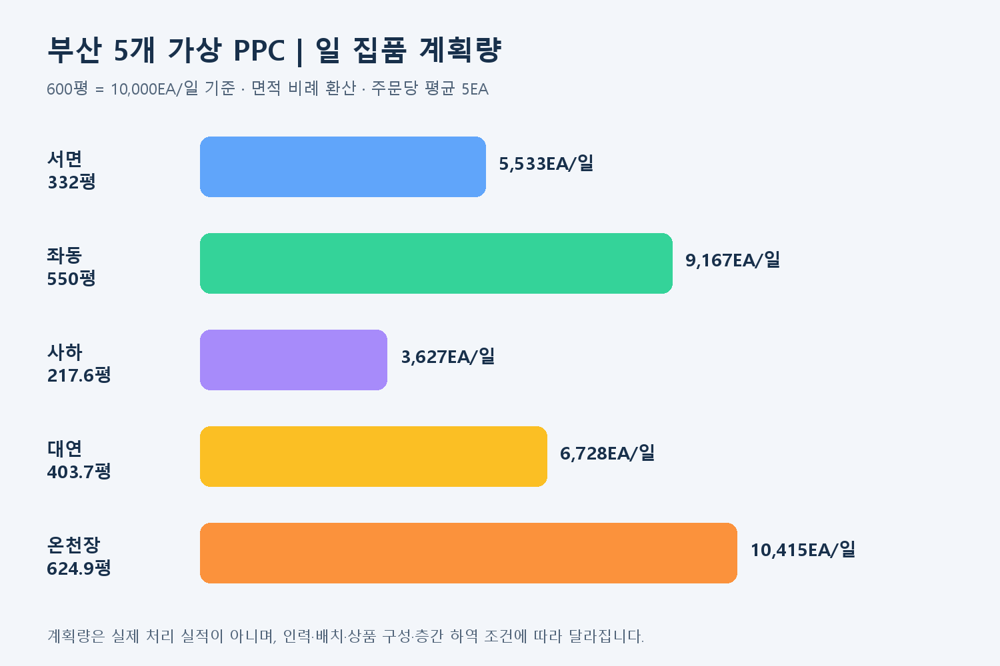
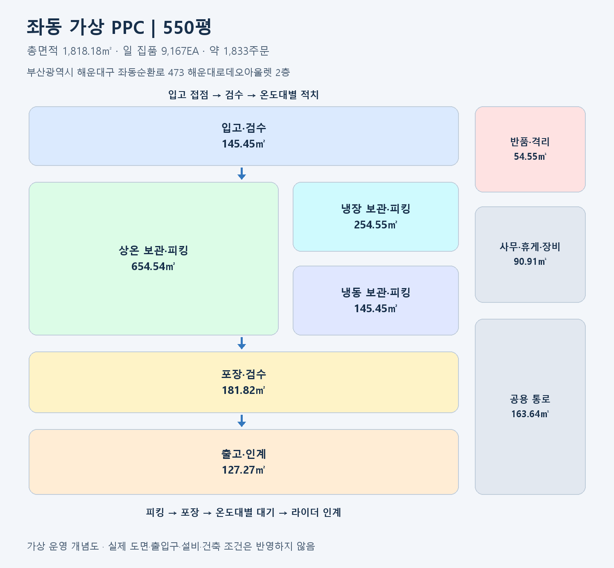
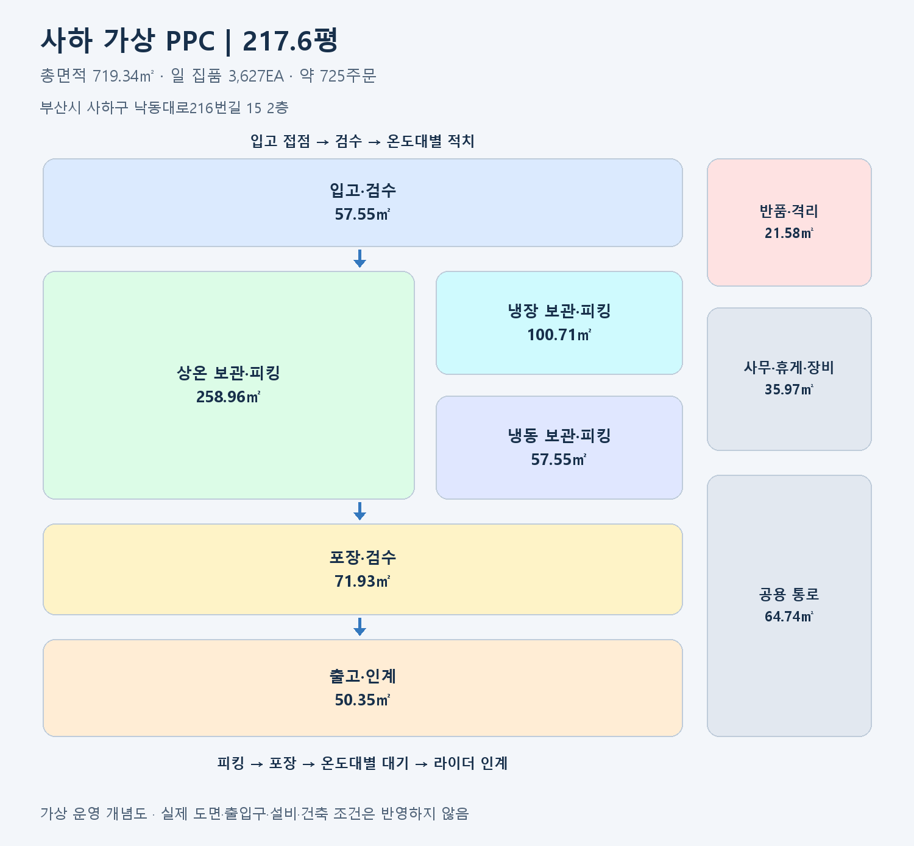
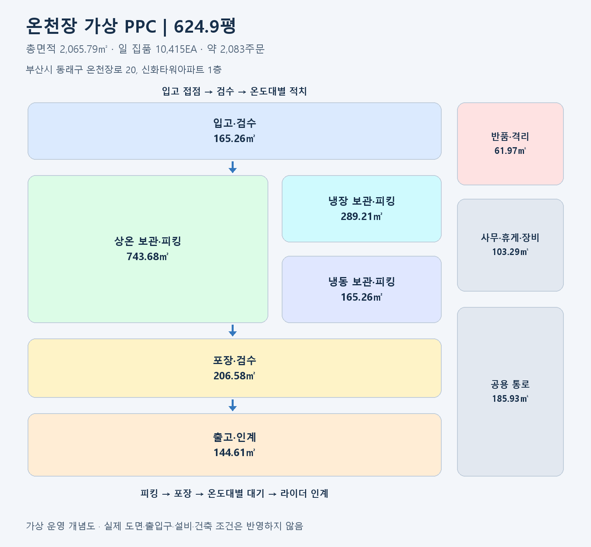

# 부산 5개 가상 PPC 센터 구성 및 집품량 산정

## 계산 기준

주신 5개 주소와 면적을 적용해 PPC(Picking & Packing Center)를 구성했습니다. 집품 가능량은 **하루에 피킹할 수 있는 낱개 상품 수량(EA/일)**으로 해석했습니다.

첨부 PDF는 온도대별 보관, 입고·검수·적치·피킹·출고 흐름, 광역 허브와 지역 센터의 역할, 재고 예약과 로케이션 관리에 참고했습니다. PDF에 PPC 면적당 실측 집품 생산성은 없어, **앞서 만든 600평 센터의 10,000EA/일을 가상 기준**으로 사용했습니다.

- 면적 환산: `평수 × 3.305785 = ㎡`
- 집품 계획량: `평수 ÷ 600 × 10,000EA/일`
- 면적당 기준: 약 `16.67EA/평·일`, 약 `5.04EA/㎡·일`
- 주문 환산: `집품량 ÷ 5EA/주문`
- 보관 재고 계획치: `평수 ÷ 600 × 60,000EA`
- 운영 시간: 하루 16시간, 상품 구성·설비 수준·작업 효율은 같은 조건으로 가정.
- 정수 수량은 반올림, 피크 작업자 수는 올림으로 산정.

**평수만으로 실제 최대 집품량을 확정할 수는 없습니다. 아래 값은 동일 조건에서 면적에 비례한 비교용 계획치입니다.**

## 센터별 비교

| 센터 | 면적(평) | 면적(㎡) | 집품(EA/일) | 주문 환산(건/일) | 보관 재고(EA) | 피크 집품 인력 |
|---|---:|---:|---:|---:|---:|---:|
| 서면 PPC | 332 | 1,097.52 | 5,533 | 1,107 | 33,200 | 6명 |
| 좌동 PPC | 550 | 1,818.18 | 9,167 | 1,833 | 55,000 | 10명 |
| 사하 PPC | 217.6 | 719.34 | 3,627 | 725 | 21,760 | 4명 |
| 대연 PPC | 403.7 | 1,334.55 | 6,728 | 1,346 | 40,370 | 8명 |
| 온천장 PPC | 624.9 | 2,065.79 | 10,415 | 2,083 | 62,490 | 11명 |
| **합계** | **2,128.2** | **7,035.38** | **35,470** | **7,094** | **212,820** | **39명** |

주문 합계는 센터별 반올림 값을 합산했습니다. 상품 수량의 주문 환산값이며 실제 주문당 상품 수에 따라 달라집니다.

## 주소와 개별 문서

- **서면 PPC**: 부산광역시 부산진구 동천로 109 2층, 332평 — [개별 구성안](01_서면_PPC.md)
- **좌동 PPC**: 부산광역시 해운대구 좌동순환로 473 해운대로데오아울렛 2층, 550평 — [개별 구성안](02_좌동_PPC.md)
- **사하 PPC**: 부산시 사하구 낙동대로216번길 15 2층, 217.6평 — [개별 구성안](03_사하_PPC.md)
- **대연 PPC**: 부산광역시 남구 수영로 305 스파크타워 지하 1층, 403.7평 — [개별 구성안](04_대연_PPC.md)
- **온천장 PPC**: 부산시 동래구 온천장로 20, 신화타워아파트 1층, 624.9평 — [개별 구성안](05_온천장_PPC.md)

## 공간 배분 공통 기준

입고·검수 8%, 상온 보관·피킹 36%, 냉장 14%, 냉동 8%, 포장·검수 10%, 출고·인계 7%, 반품·격리 3%, 사무·휴게·장비 5%, 공용 통로 9%로 배분했습니다. 각 센터의 총면적에 비례해 적용했습니다.

주소에 표시된 2층·지하 1층·1층은 그대로 유지했습니다. 층별 하역과 라이더 인계 경로는 실제 자료가 없어 처리량에 별도의 감산 계수를 넣지 않았습니다. 실제 도면과 운영 측정값이 확보되면 병목 구간을 반영해 조정해야 합니다.

## 참고 자료

1. 물류 허브 구성 설명.pdf: 광역 허브의 SKU·보관량·출고량 구분과 규모 가정.
2. 물류 허브 구성 설명 (1).pdf: I자형 물류 흐름.
3. 물류 허브 구성 설명 (2).pdf: 공간 구분, 검수, 로케이션·재고 이동.
4. 물류 허브 구성 설명 (3).pdf: 광역 허브와 MFC 역할, 단일 센터 주문 처리, 재고 예약.

자료의 광역 허브 출고량은 지역 PPC의 고객 주문 집품량과 다른 지표입니다. 본 문서의 집품 생산성·상품 종류·재고·인력 수치는 가상 설정이며, 제공 자료 내 질문과 제안은 참고 내용으로 취급했습니다.

---

## 센터별 상세 구성

### 서면 가상 PPC 센터

#### 1. 기본 설정

| 항목 | 내용 |
|---|---|
| 센터 코드 | PPC-BUS-01 |
| 주소 | 부산광역시 부산진구 동천로 109 2층 |
| 사용자 제공 면적 | 332평 |
| 환산 면적 | 1,097.52㎡ |
| 역할 | 부산 광역 허브 보충 상품 수령, 고객 주문 집품·포장·인계 |
| 운영 시간 가정 | 08:00~24:00, 하루 16시간 |
| 취급 상품 가정 | 2,210 SKU |
| 보관 재고 계획치 | 33,200EA |
| 하루 집품 계획량 | **5,533EA/일** |
| 하루 주문 환산 | **약 1,107건/일**, 주문당 평균 5EA |

#### 2. 평수 대비 집품량 계산

- 면적 환산: `332평 × 3.305785 = 1,097.52㎡`
- 기준: `600평 PPC = 10,000EA/일`, 동일한 상품 구성·운영 시간·설비 수준을 가정.
- 면적 비율: `332 ÷ 600 = 0.5533`
- 일 집품량: `10,000 × (332 ÷ 600) = 5,533.33EA → 5,533EA/일`
- 주문 환산: `5,533 ÷ 5 = 약 1,107건/일`
- 보관 재고: `60,000 × (332 ÷ 600) = 33,200EA`

집품량은 낱개 상품을 하루에 피킹하는 계획 수량입니다. 보관 가능한 상품 수량과 구분합니다. 평균 재고 보유일수는 약 6일이며 품목별 소비기한은 별도로 관리합니다.

#### 3. 공간 배분과 배치도

| 구역 | 비중 | 면적(㎡) |
|---|---:|---:|
| 입고·검수 | 8% | 87.80 |
| 상온 보관·피킹 | 36% | 395.11 |
| 냉장 보관·피킹 | 14% | 153.65 |
| 냉동 보관·피킹 | 8% | 87.80 |
| 포장·검수 | 10% | 109.75 |
| 출고·인계 | 7% | 76.83 |
| 반품·격리 | 3% | 32.93 |
| 사무·휴게·장비 | 5% | 54.88 |
| 공용 통로 | 9% | 98.77 |
| **합계** | **100%** | **1,097.52** |

상온·냉장·냉동 보관·피킹 구역은 총면적의 58%입니다. 각 구역 면적에는 내부 작업 통로를 포함하며, 공용 통로는 구역 간 이동 공간입니다. 마지막 구역에 반올림 차이를 반영했습니다. 도면은 운영 흐름을 설명하는 개념도이며 실제 출입구 배치를 추정한 것이 아닙니다.

#### 4. 집품량을 뒷받침하는 인력 가정

| 항목 | 계산·설정 |
|---|---|
| 피크 시간 주문 수요 | 600평 기준 250건/시간 × 면적 비율 = 약 138.3건/시간 |
| 집품 작업자 생산성 | 1명당 24주문/시간, 평균 5EA 기준 120EA/시간 |
| 피크 집품 인력 | 올림(138.3 ÷ 24) = **6명** |
| 집품팀 시간당 처리 능력 | **144주문 / 720EA** |
| 포장 작업자 생산성 | 1명당 40주문/시간 |
| 피크 포장 인력 | 올림(138.3 ÷ 40) = **4명** |
| 포장팀 시간당 처리 능력 | **160주문** |

집품·포장 인원은 피크 시간 동시 투입 인원입니다. 운영 책임자·입고·재고 보충·인계·휴게 교대 인력과 라이더는 포함하지 않습니다. 하루 집품 계획량은 피크 능력을 16시간 내내 유지한다고 계산한 값이 아니라 면적 기준 계획치입니다. 인력 계산은 피크 수요를 처리할 수 있는지 별도로 확인하는 보조 계산입니다.

#### 5. 운영 시나리오

1. 부산 광역 허브에서 하루 2회 보충을 받아 수량·상태·소비기한을 검수합니다.
2. 상온·냉장·냉동별로 적치하고 센터·로케이션·상품·로트별 재고를 기록합니다.
3. 고객 주소가 센터의 등록 배송 권역에 포함되면 판매 가능 재고를 확인·예약합니다.
4. 결제가 완료되면 기한이 먼저 도래하는 판매 가능 상품부터 집품합니다.
5. 바코드로 상품·수량을 검증하고 온도대에 맞춰 포장합니다.
6. 라이더 인계 시 실물 재고와 예약 재고를 함께 차감합니다.
7. 결제 실패·주문 취소 시 예약 재고를 해제하고, 반품은 격리·검수 후 재입고 여부를 결정합니다.

한 주문은 한 PPC에서 처리합니다. 판매 가능 재고는 `실물 재고 − 예약 재고 − 판매 불가 재고`입니다. 허브 출고는 이동 중 재고이며 PPC 검수 완료 시 입고를 확정합니다.

#### 6. 설정의 범위

주소와 평수는 사용자 제공값입니다. 해당 면적을 센터의 전체 사용 면적으로 가정했습니다. 실제 시설의 임대·사용 가능 여부, 구조, 하역 수단, 출입 동선, 냉장·냉동 설비, 배송 권역은 확인하지 않았습니다. 층 정보는 주소대로 유지했습니다.

집품 계획치는 이전 600평 가상 센터 설정을 비례 환산한 값이며 업계 실측 생산성이나 실제 영업 실적이 아닙니다. 실물 공간에서 같은 성과를 내는지 판단하려면 집품 경로와 상품 구성, 작업자 생산성을 측정해야 합니다.

---

### 좌동 가상 PPC 센터

#### 1. 기본 설정

| 항목 | 내용 |
|---|---|
| 센터 코드 | PPC-BUS-02 |
| 주소 | 부산광역시 해운대구 좌동순환로 473 해운대로데오아울렛 2층 |
| 사용자 제공 면적 | 550평 |
| 환산 면적 | 1,818.18㎡ |
| 역할 | 부산 광역 허브 보충 상품 수령, 고객 주문 집품·포장·인계 |
| 운영 시간 가정 | 08:00~24:00, 하루 16시간 |
| 취급 상품 가정 | 3,670 SKU |
| 보관 재고 계획치 | 55,000EA |
| 하루 집품 계획량 | **9,167EA/일** |
| 하루 주문 환산 | **약 1,833건/일**, 주문당 평균 5EA |

#### 2. 평수 대비 집품량 계산

- 면적 환산: `550평 × 3.305785 = 1,818.18㎡`
- 기준: `600평 PPC = 10,000EA/일`, 동일한 상품 구성·운영 시간·설비 수준을 가정.
- 면적 비율: `550 ÷ 600 = 0.9167`
- 일 집품량: `10,000 × (550 ÷ 600) = 9,166.67EA → 9,167EA/일`
- 주문 환산: `9,167 ÷ 5 = 약 1,833건/일`
- 보관 재고: `60,000 × (550 ÷ 600) = 55,000EA`

집품량은 낱개 상품을 하루에 피킹하는 계획 수량입니다. 보관 가능한 상품 수량과 구분합니다. 평균 재고 보유일수는 약 6일이며 품목별 소비기한은 별도로 관리합니다.

#### 3. 공간 배분과 배치도

| 구역 | 비중 | 면적(㎡) |
|---|---:|---:|
| 입고·검수 | 8% | 145.45 |
| 상온 보관·피킹 | 36% | 654.54 |
| 냉장 보관·피킹 | 14% | 254.55 |
| 냉동 보관·피킹 | 8% | 145.45 |
| 포장·검수 | 10% | 181.82 |
| 출고·인계 | 7% | 127.27 |
| 반품·격리 | 3% | 54.55 |
| 사무·휴게·장비 | 5% | 90.91 |
| 공용 통로 | 9% | 163.64 |
| **합계** | **100%** | **1,818.18** |

상온·냉장·냉동 보관·피킹 구역은 총면적의 58%입니다. 각 구역 면적에는 내부 작업 통로를 포함하며, 공용 통로는 구역 간 이동 공간입니다. 마지막 구역에 반올림 차이를 반영했습니다. 도면은 운영 흐름을 설명하는 개념도이며 실제 출입구 배치를 추정한 것이 아닙니다.

#### 4. 집품량을 뒷받침하는 인력 가정

| 항목 | 계산·설정 |
|---|---|
| 피크 시간 주문 수요 | 600평 기준 250건/시간 × 면적 비율 = 약 229.2건/시간 |
| 집품 작업자 생산성 | 1명당 24주문/시간, 평균 5EA 기준 120EA/시간 |
| 피크 집품 인력 | 올림(229.2 ÷ 24) = **10명** |
| 집품팀 시간당 처리 능력 | **240주문 / 1,200EA** |
| 포장 작업자 생산성 | 1명당 40주문/시간 |
| 피크 포장 인력 | 올림(229.2 ÷ 40) = **6명** |
| 포장팀 시간당 처리 능력 | **240주문** |

집품·포장 인원은 피크 시간 동시 투입 인원입니다. 운영 책임자·입고·재고 보충·인계·휴게 교대 인력과 라이더는 포함하지 않습니다. 하루 집품 계획량은 피크 능력을 16시간 내내 유지한다고 계산한 값이 아니라 면적 기준 계획치입니다. 인력 계산은 피크 수요를 처리할 수 있는지 별도로 확인하는 보조 계산입니다.

#### 5. 운영 시나리오

1. 부산 광역 허브에서 하루 2회 보충을 받아 수량·상태·소비기한을 검수합니다.
2. 상온·냉장·냉동별로 적치하고 센터·로케이션·상품·로트별 재고를 기록합니다.
3. 고객 주소가 센터의 등록 배송 권역에 포함되면 판매 가능 재고를 확인·예약합니다.
4. 결제가 완료되면 기한이 먼저 도래하는 판매 가능 상품부터 집품합니다.
5. 바코드로 상품·수량을 검증하고 온도대에 맞춰 포장합니다.
6. 라이더 인계 시 실물 재고와 예약 재고를 함께 차감합니다.
7. 결제 실패·주문 취소 시 예약 재고를 해제하고, 반품은 격리·검수 후 재입고 여부를 결정합니다.

한 주문은 한 PPC에서 처리합니다. 판매 가능 재고는 `실물 재고 − 예약 재고 − 판매 불가 재고`입니다. 허브 출고는 이동 중 재고이며 PPC 검수 완료 시 입고를 확정합니다.

#### 6. 설정의 범위

주소와 평수는 사용자 제공값입니다. 해당 면적을 센터의 전체 사용 면적으로 가정했습니다. 실제 시설의 임대·사용 가능 여부, 구조, 하역 수단, 출입 동선, 냉장·냉동 설비, 배송 권역은 확인하지 않았습니다. 층 정보는 주소대로 유지했습니다.

집품 계획치는 이전 600평 가상 센터 설정을 비례 환산한 값이며 업계 실측 생산성이나 실제 영업 실적이 아닙니다. 실물 공간에서 같은 성과를 내는지 판단하려면 집품 경로와 상품 구성, 작업자 생산성을 측정해야 합니다.

---

### 사하 가상 PPC 센터

#### 1. 기본 설정

| 항목 | 내용 |
|---|---|
| 센터 코드 | PPC-BUS-03 |
| 주소 | 부산시 사하구 낙동대로216번길 15 2층 |
| 사용자 제공 면적 | 217.6평 |
| 환산 면적 | 719.34㎡ |
| 역할 | 부산 광역 허브 보충 상품 수령, 고객 주문 집품·포장·인계 |
| 운영 시간 가정 | 08:00~24:00, 하루 16시간 |
| 취급 상품 가정 | 1,450 SKU |
| 보관 재고 계획치 | 21,760EA |
| 하루 집품 계획량 | **3,627EA/일** |
| 하루 주문 환산 | **약 725건/일**, 주문당 평균 5EA |

#### 2. 평수 대비 집품량 계산

- 면적 환산: `217.6평 × 3.305785 = 719.34㎡`
- 기준: `600평 PPC = 10,000EA/일`, 동일한 상품 구성·운영 시간·설비 수준을 가정.
- 면적 비율: `217.6 ÷ 600 = 0.3627`
- 일 집품량: `10,000 × (217.6 ÷ 600) = 3,626.67EA → 3,627EA/일`
- 주문 환산: `3,627 ÷ 5 = 약 725건/일`
- 보관 재고: `60,000 × (217.6 ÷ 600) = 21,760EA`

집품량은 낱개 상품을 하루에 피킹하는 계획 수량입니다. 보관 가능한 상품 수량과 구분합니다. 평균 재고 보유일수는 약 6일이며 품목별 소비기한은 별도로 관리합니다.

#### 3. 공간 배분과 배치도

| 구역 | 비중 | 면적(㎡) |
|---|---:|---:|
| 입고·검수 | 8% | 57.55 |
| 상온 보관·피킹 | 36% | 258.96 |
| 냉장 보관·피킹 | 14% | 100.71 |
| 냉동 보관·피킹 | 8% | 57.55 |
| 포장·검수 | 10% | 71.93 |
| 출고·인계 | 7% | 50.35 |
| 반품·격리 | 3% | 21.58 |
| 사무·휴게·장비 | 5% | 35.97 |
| 공용 통로 | 9% | 64.74 |
| **합계** | **100%** | **719.34** |

상온·냉장·냉동 보관·피킹 구역은 총면적의 58%입니다. 각 구역 면적에는 내부 작업 통로를 포함하며, 공용 통로는 구역 간 이동 공간입니다. 마지막 구역에 반올림 차이를 반영했습니다. 도면은 운영 흐름을 설명하는 개념도이며 실제 출입구 배치를 추정한 것이 아닙니다.

#### 4. 집품량을 뒷받침하는 인력 가정

| 항목 | 계산·설정 |
|---|---|
| 피크 시간 주문 수요 | 600평 기준 250건/시간 × 면적 비율 = 약 90.7건/시간 |
| 집품 작업자 생산성 | 1명당 24주문/시간, 평균 5EA 기준 120EA/시간 |
| 피크 집품 인력 | 올림(90.7 ÷ 24) = **4명** |
| 집품팀 시간당 처리 능력 | **96주문 / 480EA** |
| 포장 작업자 생산성 | 1명당 40주문/시간 |
| 피크 포장 인력 | 올림(90.7 ÷ 40) = **3명** |
| 포장팀 시간당 처리 능력 | **120주문** |

집품·포장 인원은 피크 시간 동시 투입 인원입니다. 운영 책임자·입고·재고 보충·인계·휴게 교대 인력과 라이더는 포함하지 않습니다. 하루 집품 계획량은 피크 능력을 16시간 내내 유지한다고 계산한 값이 아니라 면적 기준 계획치입니다. 인력 계산은 피크 수요를 처리할 수 있는지 별도로 확인하는 보조 계산입니다.

#### 5. 운영 시나리오

1. 부산 광역 허브에서 하루 2회 보충을 받아 수량·상태·소비기한을 검수합니다.
2. 상온·냉장·냉동별로 적치하고 센터·로케이션·상품·로트별 재고를 기록합니다.
3. 고객 주소가 센터의 등록 배송 권역에 포함되면 판매 가능 재고를 확인·예약합니다.
4. 결제가 완료되면 기한이 먼저 도래하는 판매 가능 상품부터 집품합니다.
5. 바코드로 상품·수량을 검증하고 온도대에 맞춰 포장합니다.
6. 라이더 인계 시 실물 재고와 예약 재고를 함께 차감합니다.
7. 결제 실패·주문 취소 시 예약 재고를 해제하고, 반품은 격리·검수 후 재입고 여부를 결정합니다.

한 주문은 한 PPC에서 처리합니다. 판매 가능 재고는 `실물 재고 − 예약 재고 − 판매 불가 재고`입니다. 허브 출고는 이동 중 재고이며 PPC 검수 완료 시 입고를 확정합니다.

#### 6. 설정의 범위

주소와 평수는 사용자 제공값입니다. 해당 면적을 센터의 전체 사용 면적으로 가정했습니다. 실제 시설의 임대·사용 가능 여부, 구조, 하역 수단, 출입 동선, 냉장·냉동 설비, 배송 권역은 확인하지 않았습니다. 층 정보는 주소대로 유지했습니다.

집품 계획치는 이전 600평 가상 센터 설정을 비례 환산한 값이며 업계 실측 생산성이나 실제 영업 실적이 아닙니다. 실물 공간에서 같은 성과를 내는지 판단하려면 집품 경로와 상품 구성, 작업자 생산성을 측정해야 합니다.

---

### 대연 가상 PPC 센터

#### 1. 기본 설정

| 항목 | 내용 |
|---|---|
| 센터 코드 | PPC-BUS-04 |
| 주소 | 부산광역시 남구 수영로 305 스파크타워 지하 1층 |
| 사용자 제공 면적 | 403.7평 |
| 환산 면적 | 1,334.55㎡ |
| 역할 | 부산 광역 허브 보충 상품 수령, 고객 주문 집품·포장·인계 |
| 운영 시간 가정 | 08:00~24:00, 하루 16시간 |
| 취급 상품 가정 | 2,690 SKU |
| 보관 재고 계획치 | 40,370EA |
| 하루 집품 계획량 | **6,728EA/일** |
| 하루 주문 환산 | **약 1,346건/일**, 주문당 평균 5EA |

#### 2. 평수 대비 집품량 계산

- 면적 환산: `403.7평 × 3.305785 = 1,334.55㎡`
- 기준: `600평 PPC = 10,000EA/일`, 동일한 상품 구성·운영 시간·설비 수준을 가정.
- 면적 비율: `403.7 ÷ 600 = 0.6728`
- 일 집품량: `10,000 × (403.7 ÷ 600) = 6,728.33EA → 6,728EA/일`
- 주문 환산: `6,728 ÷ 5 = 약 1,346건/일`
- 보관 재고: `60,000 × (403.7 ÷ 600) = 40,370EA`

집품량은 낱개 상품을 하루에 피킹하는 계획 수량입니다. 보관 가능한 상품 수량과 구분합니다. 평균 재고 보유일수는 약 6일이며 품목별 소비기한은 별도로 관리합니다.

#### 3. 공간 배분과 배치도

| 구역 | 비중 | 면적(㎡) |
|---|---:|---:|
| 입고·검수 | 8% | 106.76 |
| 상온 보관·피킹 | 36% | 480.44 |
| 냉장 보관·피킹 | 14% | 186.84 |
| 냉동 보관·피킹 | 8% | 106.76 |
| 포장·검수 | 10% | 133.46 |
| 출고·인계 | 7% | 93.42 |
| 반품·격리 | 3% | 40.04 |
| 사무·휴게·장비 | 5% | 66.73 |
| 공용 통로 | 9% | 120.10 |
| **합계** | **100%** | **1,334.55** |

상온·냉장·냉동 보관·피킹 구역은 총면적의 58%입니다. 각 구역 면적에는 내부 작업 통로를 포함하며, 공용 통로는 구역 간 이동 공간입니다. 마지막 구역에 반올림 차이를 반영했습니다. 도면은 운영 흐름을 설명하는 개념도이며 실제 출입구 배치를 추정한 것이 아닙니다.

#### 4. 집품량을 뒷받침하는 인력 가정

| 항목 | 계산·설정 |
|---|---|
| 피크 시간 주문 수요 | 600평 기준 250건/시간 × 면적 비율 = 약 168.2건/시간 |
| 집품 작업자 생산성 | 1명당 24주문/시간, 평균 5EA 기준 120EA/시간 |
| 피크 집품 인력 | 올림(168.2 ÷ 24) = **8명** |
| 집품팀 시간당 처리 능력 | **192주문 / 960EA** |
| 포장 작업자 생산성 | 1명당 40주문/시간 |
| 피크 포장 인력 | 올림(168.2 ÷ 40) = **5명** |
| 포장팀 시간당 처리 능력 | **200주문** |

집품·포장 인원은 피크 시간 동시 투입 인원입니다. 운영 책임자·입고·재고 보충·인계·휴게 교대 인력과 라이더는 포함하지 않습니다. 하루 집품 계획량은 피크 능력을 16시간 내내 유지한다고 계산한 값이 아니라 면적 기준 계획치입니다. 인력 계산은 피크 수요를 처리할 수 있는지 별도로 확인하는 보조 계산입니다.

#### 5. 운영 시나리오

1. 부산 광역 허브에서 하루 2회 보충을 받아 수량·상태·소비기한을 검수합니다.
2. 상온·냉장·냉동별로 적치하고 센터·로케이션·상품·로트별 재고를 기록합니다.
3. 고객 주소가 센터의 등록 배송 권역에 포함되면 판매 가능 재고를 확인·예약합니다.
4. 결제가 완료되면 기한이 먼저 도래하는 판매 가능 상품부터 집품합니다.
5. 바코드로 상품·수량을 검증하고 온도대에 맞춰 포장합니다.
6. 라이더 인계 시 실물 재고와 예약 재고를 함께 차감합니다.
7. 결제 실패·주문 취소 시 예약 재고를 해제하고, 반품은 격리·검수 후 재입고 여부를 결정합니다.

한 주문은 한 PPC에서 처리합니다. 판매 가능 재고는 `실물 재고 − 예약 재고 − 판매 불가 재고`입니다. 허브 출고는 이동 중 재고이며 PPC 검수 완료 시 입고를 확정합니다.

#### 6. 설정의 범위

주소와 평수는 사용자 제공값입니다. 해당 면적을 센터의 전체 사용 면적으로 가정했습니다. 실제 시설의 임대·사용 가능 여부, 구조, 하역 수단, 출입 동선, 냉장·냉동 설비, 배송 권역은 확인하지 않았습니다. 층 정보는 주소대로 유지했습니다.

집품 계획치는 이전 600평 가상 센터 설정을 비례 환산한 값이며 업계 실측 생산성이나 실제 영업 실적이 아닙니다. 실물 공간에서 같은 성과를 내는지 판단하려면 집품 경로와 상품 구성, 작업자 생산성을 측정해야 합니다.

---

### 온천장 가상 PPC 센터

#### 1. 기본 설정

| 항목 | 내용 |
|---|---|
| 센터 코드 | PPC-BUS-05 |
| 주소 | 부산시 동래구 온천장로 20, 신화타워아파트 1층 |
| 사용자 제공 면적 | 624.9평 |
| 환산 면적 | 2,065.79㎡ |
| 역할 | 부산 광역 허브 보충 상품 수령, 고객 주문 집품·포장·인계 |
| 운영 시간 가정 | 08:00~24:00, 하루 16시간 |
| 취급 상품 가정 | 4,170 SKU |
| 보관 재고 계획치 | 62,490EA |
| 하루 집품 계획량 | **10,415EA/일** |
| 하루 주문 환산 | **약 2,083건/일**, 주문당 평균 5EA |

#### 2. 평수 대비 집품량 계산

- 면적 환산: `624.9평 × 3.305785 = 2,065.79㎡`
- 기준: `600평 PPC = 10,000EA/일`, 동일한 상품 구성·운영 시간·설비 수준을 가정.
- 면적 비율: `624.9 ÷ 600 = 1.0415`
- 일 집품량: `10,000 × (624.9 ÷ 600) = 10,415.00EA → 10,415EA/일`
- 주문 환산: `10,415 ÷ 5 = 약 2,083건/일`
- 보관 재고: `60,000 × (624.9 ÷ 600) = 62,490EA`

집품량은 낱개 상품을 하루에 피킹하는 계획 수량입니다. 보관 가능한 상품 수량과 구분합니다. 평균 재고 보유일수는 약 6일이며 품목별 소비기한은 별도로 관리합니다.

#### 3. 공간 배분과 배치도

| 구역 | 비중 | 면적(㎡) |
|---|---:|---:|
| 입고·검수 | 8% | 165.26 |
| 상온 보관·피킹 | 36% | 743.68 |
| 냉장 보관·피킹 | 14% | 289.21 |
| 냉동 보관·피킹 | 8% | 165.26 |
| 포장·검수 | 10% | 206.58 |
| 출고·인계 | 7% | 144.61 |
| 반품·격리 | 3% | 61.97 |
| 사무·휴게·장비 | 5% | 103.29 |
| 공용 통로 | 9% | 185.93 |
| **합계** | **100%** | **2,065.79** |

상온·냉장·냉동 보관·피킹 구역은 총면적의 58%입니다. 각 구역 면적에는 내부 작업 통로를 포함하며, 공용 통로는 구역 간 이동 공간입니다. 마지막 구역에 반올림 차이를 반영했습니다. 도면은 운영 흐름을 설명하는 개념도이며 실제 출입구 배치를 추정한 것이 아닙니다.

#### 4. 집품량을 뒷받침하는 인력 가정

| 항목 | 계산·설정 |
|---|---|
| 피크 시간 주문 수요 | 600평 기준 250건/시간 × 면적 비율 = 약 260.4건/시간 |
| 집품 작업자 생산성 | 1명당 24주문/시간, 평균 5EA 기준 120EA/시간 |
| 피크 집품 인력 | 올림(260.4 ÷ 24) = **11명** |
| 집품팀 시간당 처리 능력 | **264주문 / 1,320EA** |
| 포장 작업자 생산성 | 1명당 40주문/시간 |
| 피크 포장 인력 | 올림(260.4 ÷ 40) = **7명** |
| 포장팀 시간당 처리 능력 | **280주문** |

집품·포장 인원은 피크 시간 동시 투입 인원입니다. 운영 책임자·입고·재고 보충·인계·휴게 교대 인력과 라이더는 포함하지 않습니다. 하루 집품 계획량은 피크 능력을 16시간 내내 유지한다고 계산한 값이 아니라 면적 기준 계획치입니다. 인력 계산은 피크 수요를 처리할 수 있는지 별도로 확인하는 보조 계산입니다.

#### 5. 운영 시나리오

1. 부산 광역 허브에서 하루 2회 보충을 받아 수량·상태·소비기한을 검수합니다.
2. 상온·냉장·냉동별로 적치하고 센터·로케이션·상품·로트별 재고를 기록합니다.
3. 고객 주소가 센터의 등록 배송 권역에 포함되면 판매 가능 재고를 확인·예약합니다.
4. 결제가 완료되면 기한이 먼저 도래하는 판매 가능 상품부터 집품합니다.
5. 바코드로 상품·수량을 검증하고 온도대에 맞춰 포장합니다.
6. 라이더 인계 시 실물 재고와 예약 재고를 함께 차감합니다.
7. 결제 실패·주문 취소 시 예약 재고를 해제하고, 반품은 격리·검수 후 재입고 여부를 결정합니다.

한 주문은 한 PPC에서 처리합니다. 판매 가능 재고는 `실물 재고 − 예약 재고 − 판매 불가 재고`입니다. 허브 출고는 이동 중 재고이며 PPC 검수 완료 시 입고를 확정합니다.

#### 6. 설정의 범위

주소와 평수는 사용자 제공값입니다. 해당 면적을 센터의 전체 사용 면적으로 가정했습니다. 실제 시설의 임대·사용 가능 여부, 구조, 하역 수단, 출입 동선, 냉장·냉동 설비, 배송 권역은 확인하지 않았습니다. 층 정보는 주소대로 유지했습니다.

집품 계획치는 이전 600평 가상 센터 설정을 비례 환산한 값이며 업계 실측 생산성이나 실제 영업 실적이 아닙니다. 실물 공간에서 같은 성과를 내는지 판단하려면 집품 경로와 상품 구성, 작업자 생산성을 측정해야 합니다.

---
