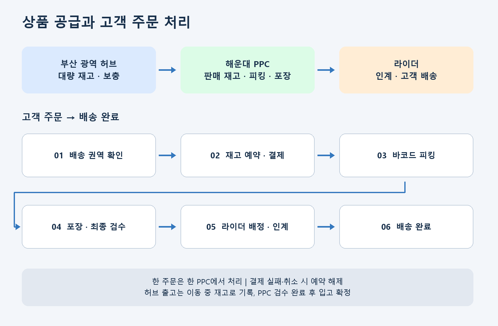
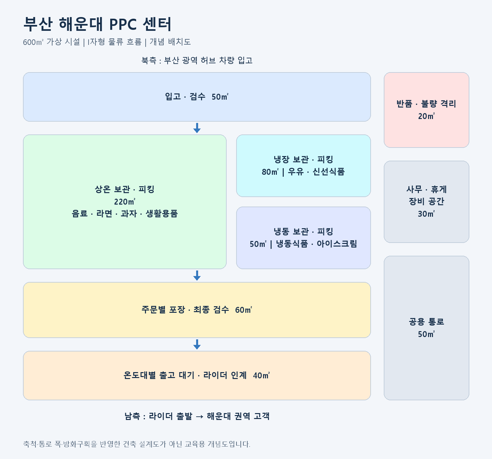

# 부산 해운대 PPC 센터 구성안

> 첨부된 물류 허브 설명 자료를 참고한 교육·개발 프로젝트용 가상 센터입니다. PPC는 이 문서에서 Picking & Packing Center(고객 주문 상품 피킹·포장 센터)로 정의합니다. 위치·규모·인력·처리량은 모두 가정입니다.

## 1. 센터 개요

부산 광역 물류 허브에서 상품을 공급받아 해운대 지역 고객의 주문을 처리하는 도심형 퀵커머스 센터입니다. 참고 자료의 지역 MFC 역할을 PPC에 적용했습니다.

| 항목 | 가상 설정 |
|---|---|
| 센터명 | 부산 해운대 PPC 센터 |
| 센터 코드 | PPC-BUS-HAE-01 |
| 위치 | 부산 해운대구 우동 일대의 가상 시설 |
| 규모 | 단층 600㎡, 약 182평 |
| 공급 거점 | 부산 광역 물류 허브 |
| 배송 권역 | 센터 기준 약 3km, 주문 가능 여부는 등록된 배송 권역으로 판별 |
| 취급 상품 | 식품·음료·생활용품 2,000 SKU |
| 평균 보관 재고 | 18,000EA |
| 일평균 주문 | 800건, 주문당 평균 5EA |
| 일평균 출고 | 4,000EA |
| 고객 주문 운영 | 08:00~24:00 |
| 허브 보충 | 매일 07:00·15:00, 판매량에 따라 수량 조정 |
| 배송 목표 | 주문 확정부터 도착까지 40분 이내 |

SKU는 상품 종류, EA는 낱개 수량입니다. 평균 보관 재고를 일평균 출고로 나눈 단순 재고 보유일수는 약 4.5일이며, 상품별 수요와 소비기한은 별도로 관리합니다.

## 2. 물류망과 주문 흐름

**공급업체 → 부산 광역 허브 → 해운대 PPC → 라이더 → 고객**

광역 허브는 대량 재고와 PPC 보충을 관리하고, 해운대 PPC는 고객 판매 재고와 주문별 피킹·포장·출고를 담당합니다. 광역 허브에 우유가 5,000개 있어도 해운대 PPC에 판매 가능 재고가 없으면 고객 화면에서는 품절로 표시합니다.

## 3. 공간 구성

북측에서 입고하고 남측에서 라이더에게 인계하는 I자형 흐름을 적용합니다. 작업자가 항상 직선으로 이동한다는 뜻은 아니며, 입고와 출고를 반대편에 배치하는 구성입니다.

| 구역 | 면적 | 주요 기능 |
|---|---:|---|
| 입고·검수 | 50㎡ | 하역, 수량·상태·기한 확인 |
| 상온 보관·피킹 | 220㎡ | 음료, 라면, 과자, 생활용품 |
| 냉장 보관·피킹 | 80㎡ | 우유, 신선식품 |
| 냉동 보관·피킹 | 50㎡ | 냉동식품, 아이스크림 |
| 포장·최종 검수 | 60㎡ | 주문별 합포장, 누락·오피킹 확인 |
| 출고 대기·라이더 인계 | 40㎡ | 주문 확인, 온도대별 대기, 인계 스캔 |
| 반품·불량 격리 | 20㎡ | 판매 불가 상품 분리 |
| 사무·휴게·장비 | 30㎡ | 관리자, 작업자 휴게, 장비 보관 |
| 공용 통로 | 50㎡ | 구역 간 이동 |
| **합계** | **600㎡** | |

보관 구역 면적에는 구역 내부 작업 통로를 포함하고, 공용 통로는 구역 간 이동 공간입니다. 배치도는 축척·통로 폭·방화구획을 반영한 건축 설계도가 아닙니다. 냉장·냉동 상품은 피킹 후 포장·인계까지 온도 관리가 이어지도록 운영합니다.

## 4. 고객 주문 처리 예시

해운대 고객이 **생수 2개, 우유 1개, 라면 5개**를 주문합니다.

1. 고객 주소가 해운대 PPC의 배송 권역에 포함되는지 확인합니다.
2. 세 상품 모두 판매 가능한 수량이 있는지 확인합니다.
3. 재고를 예약하고 결제를 진행합니다.
4. 결제 성공 시 피킹 작업을 생성합니다.
5. 작업자가 지정 위치에서 상품 바코드를 스캔합니다.
6. 포장 담당자가 상품·수량을 확인하고 온도대에 맞춰 포장합니다.
7. 라이더를 배정하고 주문 QR을 확인해 인계합니다.
8. 인계 시 출고를 확정하고 배송 완료까지 추적합니다.

**한 주문은 한 PPC에서 처리합니다.** 상품 하나라도 부족하면 주문 확정 전에 수량 변경이나 상품 제외를 안내합니다.

## 5. 재고와 로케이션

로케이션 코드는 `구역-랙-선반`으로 관리합니다. `A`는 상온, `C`는 냉장, `F`는 냉동입니다.

| 코드 | 상품 | 실물 재고 | 예약 | 판매 불가 | 판매 가능 |
|---|---|---:|---:|---:|---:|
| A-01-01 | 생수 2L | 120 | 20 | 0 | 100 |
| C-01-02 | 우유 1L | 60 | 10 | 5 | 45 |
| A-03-01 | 라면 | 200 | 30 | 0 | 170 |

- **판매 가능 재고 = 실물 재고 − 예약 재고 − 판매 불가 재고**
- 실물 재고는 센터에 남아 있는 수량이며 예약 상품과 판매 불가 상품을 포함합니다.
- 같은 상품도 입고 로트와 소비기한을 구분합니다.
- 기한이 먼저 도래하는 판매 가능 상품부터 피킹합니다.
- 주문 취소·결제 실패 시 예약 재고를 해제합니다.
- 라이더 인계 시 실물 재고와 예약 재고를 함께 차감합니다.
- 피킹된 상품은 보관 위치에서 포장·출고 대기 위치로 이동한 것으로 기록합니다.

## 6. 허브 보충 예시

우유의 다음 보충 도착 전 예상 판매량이 80개이고 안전재고가 20개라고 가정합니다.

| 항목 | 수량 |
|---|---:|
| 목표 판매 가능 재고 | 100개 |
| 현재 판매 가능 재고 | 45개 |
| 입고 예정 재고 | 15개 |
| **추가 보충 요청** | **40개** |

보충 요청량은 `max(0, 목표 재고 − 현재 판매 가능 재고 − 입고 예정 재고)`로 계산합니다. 발주 포장 단위와 보관 공간에 맞춰 최종 수량을 조정합니다.

허브에서 출고하면 이동 중 재고로 관리하고, **PPC에서 검수 완료한 수량만 입고 처리**합니다. 부족·파손 수량은 차이 기록으로 남기며 판매 가능 재고에 더하지 않습니다.

## 7. 운영 인력과 처리 능력

| 역할 | 피크 시간 동시 투입 |
|---|---:|
| 운영 책임자 | 1명 |
| 입고·보충 | 2명 |
| 피킹 | 5명 |
| 포장·검수 | 3명 |
| 출고·라이더 인계 | 1명 |
| **합계** | **12명** |

피킹 작업자 1명당 시간당 24주문을 가정하면 5명의 처리 능력은 **120주문/시간**입니다. 포장 담당자 1명당 40주문/시간을 가정하면 포장도 **120주문/시간**입니다.

피크 수요 100주문/시간을 기준으로 설정했습니다. 12명은 피크 시간 동시 투입 인원이며 전체 교대 인원은 별도입니다. 라이더는 별도 배차 자원으로 관리합니다. 실제 처리 능력은 상품 수, 이동 거리, 입고 작업과의 간섭 등을 검증해야 합니다.

## 8. 개발 프로젝트 범위

| 기능 | 구현 내용 |
|---|---|
| 센터·배송 권역 | 고객 주소로 담당 PPC 결정 |
| 상품·재고 | 센터·로케이션·로트별 수량 관리 |
| 주문·결제 | 동시 주문 재고 예약, 실패 시 해제 |
| 피킹·포장 | 작업 배정, 바코드 검증, 완료 처리 |
| 허브 보충 | 요청·출고·이동 중·검수 입고 |
| 배송 | 라이더 배정, 인계, 완료 |
| 운영 화면 | 주문 대기, 품절, 보충 필요, 재고 차이 확인 |

### 상태 관리

- 주문: **결제 대기 → 결제 완료 → 피킹 중 → 포장 완료 → 인계 완료 → 배송 중 → 배송 완료**
- 보충: **요청 → 승인 → 허브 피킹 → 허브 출고 → 이동 중 → PPC 검수 → 입고 완료**

피킹 중 파손·재고 부족이 발견되면 예외 처리로 전환해 고객 확인 또는 취소·환불을 진행합니다. 재시도나 중복 스캔으로 재고가 두 번 차감되지 않도록 처리합니다. 라이더 인계 이후의 반품은 별도 반품 입고·검수 절차로 처리합니다.

### 주요 데이터

| 데이터 | 관리 항목 |
|---|---|
| 센터 | 센터 코드, 유형, 상위 허브 |
| 배송 권역 | 담당 센터, 권역 경계 |
| 로케이션 | 구역, 랙, 선반, 온도대 |
| 재고 | 센터, 상품, 위치, 로트, 실물·예약·판매 불가 수량 |
| 주문 | 담당 PPC, 고객, 결제·작업 상태 |
| 피킹 작업 | 주문 상품, 지정 위치, 스캔·완료 내역 |
| 재고 이동 | 공급 허브, 도착 PPC, 요청·출고·검수 수량 |
| 배송 | 주문, 라이더, 인계·완료 시각 |

## 9. 참고 자료와 적용 범위

사용자가 제공한 아래 PDF 4개를 참고했습니다.

1. 물류 허브 구성 설명.pdf: 광역 허브의 SKU·재고·출고 규모와 보충 개념.
2. 물류 허브 구성 설명 (1).pdf: I자형 입출고 배치와 동선.
3. 물류 허브 구성 설명 (2).pdf: 온도대별 공간, 검수, 로케이션과 재고 이동.
4. 물류 허브 구성 설명 (3).pdf: 광역 허브·지역 MFC의 역할, 단일 센터 주문 처리, 재고 예약.

첨부 자료의 3,000㎡·40만EA 등은 광역 허브 설정입니다. 이 문서의 600㎡·18,000EA·800주문/일 등은 해운대 PPC를 위해 새로 설정한 가상 수치입니다. 자료 내 제안·질문은 참고 내용으로 취급했습니다.

이미지는 이 문서를 위해 제작한 개념도이며 실제 시설 사진이 아닙니다.
